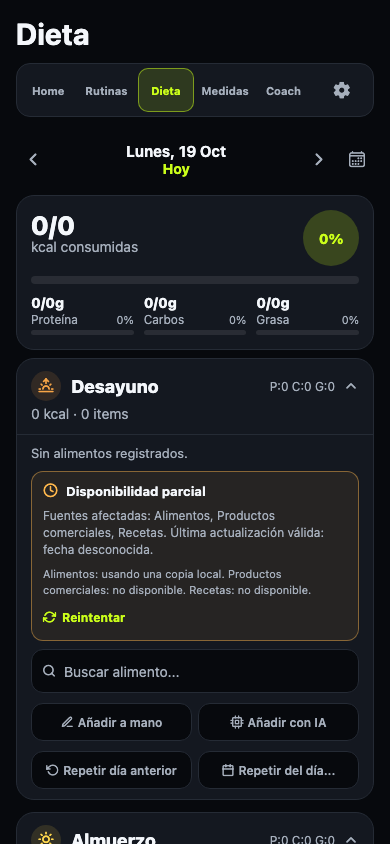

# Unificación de las 12 familias adaptables

Se implementan las doce familias marcadas «Adaptar» en la revisión original de
GYM-8 (ticket para unificar componentes repetidos de la interfaz). Las otras dos
familias reutilizables y las quince propuestas de abstracción nueva permanecen
fuera de esta fase. Los nombres de implementación describen unidades visuales;
no trasladan modelos ni controladores a la biblioteca.

## Componentes e integración

| Familia visual | Base compartida | Integración |
| --- | --- | --- |
| Botón de acción | [Button](../../../apps/mobile/components/Button.tsx) | Helpers principales de Inicio, Entreno y chat; acción secundaria de Dieta. Mantiene variantes, icono y estado desactivado. |
| Campo de formulario | [TextField](../../../apps/mobile/components/TextField.tsx) | Memoria, formularios de Medidas, fechas de Dieta y las tres superficies de conversación. Reenvía props y referencia del TextInput nativo. |
| Buscador | [SearchField](../../../apps/mobile/components/SearchField.tsx) | Alimentos/productos de Ajustes, comidas y catálogo de ejercicios. Conserva estilos, foco y el callback específico para limpiar cada búsqueda. |
| Opción seleccionable | [ChoiceChip](../../../apps/mobile/components/ChoiceChip.tsx), [ChoiceRow](../../../apps/mobile/components/ChoiceRow.tsx), [OptionChips](../../../apps/mobile/components/OptionChips.tsx) | Ajustes de Dieta y opciones del ejercicio personalizado. Conserva contratos separados de selección única y múltiple. |
| Tarjeta de métrica | [StatCard](../../../apps/mobile/components/StatCard.tsx) | Inicio y Medidas; icono de cabecera y variación auxiliar opcionales. |
| Panel de gráfica | [ChartCard](../../../apps/mobile/components/ChartCard.tsx) | Medidas y detalle de Rutinas; comparte marco, cabecera y selectores, con gráficos independientes. |
| Miniatura | [Thumbnail](../../../apps/mobile/components/Thumbnail.tsx) | Dieta, sus superposiciones y catálogos de Ajustes. Wrappers de dominio conservan URI, emoji, icono o punto alternativo y tamaños. |
| Fila con imagen | [ItemRow](../../../apps/mobile/components/ItemRow.tsx) | Búsqueda de alimentos, filas de catálogos de Ajustes y lista virtualizada de ejercicios; conserva la estructura de los hijos. |
| Tarjeta de registro | [RecordCard](../../../apps/mobile/components/RecordCard.tsx) | Historial de Entreno y registros de Medidas. El host sigue siendo Pressable para sesiones y View para medidas; los modelos siguen separados. |
| Aviso informativo | [NoticeFrame](../../../apps/mobile/components/NoticeFrame.tsx) | Avisos de identidad IA, salud, catálogo y estado de política. Solo comparte superficie; texto, anuncios accesibles y decisiones siguen en sus wrappers. |
| Entrada de conversación | [ChatComposer](../../../apps/mobile/components/ChatComposer.tsx) | Coach, estimador y asistente de alimentos personales; disposición vertical u horizontal y zonas de campo, envío y pie. |
| Fila con interruptor | [ToggleField](../../../apps/mobile/components/ToggleField.tsx) | Notificaciones, sonido, vibración y segunda opinión IA. Conserva los dos layouts y sus áreas de pulsación; permisos y consentimiento permanecen en Ajustes. |

Son 12 familias y 14 ficheros de componentes: la selección usa una unidad y dos
adaptadores de grupo. No se han implementado los quince patrones «Crear».
Tampoco se fuerza cada Pressable, formulario o fila de la aplicación a usar la
biblioteca: se sustituyen las bases y los usos indicados, manteniendo piezas
especializadas cuando sus contratos difieren.

Los componentes se clasifican en la capa `ui`. Los catálogos que ya contienen
interfaz pueden consumir esa capa para sus buscadores, filas y avisos; se mantiene
la validación de dependencias y ciclos. No se añaden paquetes ni servicios.

## Conservación de comportamiento

Los callbacks de cada dominio, los identificadores y las props nativas permanecen
en los usos. El compositor recibe el campo y la acción existentes como zonas
controladas. La fila de registro conserva su host nativo. Las miniaturas mantienen
el comportamiento de error y sus alternativas de dominio. Los avisos conservan
sus fuentes de texto, roles y anuncios accesibles.

No cambian cálculos, almacenamiento, proveedores, permisos, consentimiento,
prompts, reglas sanitarias ni confirmaciones. No se ha ejecutado ninguna promoción
de política, fusión o build de Android.

## Comparación visual

Las parejas de [adaptations/](adaptations/) comparan exportaciones locales de
Development/fake anteriores y posteriores, con contextos nuevos, datos de QA,
reloj fijado y red externa bloqueada. No usan claves reales ni la sesión personal.
Se conservan los 54 originales del recorrido publicado.

La comparación puede repetirse tras exportar los dos estados en Development/fake:

```sh
COMPONENT_QA_BEFORE=/ruta/exportacion-anterior COMPONENT_QA_AFTER=/ruta/exportacion-posterior node scripts/design-component-audit/compare-adaptations.cjs
```

La comprobación tolera solo variaciones de rasterización de hasta 2/255 por canal
en el contenido y excluye los 20 píxeles derechos donde aparece la barra nativa.
Las capturas completas y las diferencias crudas se conservan para inspección.

Se revisan trece vistas a 390 × 844: Inicio, Medidas, formulario de medidas,
Dieta, Coach, plan de dieta, notificaciones, memoria, registros de medidas,
proveedor, estimador, asistente de alimentos y catálogo de alimentos. Los resultados
crudos están en [adaptations/results.json](adaptations/results.json).

En la ejecución final las trece vistas coinciden píxel a píxel, incluidos los
bordes y las barras nativas visibles: los resultados crudos tienen cero píxeles
distintos. La revisión visual conserva la referencia de
`../Gimnasia Design System.png`.

La comparación detectó inicialmente un buscador de comida 4 px más bajo que el
original. SearchField distingue ahora tamaño compacto y altura por contenido;
la E2E de Dieta comprueba que el campo conserva al menos 42 px y que su contenedor
no lo recorta.



## Validación

- `npm test`: 112 archivos y 966 pruebas deterministas, 11 pruebas de dev-store y
  3 de límites arquitectónicos.
- `npm --workspace apps/mobile exec tsc --noEmit`.
- `npm run check:mobile-boundaries`, `npm run check:data-inventory`.
- Exportaciones web Development/fake de ambos estados y Development/BYOK final.
- E2E del shell compacto/escritorio, Dieta (con regresión de altura), catálogos,
  Entreno, preferencias y consentimiento sanitario.
- `AGENT_E2E_URL` sin configurar, `node apps/mobile/scripts/agent-chat.e2e.mjs`: Coach con OpenAI, Anthropic y Google interceptados, tools, confirmaciones, denuncias y credenciales de prueba; correcto.
- `COMPONENT_QA_BEFORE=... COMPONENT_QA_AFTER=... node scripts/design-component-audit/compare-adaptations.cjs`: 13/13 parejas con cero píxeles distintos.
- Generador del inventario y comprobación del DOM de la galería.
- `git diff --check`.

Si se reutiliza un servidor para la E2E de Coach, el bundle debe haberse exportado
con `FEEDBACK_API_BASE_URL=https://feedback.e2e.test`: la prueba intercepta ese
endpoint para verificar fallos y reintentos de las denuncias. El comando normal
`node apps/mobile/scripts/agent-chat.e2e.mjs` ya prepara esa configuración. Un
bundle genérico de Development deja el endpoint vacío de forma intencionada.

La validación funcional automatizada se hizo en web. La PR #350 está fusionada y
la versión 1.52.4 se publicó con AAB y APK verificados y envío a Prueba cerrada de
Google Play. El 21 de octubre de 2026 el mantenedor confirmó que la probó en el
móvil y funciona bien. Esa confirmación resuelve la validación móvil general del
alcance entregado; no documenta un recorrido exhaustivo de teclado y foco en
Android e iOS ni especifica el dispositivo usado.

GYM-8 (ticket para unificar componentes repetidos de la interfaz) se cerró con
las doce familias adaptables entregadas. Las quince propuestas de abstracción
nueva siguen fuera de esta entrega.
