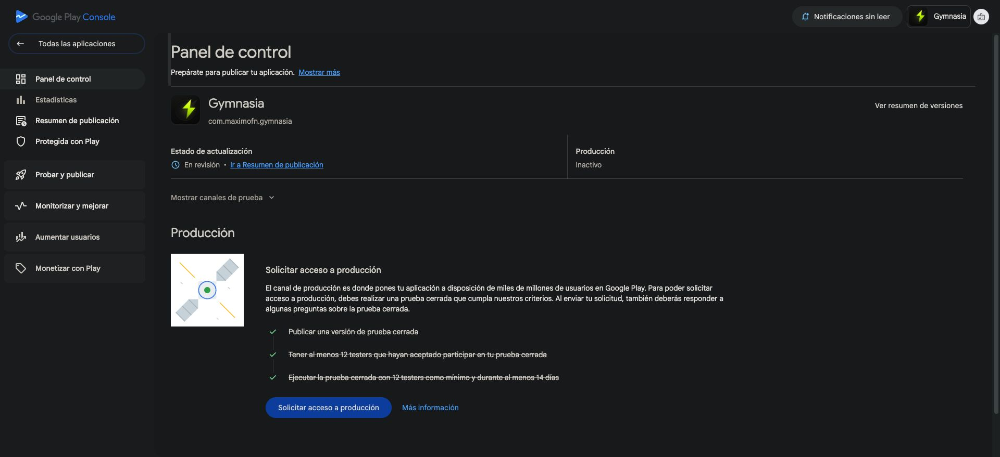

# Prueba cerrada y acceso a producción de Google Play

Estado comprobado el **15 de octubre de 2026** para GYM-200 (ticket para
coordinar la prueba cerrada) y GYM-201 (ticket para publicar primero en España).
Google Play reconoce el cumplimiento de los requisitos de testers y permite
abrir la solicitud de acceso a producción. La solicitud está en preparación.

## Cumplimiento de la cohorte

El [panel de control de Gymnasia](https://play.google.com/console/u/0/developers/8108994737998375347/app/4972645631625321604/app-dashboard)
marca como completadas las tres tareas:

- Publicar una versión de prueba cerrada.
- Tener al menos 12 testers que hayan aceptado participar.
- Ejecutar la prueba cerrada con al menos 12 testers durante al menos 14 días.

El mantenedor confirma que los 12 testers llevan más de 14 días. El grupo
configurado de distribución contiene 14 personas; ese tamaño de lista no se
usa como sustituto del cumplimiento reconocido por Play. No se fija una fecha
de inicio individual que la pantalla no muestra ni se publican los correos de
los participantes. El objetivo inicial de reclutar 15 personas era un margen;
el requisito de Google que se acredita es el mínimo de 12.

## Pruebas y cambios derivados del feedback

Los testers enviaron comentarios y capturas al mantenedor, registrados en
GYM-243 (ticket para resolver las incidencias comunicadas por los testers).

| Incidencia | Resultado documentado |
| --- | --- |
| GYM-245 (ticket para permitir registrar peso desde el plan de dieta) | Corrección publicada en la versión 1.45.0; QA del mantenedor en Android y pruebas de persistencia, dieta y agente. |
| GYM-246 (ticket para mostrar las preferencias de forma legible) | Corrección publicada en 1.45.1; QA del mantenedor en Android y pruebas unitarias, de contrato y de propiedades. |
| GYM-247 (ticket para impedir activar la evaluación sanitaria sin clave) | Cerrado con pruebas unitarias, E2E con proveedor interceptado, migración y propiedades del consentimiento. |
| GYM-249 (ticket para evitar el solapamiento con las barras de Android) | Corrección en 1.45.4; el tester que lo reportó confirmó el 8 de octubre que ya funciona en su dispositivo. |
| GYM-244 (ticket para investigar el Coach sin snapshot firmado) | Sigue abierto. El mantenedor confirmó el 15 de octubre que Coach responde sin ese error en su móvil actualizado desde Play. Esa confirmación no completa por sí sola la investigación histórica, el mensaje accionable y todos los criterios del ticket. |
| GYM-256 (ticket para situar el descanso en el ejercicio cuya serie se completó) | Sigue abierto; una captura del 9 de octubre muestra el temporizador en el ejercicio anterior al completar una serie fuera de orden. No consta una confirmación de corrección. |

GYM-199 (ticket para publicar y validar el AAB en pruebas cerradas) está cerrado.
Su evidencia recoge la versión 1.50.1 (80), publicada en Alpha, y la confirmación
del mantenedor del 15 de octubre: arranque, entrenamiento y guardado,
notificación de descanso, BYOK, Coach y denuncia en un móvil actualizado desde
Play. No se atribuye esa ejecución a todos los testers ni se infiere una
versión instalada que el mantenedor no indicó.

El [acceso del revisor](reviewer-access.md) está preparado y comprobado. La
actualización de sus instrucciones permanece en revisión en Google el
15 de octubre; es un envío distinto de la solicitud de acceso a producción.

## Borrador del cuestionario

Play limita cada respuesta de texto de la primera sección a **300 caracteres**.
Las respuestas se guardan al avanzar con **Siguiente**. Abrir el cuestionario o
rellenar un campo no equivale a enviar la solicitud.

### Reclutamiento

Pendiente de la respuesta del mantenedor sobre el método de reclutamiento y la
dificultad experimentada. No se presume que se utilizaran servicios de pago.

### Interacción de los testers

> El uso incluyó rutinas y sesiones de entrenamiento, medidas y dieta, ajustes y Coach con clave propia. Los testers detectaron problemas durante el uso real y enviaron capturas y comentarios al mantenedor. No contamos con una medición de cobertura por persona.

### Comentarios recibidos

> Recibimos comentarios y capturas directamente al mantenedor y los registramos en tickets. Corregimos el solapamiento con barras Android, preferencias ilegibles, el registro de peso y la evaluación sanitaria sin clave. Sigue abierta una incidencia de colocación del temporizador de descanso.

### Público objetivo

> Personas de 16 años en adelante interesadas en organizar entrenamientos, alimentación y medidas corporales. La IA es opcional y requiere una clave propia del proveedor elegido. Gymnasia no es un dispositivo médico.

### Valor de la aplicación

> Reúne rutinas, sesiones, dieta, medidas y seguimiento del progreso en una app que conserva los datos principales en el dispositivo. Permite añadir un Coach y estimador de comida con IA mediante una clave propia, con identificación como IA y denuncia de respuestas.

### Cambios tras la prueba

> Corregimos los márgenes de Android, la presentación de preferencias, el registro de peso desde la dieta y el consentimiento sanitario sin clave. Se validó la actualización desde Play y el uso de Coach. Sigue pendiente revisar el anclaje visual del temporizador de descanso.

### Preparación para producción

La respuesta final depende de resolver o aceptar expresamente las incidencias
pendientes, registrar la regresión correspondiente y confirmar la estimación
de descargas del primer año. No se declara que todas las incidencias estén
resueltas ni que todos los participantes hayan usado todas las funciones.

## Pasos restantes

1. Completar las respuestas del mantenedor sobre reclutamiento y previsión de
   descargas, ajustadas a las opciones reales del formulario.
2. Decidir el tratamiento de las incidencias abiertas y comprobar sus flujos.
3. Revisar las tres secciones completas y enviar la solicitud de acceso.
4. Conservar el resultado y la fecha de envío. El acceso aprobado permitirá
   preparar el lanzamiento público inicial en España; esta solicitud no lanza
   una versión pública.

## Referencias

- [Requisitos y cuestionario de acceso a producción de Google Play](https://support.google.com/googleplay/android-developer/answer/14151465?hl=es).
- [Distribución en Prueba cerrada Alpha](production-promotion-gates.md).
- [Matriz de ficha, audiencia y declaraciones](console-matrix.md).
