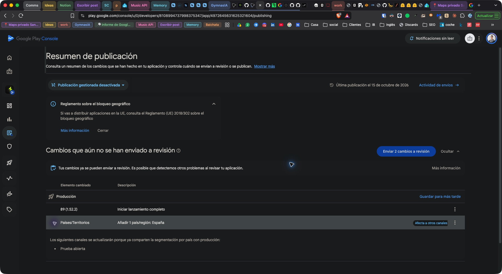
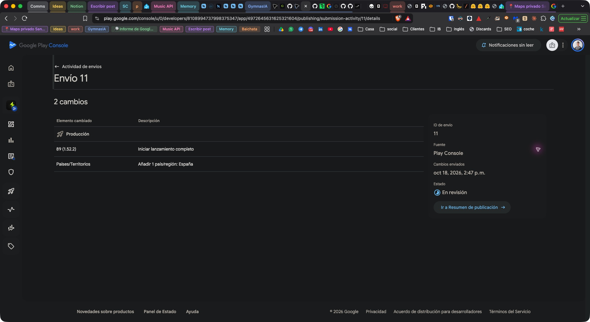
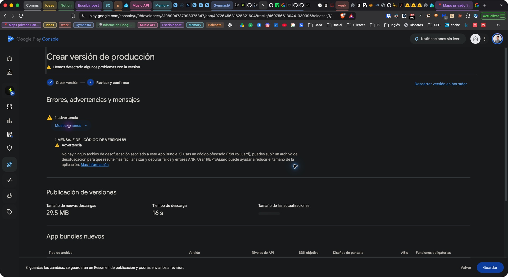

# Primer lanzamiento público en España

Expediente de GYM-201 (ticket para publicar primero en España y ampliar después
los países). Preparación del **18 de octubre de 2026**. El acceso a producción
está concedido y la cohorte está cerrada. El propietario autoriza el envío y la
publicación de **1.52.2 (89), solo España**, manteniendo pendiente el fallo visual
del temporizador. Google registra el **envío 11, En revisión**, el 18 de octubre
a las **14:47, hora de Madrid**. La disponibilidad pública sigue sin verificarse.

## Estado preparado en Play Console

Se ha guardado una versión con el bundle existente **89 (1.52.2)**, seleccionado
mediante **Añadir de la biblioteca**. No se ha recompilado ni vuelto a subir el
AAB. Antes de enviarlo, el resumen de publicación contenía exactamente dos cambios:

1. Producción: **89 (1.52.2), Iniciar lanzamiento completo**.
2. Países/Territorios: **Añadir 1 país/región: España**.

Solo Prueba abierta comparte esa segmentación; Play no enumera Alpha entre los
canales afectados. Preparar España no inicia una prueba abierta.
Las comprobaciones rápidas de Google han terminado y el resumen muestra que
los cambios ya pueden enviarse a revisión. Esa comprobación no sustituye la
revisión de Google ni acredita que la app esté publicada.

**Publicación gestionada está desactivada.** Enviar estos cambios a revisión
puede conducir a la publicación cuando Google los apruebe, sin otro botón de
liberación. El mantenedor autoriza expresamente ese efecto, la versión y España con la
respuesta **«Autorizo»**, después de revisar el alcance y el fallo visual
pendiente. La autorización de acceso y el «empieza» anterior se conservan como
etapas distintas; no sustituyen esta aprobación final.

- [Resumen de publicación](https://play.google.com/console/u/0/developers/8108994737998375347/app/4972645631625321604/publishing).
- [Revisión de la versión preparada](https://play.google.com/console/u/0/developers/8108994737998375347/app/4972645631625321604/tracks/4697566130441339396/releases/1/review).
- [Acceso concedido y cierre de la cohorte](closed-test-production-access.md).



## Envío autorizado y recepción de Google

El 18 de octubre de 2026, tras la confirmación explícita del mantenedor, se
pulsa **Enviar 2 cambios a revisión** y se confirma **Enviar cambios a revisión**.
El detalle persistente del envío registra:

| Campo de Play Console | Resultado observado |
|---|---|
| ID de envío | **11** |
| Fuente | Play Console |
| Cambios enviados | **18 de octubre de 2026, 14:47**, hora de Madrid |
| Estado | **En revisión** |
| Producción | **89 (1.52.2), Iniciar lanzamiento completo** |
| Países/Territorios | **Añadir 1 país/región: España** |

[Detalle del envío 11](https://play.google.com/console/u/0/developers/8108994737998375347/app/4972645631625321604/publishing/submission-activity/11/details)
y [registro estructurado de la observación](evidence/production-spain-submission-11-2026-10-18.json).
La hora de la consola tiene precisión de minuto: no se inventan segundos. La
pantalla del envío identifica el código 89; el hash se vincula mediante la
cadena de evidencias del AAB ya comprobada, no como si la pantalla lo mostrara.



Esta evidencia acredita recepción y estado de revisión. La aprobación de
Google, la disponibilidad pública, la instalación y la actualización siguen
pendientes. La propuesta de observación posterior no inicia su cómputo con
este envío. No se amplía a otros países.

## Artefacto candidato y comprobaciones

| Campo | Valor |
|---|---|
| Release inmutable | [v1.52.2](https://github.com/maximofn/gymnasia/releases/tag/v1.52.2) |
| Commit del binario | `1a5eae4a502cff72e70025d93e764dcdd95aef1c` |
| Versión / versionCode | `1.52.2` / `89` |
| Paquete | `com.maximofn.gymnasia` |
| AAB | `gymnasia.aab`, 69.025.004 bytes |
| SHA-256 AAB | `dcd2c433509897498f634cb6055fa305b5eb07b61e8a2de7da3c09cf1d893044` |
| SHA-256 certificado de subida | `31:0B:38:39:E4:05:F1:FA:9F:92:09:25:76:7E:6E:E8:42:47:AA:A1:B8:A7:22:59:47:9E:91:9A:48:59:AB:31` |
| Perfil / origen | `production` / Alpha |
| SDK mínimo / objetivo | 24 / 36 |
| Transacción | `AndroidReleaseTransactionV2`, `validated` |
| Workflow | [38514610325](https://github.com/maximofn/gymnasia/actions/runs/38514610325), `success` |
| Gates de la fuente | 20 aprobados el 14 de octubre; incluyen suite determinista, type-check, export Android y E2E de agente y entrenamiento |
| Recibo directo de Google | Alpha, `completed`, código 89 y mismo SHA-256; observado el 14 de octubre a las 05:32:10 UTC |

El 18 de octubre se descarga el AAB y se vuelve a calcular su hash. Se valida
la release con `assertPublishedRelease`, el recibo con
`assertGooglePlayReceipt` y la lista de gates con `productionGateLabels`.
También se recalculan los hashes de las evidencias de fuente, AAB, APK, Play y
recibo, contrastándolos con la transacción y con los digests de GitHub.

[Resultado de esta verificación](evidence/production-spain-candidate-1.52.2.json).
Los veinte gates pertenecen a la ejecución del **14 de octubre**: contrastar sus
evidencias no es volver a ejecutarlos el día 18. El recibo también es histórico;
la comprobación actual de Play confirma por separado que el código 89 está en
la biblioteca y que el borrador usa ese bundle. Aún no acredita una instalación
pública ni el resultado de la revisión de Google.

Play permite guardar y presenta **una advertencia, sin errores bloqueantes**:
falta un archivo de desofuscación para ese bundle. La advertencia explica que
ese archivo facilita analizar crashes/ANR si se utiliza R8/ProGuard. No se
atribuye al binario un archivo que no tiene ni se recompila para silenciarla.



## Primera publicación y etapas posteriores

Google no ofrece porcentajes en la primera publicación de una app. La versión
inicial llega a todos los usuarios elegibles de los países seleccionados; aquí,
España. Los porcentajes quedan para **actualizaciones posteriores**. Por tanto,
la progresión inicial se limita por territorio y por una decisión posterior de
expansión, sin prometer un 1 %, 5 % o 10 % inicial que Play no permite configurar.

La cuenta utilizada para comprobar disponibilidad debe tener **España como país
de Google Play**; estar físicamente en España no sustituye ese requisito.
El resumen muestra además el aviso general sobre el Reglamento (UE) 2018/302 de
bloqueo geográfico. Se conserva ese aviso; la revisión preliminar de marca no
resuelve las obligaciones de distribución en la UE ni autoriza otros mercados.

Fuentes oficiales consultadas el 18 de octubre:
[primera publicación](https://support.google.com/googleplay/android-developer/answer/9859348?hl=es),
[porcentajes en actualizaciones](https://support.google.com/googleplay/android-developer/answer/6346149?hl=es),
[país de la cuenta](https://support.google.com/googleplay/android-developer/answer/7550024?hl=es)
y [distribución en la UE](https://support.google.com/googleplay/android-developer/answer/6223646?hl=es).

## Comprobaciones previas y límites conocidos

- [x] Acceso concedido comprobado en el panel; Producción estaba Inactiva.
- [x] Cohorte de GYM-200 (ticket para coordinar 12 testers durante 14 días)
  cerrada con evidencia; auditoría de GYM-225 (ticket para conservar pruebas y
  autorización al promover) cerrada.
- [x] AAB, digests, fuente, firma declarada, transacción y recibo contrastados.
- [x] Bundle 89 seleccionado de la biblioteca, SDK objetivo 36 y notas es-ES
  guardadas; España como único país en el resumen de cambios.
- [x] Políticas públicas es/en responden HTTP 200; `/health` del servicio
  opcional de incidencias responde HTTP 200 y `{"ok":true}` con User-Agent de
  navegador. No se envían denuncias reales en esta comprobación.
- [x] Consulta literal de marca refrescada en TMview: sin filas para `gymnasia`
  en oficinas ES/EM, con todas las clases y estados; control `gimnasio`: 86
  resultados. [Alcance y capturas](../../legal/trademark-clearance.md#actualización-previa-al-lanzamiento-18-de-octubre-de-2026).
- [x] Comprobaciones rápidas terminadas: Play permite enviar los cambios a revisión.
- [x] Aprobación explícita del mantenedor: «Autorizo», para enviar y publicar
  1.52.2 (89) en España, manteniendo pendiente el fallo visual declarado. La
  advertencia de desofuscación y el alcance técnico restante constan en el
  expediente revisado.
- [x] Dos cambios enviados el 18 de octubre a las 14:47, hora de Madrid;
  envío 11 en revisión. La aprobación y disponibilidad siguen pendientes.
- [ ] Verificar disponibilidad e instalación desde producción y completar el
  seguimiento posterior.

GYM-256 (ticket para colocar el temporizador en el ejercicio correcto) sigue
pendiente. La excepción inicial autorizaba **solicitar acceso** declarándolo en
el roadmap; el 18 de octubre el mantenedor autoriza además el envío para
publicación de este artefacto en España con ese fallo pendiente. GYM-244 (ticket para
investigar Coach sin snapshot firmado) conserva su investigación y criterios
pendientes. La QA funcional previa y el snapshot validado del candidato no
cierran por sí solos ese ticket.

## Notas es-ES guardadas

```text
<es-ES>
Primera versión pública de Gymnasia en España. Organiza rutinas y sesiones de entrenamiento, alimentación y medidas corporales. Los datos principales se guardan en tu dispositivo. Coach y estimador con IA opcionales mediante tu propia clave de proveedor.
</es-ES>
```

## Validación de esta preparación

Ejecutado el 18 de octubre en la rama aislada, con el lockfile intacto:

| Comprobación | Resultado |
|---|---|
| `npm run test:production-release` | 76/76 |
| `npm run check:legal` | Artefactos es/en al día |
| `npm run check:data-inventory` | Inventario conforme |
| `npm run check:store-listing` | Ficha y recursos válidos |
| `npm run test:store-listing` | 8/8, incluida regresión sobre la fuente real de Coach |
| `AGENT_E2E_PROVIDER=openai npm run test:agent:e2e` | Correcto: chat, persistencia, preview/confirmación/denuncia y recuperaciones con OpenAI/feedback simulados; fixture Development sin llamadas reales |
| `git diff --check` | Correcto |

El verificador de la ficha aún buscaba la explicación BYOK en `App.tsx`, aunque
la pantalla se había extraído a `screens/ChatScreen.tsx` y conservaba el texto
correcto. Se corrige únicamente esa ruta del control y se añade una prueba que
valida los ficheros reales; no se cambia el texto ni la app empaquetada.
Los primeros intentos de E2E no arrancaron porque las dependencias reutilizadas
estaban incompletas; se instaló `npm ci` en el worktree y la ejecución final
terminó correctamente. El checkout principal no se modifica.

El código de `apps/mobile` no difiere entre la fuente del AAB candidato y
`main` al preparar este expediente. El E2E nuevo es web y no sustituye la QA de
Android posterior a publicar. No cambian categorías de datos, almacenamiento,
permisos ni destinos de la app; no corresponde regenerar el texto legal ni
modificar el inventario por esta preparación operativa.

## Propuesta de estabilidad antes de ampliar países

**Propuesta pendiente de aceptar por el propietario:** observar al menos siete
días completos desde la disponibilidad pública efectiva en España. El reloj no
empieza al enviar a revisión. Ampliar países requiere otra decisión explícita;
no ocurre automáticamente al vencer el plazo.

Durante ese periodo, registrar una revisión diaria de Android vitals y de las
incidencias recibidas, sin añadir telemetría a la app. Conservar fecha, versión,
ventana, usuarios/sesiones observados, número de fallos/ANR y denominador de
cualquier tasa. La ausencia o demora de métricas significa «sin datos», no cero
fallos ni estabilidad demostrada.

Se pausa la expansión ante cualquiera de estos casos confirmados:

| Señal | Acción |
|---|---|
| Pérdida/corrupción de datos, filtración de credencial o riesgo sanitario grave | Detener expansión y valorar retirar la disponibilidad; preparar corrección con el workflow validado |
| Crash/ANR reproducible que bloquea arranque, guardado o entrenamiento | Detener expansión, abrir incidencia y validar la corrección |
| Coach no responde con una configuración válida, denuncia no llega o notificación falla de forma reproducible con permisos correctos | Detener expansión y distinguir fallo de app, proveedor, red o permisos |
| Incumplimiento de Play o reclamación fundada que afecta al mercado | Detener expansión y revisar el requisito antes de añadir países |

En cada corrección candidata, repetir el caso afectado y los flujos críticos.
La incidencia visual ya declarada del temporizador debe seguir identificada
como conocida; no se oculta dentro de una valoración genérica «sin incidencias».
Un fallo nuevo de guardado o de notificaciones no queda cubierto por esa deuda.

La primera versión no tiene una versión pública anterior a la que regresar.
No prometer un downgrade que Play no garantiza ni desinstalar para resolverlo,
porque se pondrían en riesgo los datos locales. Una corrección se distribuye
como versión posterior validada; retirar la app de nuevas instalaciones no
repara las instalaciones existentes.

Para cada ampliación: acordar países concretos y comprobar idioma de la app y
ficha, soporte, proveedores disponibles, obligaciones locales y marca. Francia
y Turquía requieren la revisión específica descrita en el expediente de marca.

## QA y registro posterior al lanzamiento

Esta preparación comprueba Play en navegador y las evidencias del AAB. Las
siguientes pruebas dependen de la publicación efectiva y de Android:

1. Desde una cuenta con país Play España y sin inscripción de tester, abrir la
   ficha pública y comprobar texto, imágenes, política e instalación del código
   89. Registrar modelo, Android, fecha, versión y resultado.
2. En otro dispositivo o perfil de prueba con una versión anterior de Alpha,
   salir de la prueba y comprobar la actualización desde Producción, sin
   desinstalar y conservando datos ficticios. Si ya tiene el código 89, no
   atribuir a ese caso una actualización entre versiones distintas.
3. Crear una rutina, completar y guardar un entrenamiento; cerrar y reabrir
   para verificar persistencia. Comprobar descanso/notificación en segundo
   plano con los permisos disponibles.
4. Configurar BYOK sin copiar la clave a evidencias, comprobar una respuesta
   completa de Coach y confirmar una única denuncia de QA identificada como
   tal, verificando el resultado del envío tras la confirmación en la app.
5. Comprobar cancelación y fallo de red: las funciones locales siguen
   disponibles y no se duplican escrituras ni denuncias.

Registrar después cada decisión con: fecha, responsable, versión/código, hash,
países, porcentaje (cuando corresponda), métricas, resultados de QA, incidencias
y decisión de continuar, pausar, corregir o retirar. Conservar por separado
aprobación del propietario, revisión de Google y disponibilidad efectiva.

GYM-201 (ticket para publicar primero en España y ampliar después los países)
continúa abierto hasta resolver el lanzamiento, sus pruebas y la decisión de
expansión prevista; preparar el envío no completa su plan de pruebas.
