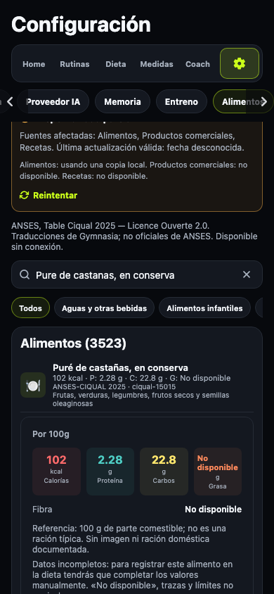
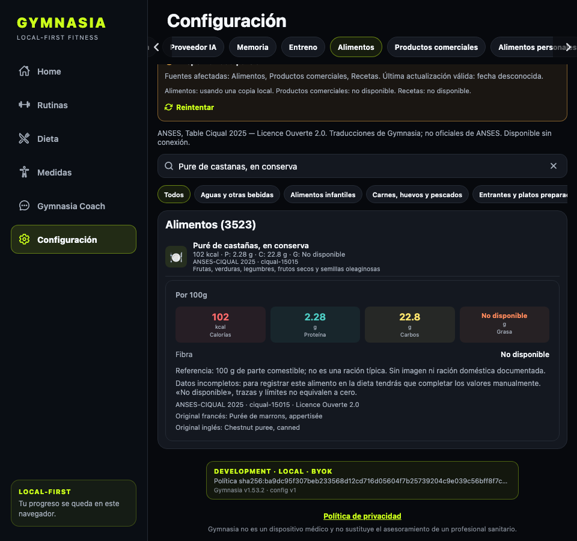

# QA: integración local de ANSES-CIQUAL 2025

Fecha: 2026-10-29. Rama: `codex/ciqual-mobile-catalog`.

## Alcance y plan de pruebas

- Unitarios: fuente integrada con 3.484 alimentos, 3.006 fichas con kcal y macros
  exactos, referencias estables, escalado y ausencia de imágenes/raciones falsas.
- E2E web: arranque limpio sin red, Ajustes, páginas de 30/60 filas, búsqueda sin
  tildes fuera de la primera página, detalle, selección en Dieta, guardado de
  150 g de arroz (525 kcal), recarga y conservación del enlace CIQUAL.
- Proveedor falso: OpenAI Responses solicita `search_foods` y `add_meal_food`;
  se comprueban los resultados enviados al proveedor, la instantánea persistida
  y el rechazo sin escritura de una referencia con nutrición incompleta.
- Contrato: la proyección completa coincide con los JSON fuente, tanto valores
  exactos como calificadores y límites; el check de CI detecta desincronización.
- Regresión: el formulario histórico interpreta vacíos como cero. Al completar
  una ficha CIQUAL se exigen los cinco campos numéricos explícitos; el E2E deja
  grasa vacía, intenta guardar y comprueba error y ausencia de registro.
  La selección manual de cantidades no modifica otras comidas históricas.
- Propiedades: 300 combinaciones de valores y calificadores en el generador;
  cantidades entre 1 y 5.000 g en el consumidor; nulos fuera de filtros numéricos
  y al final de la ordenación. Los ceros declarados se mantienen como ceros.

## Verificación ejecutada

- `npm test`: 117 archivos / 1.017 casos deterministas, más tests de dev-store
  y límites de módulos.
- `npm --workspace apps/mobile exec tsc --noEmit`.
- `npm run test:catalogs`: 27 casos, incluidos los dos nuevos de proyección.
- `npm run check:catalogs`, `npm run check:ciqual:mobile`.
- `npm run check:mobile-boundaries`.
- `npm run check:data-inventory`, `npm run test:data-inventory` (23 casos).
- `npm run check:legal`: artefactos legales sin cambios.
- `npm run test:catalogs:e2e`: suite completa con red y proveedor interceptados;
  se verificaron también los flujos anteriores de caché, migración y ambigüedad.
- `CATALOG_E2E_CIQUAL_ONLY=1 npm run test:catalogs:e2e`: repetición focalizada
  tras los ajustes visuales, con exportación limpia.
- `git diff --check`.
- `APP_ENV=production npm --workspace apps/mobile exec -- expo export --platform android --dev --clear --output-dir /private/tmp/gymnasia-ciqual-android`: bundle Android correcto, sin compilar ni publicar APK/AAB.

La QA del código nuevo se ejecutó sobre la exportación web local de esta rama:
la web publicada aún no contiene esta integración. No se usaron credenciales
reales ni se modificaron datos del mantenedor. Los 503 y avisos WebSocket de la
suite son las respuestas de las rutas interceptadas y del servidor estático de
prueba, no errores sin controlar de la aplicación.

## Revisión visual

Capturas a 390 y 960 px:

Se contrastaron con `docs/design/Gimnasia Design System.png`: superficies
oscuras, marca lima, tarjetas, chips y jerarquía existentes. Las categorías
largas se muestran debajo del nombre para no colapsar su ancho en móvil;
los filtros tienen desplazamiento horizontal. No hay imágenes inventadas ni
«ración típica» para CIQUAL. Los límites, trazas y ausencias son visibles.

## Privacidad y límites

Sin claves de almacenamiento, hosts, permisos ni backend nuevos. El inventario
documenta la fuente pública integrada y las referencias históricas existentes;
la revisión de `docs/legal/privacy-change-checklist.md` no exige cambiar la
política ni las declaraciones de Play.

La web prueba los flujos compartidos y la persistencia. La instalación de una
nueva versión y el arranque sin caché en Android físico solo podrán comprobarse
con el artefacto de release; no se afirma haberlos probado en un dispositivo.
La nueva PR toca `apps/mobile/**`: fusionarla requiere confirmación explícita,
porque disparará la compilación Android normal.
