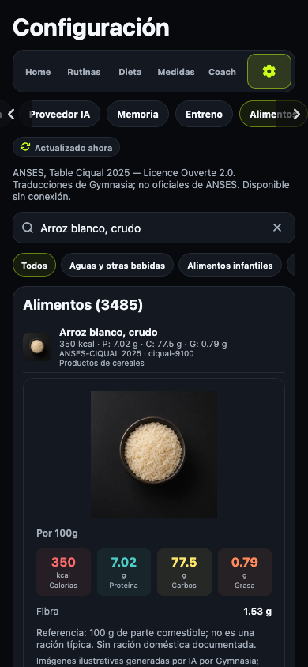
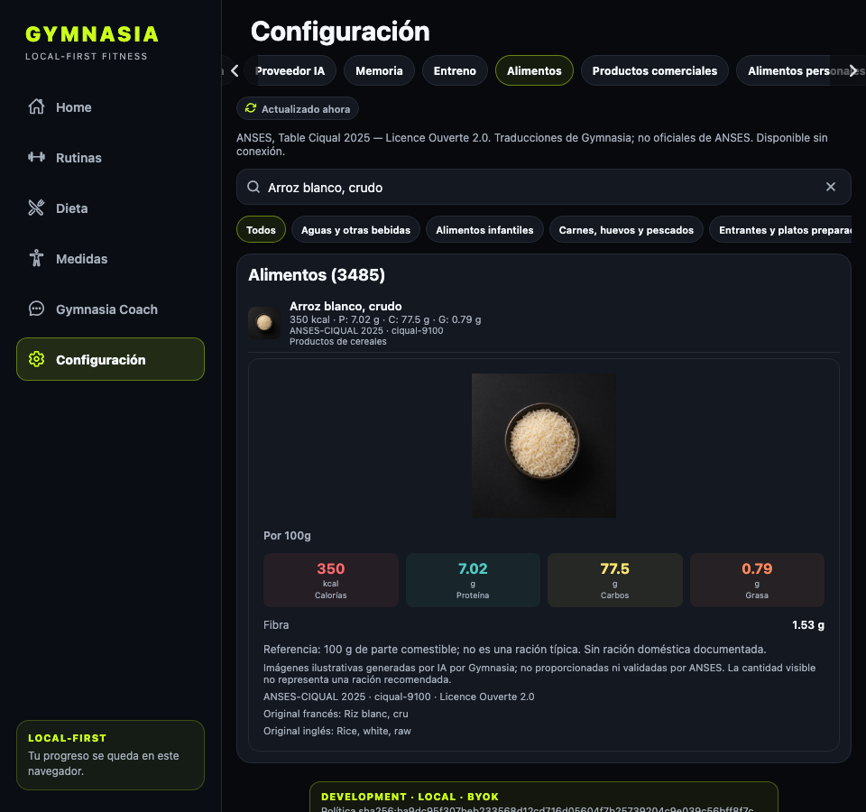
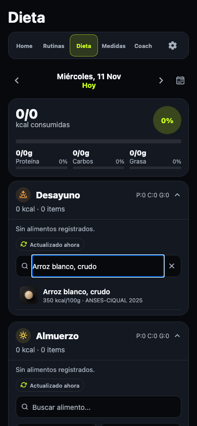
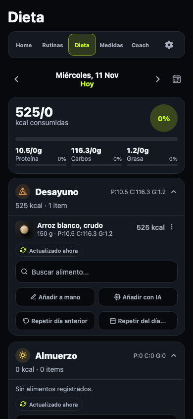

# QA: imágenes CIQUAL en catálogo, búsqueda y dieta

Fecha: 2026-11-11. Rama: `codex/ciqual-mobile-images`.
Versión preparada: 1.55.0 mediante `prepare:production-version`, conforme al
incremento menor exigido por CI para esta función. No se ha lanzado una build.

La integración enlaza 3.484 imágenes editoriales mediante un índice generado
desde las muestras y las 53 tandas, incluida la última entrega de la PR 451.
Los datos nutricionales y sus nombres permanecen intactos. Las imágenes se
cargan al mostrarse desde el repositorio público, sin empaquetar todos los WebP
en la aplicación. Las capturas corresponden a la exportación web local de la
misma app, no a una versión ya publicada.

## Escenarios comprobados en Chromium

- Miniatura y ficha de arroz (`ciqual-9100`, muestra aprobada) en Ajustes;
  carga del WebP real de 1024 × 1024 y atribución de IA visible.
- Miniatura de pastis (`ciqual-1010`) de la última tanda 0053. Las rutas
  inexistentes reciben 404: la prueba no sustituye las imágenes CIQUAL por
  una imagen genérica.
- Imagen en búsqueda de Dieta y registro de 150 g de arroz: 525 kcal,
  referencia CIQUAL y URL de imagen persistidas.
- Recarga de una comida sin `image_uri`, como las guardadas antes de esta
  integración: imagen resuelta por la referencia estable y estado nutricional
  conservado exactamente, sin migración ni reescritura de la URL.
- Red bloqueada: las imágenes fallan y se sustituyen; la comida existente
  sigue visible y se registra una segunda comida de 100 g sin conexión.
- Catálogo completo sin caché/red, fichas incompletas, trazas y límites;
  consulta y registro por tools con OpenAI simulado. Sin claves reales ni
  llamadas a proveedores de IA.

Revisión visual a 390 × 844 y 960 × 900 conforme a
`docs/design/Gimnasia Design System.png`: se conservan las miniaturas de 36 px,
los colores, las tarjetas, los espacios y la jerarquía. La imagen de detalle
queda completa con `contain` y las atribuciones se leen sin desbordamiento.

## Validación

- `npm test`: 117 archivos, 1.019 tests deterministas; comprobaciones de
  dev-store y límites entre módulos correctas.
- `npm run test:catalogs`: 35 tests correctos, incluido el índice completo
  con hashes, cobertura, duplicados y nombres obsoletos.
- `npm --workspace apps/mobile exec tsc --noEmit`: correcto.
- `npm run check:data-inventory`, `npm run test:data-inventory` (23 tests),
  `npm run check:catalogs`, `npm run check:ciqual`,
  `npm run check:ciqual:mobile`, `npm run check:legal` y `git diff --check`:
  correctos.
- `npm run check:production-version -- --base origin/main --published-versions v1.54.1`,
  `npm run check:android-native-config` y `npm run check:android-permissions`:
  correctos con la versión preparada 1.55.0.
- `CATALOG_E2E_CIQUAL_ONLY=1 CATALOG_E2E_SCREENSHOT_DIR=/tmp/ciqual-images-qa npm run test:catalogs:e2e`:
  correcto; exportación con caché limpia y WebP originales servidos desde el
  checkout para comprobar el contenido que publicará la rama.
- `CATALOG_E2E_SKIP_EXPORT=1 npm run test:catalogs:e2e`: regresión completa
  correcta, incluidos los otros catálogos, cachés, migraciones y selección
  ambigua. Termina con «Catálogos E2E completados correctamente, incluidas
  imágenes CIQUAL».
- `APP_ENV=production npm --workspace apps/mobile exec -- expo export --platform android --dev --clear --output-dir /tmp/ciqual-images-android`:
  bundle Android correcto, sin compilar ni publicar APK/AAB.

Revisión de privacidad conforme a `docs/legal/privacy-change-checklist.md`:
GitHub ya era destino de los catálogos y sus imágenes; el inventario explicita
las nuevas rutas CIQUAL y el uso del campo existente `image_uri`. No se añaden
claves, permisos, categorías personales, terceros ni reglas de copia/borrado.
La política publicada ya cubre la descarga de recursos públicos de GitHub;
no cambian el texto legal ni las declaraciones de Play.

La disponibilidad y caché de imágenes sin conexión en Android/iOS depende de
la plataforma. No se ha ejecutado una build ni una prueba en dispositivo; la
aplicación mantiene el sustituto y el funcionamiento local cuando no hay imagen.

## Capturas

