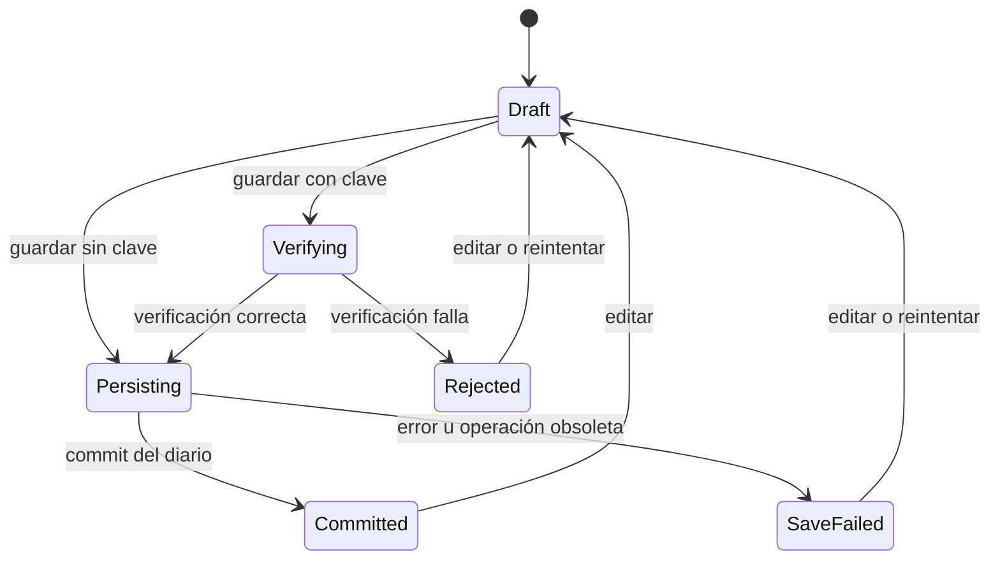
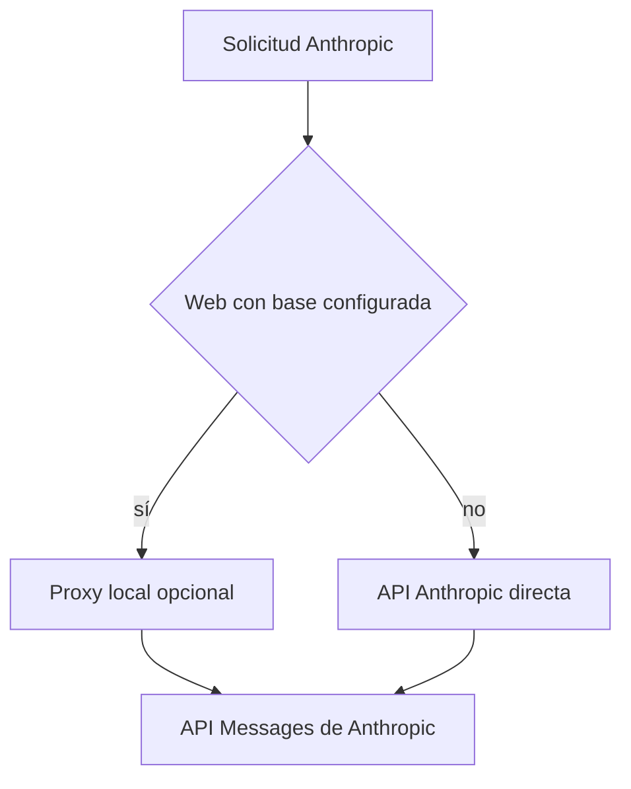

---
okf:
  version: 1
  kind: code-wiki
  status: grounded
  requirement: RQ-01
  scope: Configuración BYOK, persistencia y verificación de proveedores de IA móviles
type: concepto de configuración
title: Configuración BYOK de proveedores
description: Contratos locales para elegir, validar, persistir y usar credenciales y modelos BYOK de OpenAI, Anthropic, Google y servidores compatibles con OpenAI en la aplicación móvil.
summary: Ciclo de vida local de credenciales, modelos, verificación, descubrimiento y transporte por plataforma.
tags: [agent, configuration, providers, credentials, byok, mobile, openai-compatible]
related:
  - ./runtime.md
  - ./provider-streaming.md
  - ../operations/runtime-behavior.md
  - ../services/anthropic-proxy.md
verified:
  - by: openwiki/0.6.0
    at: 2026-10-17T11:49:19.843Z
sources:
  - id: openwiki-source-88e87a6a49f8c4bba044cff2
    resource: repo://apps/anthropic_proxy/README.md
  - id: openwiki-source-2e89f734760be2c893fbd66e
    resource: repo://apps/mobile/agent/anthropicModels.ts
  - id: openwiki-source-74a8135d887c0dcfb2d83938
    resource: repo://apps/mobile/agent/customOpenAIChat.ts
  - id: openwiki-source-8386aa6f62e471c6ed28f6e0
    resource: repo://apps/mobile/agent/customOpenAIModels.ts
  - id: openwiki-source-851640bf701b674c49b731d8
    resource: repo://apps/mobile/agent/customOpenAIUrl.ts
  - id: openwiki-source-dc42304b20e8518ef65b4b63
    resource: repo://apps/mobile/agent/googleContextBudget.ts
  - id: openwiki-source-f310c5fb576ae69a7753918c
    resource: repo://apps/mobile/agent/googleStreamTransport.ts
  - id: openwiki-source-9cad4ef8944c5d67ea03dec8
    resource: repo://apps/mobile/agent/providerChatClient.ts
  - id: openwiki-source-e4b8b3a3e8fb5e339227c3fd
    resource: repo://apps/mobile/agent/providerConfiguration.test.ts
  - id: openwiki-source-0d2384426991583d96044996
    resource: repo://apps/mobile/agent/providerConfiguration.ts
  - id: openwiki-source-04c01bf94878938a4aa2dfd8
    resource: repo://apps/mobile/agent/providerConfigurationPersistence.test.ts
  - id: openwiki-source-98e300a08b181f278443549a
    resource: repo://apps/mobile/agent/providerConfigurationPersistence.ts
  - id: openwiki-source-150caf6747c75c64a081007d
    resource: repo://apps/mobile/agent/providerCredentials.ts
  - id: openwiki-source-0bfe6194a595817dd215a286
    resource: repo://apps/mobile/agent/providerTransport.contract.test.ts
  - id: openwiki-source-c5c28138a849ad0b9daed017
    resource: repo://apps/mobile/agent/providerTransport.test.ts
  - id: openwiki-source-cc29928f3ae5e1998f27d57a
    resource: repo://apps/mobile/agent/providerTransport.ts
  - id: openwiki-source-c80e54251b903682e229caf2
    resource: repo://apps/mobile/agent/providerVerification.ts
  - id: openwiki-source-a6ba9053969a3e00cd971742
    resource: repo://apps/mobile/app.config.ts
  - id: openwiki-source-929e8e1df23628a3f3848ff8
    resource: repo://apps/mobile/App.tsx
generated: { by: "openwiki/0.6.0", at: "2026-10-17T11:49:19.843Z" }
---

# Configuración BYOK de proveedores

La aplicación móvil admite cuatro configuraciones BYOK: `openai`, `anthropic`, `google` y `custom_openai`. Las tres primeras se conectan a sus APIs conocidas; la última permite un servidor HTTPS que implemente el contrato OpenAI Chat Completions. La configuración pertenece al dispositivo, no a un backend de cuentas: no debe documentarse, exportarse ni registrarse una clave real.

Esta página cubre la frontera entre Ajustes y las solicitudes al proveedor. Para streaming y continuaciones de herramientas, consulte [Streaming de proveedores](./provider-streaming.md); para el recorrido de un turno, consulte [Runtime del agente](./runtime.md). La configuración o una traza local no demuestran disponibilidad, coste ni latencia del servicio remoto.

## Contrato normalizado y selección

`ProviderConfiguration` guarda `provider`, `is_active`, `api_key`, `model`, `base_url?`, `workspace_id?` y `reasoning_effort?`; `ProviderDraft` no incluye `is_active`, por lo que editar no publica ni selecciona nada. `PROVIDERS` define el orden canónico `openai`, `anthropic`, `google`, `custom_openai`.

La normalización devuelve siempre una entrada por proveedor y exactamente una activa: conserva la primera activa según ese orden o activa OpenAI si no había ninguna. Recorta claves y modelos; completa un modelo vacío para OpenAI, Anthropic y Google, pero conserva vacío el de `custom_openai` para exigir un ID explícito. Migra `gpt-4o-mini` y los valores Google heredados al valor actual sin sustituir un modelo personalizado no vacío.

Los campos específicos no se filtran entre proveedores: `base_url` solo sobrevive en `custom_openai`, `workspace_id` solo en Anthropic y `reasoning_effort` solo en OpenAI. El esfuerzo de razonamiento OpenAI se vuelve a calcular contra la familia del modelo: un valor no compatible pasa a `medium` si está permitido, a la primera alternativa soportada o a `null`. Anthropic decide el formato de `thinking` al construir la petición: Claude 3 y 4.5 reciben el modo heredado con presupuesto; los demás, incluso un modelo desconocido, reciben el modo adaptativo resumido.

Un guardado con clave activa al candidato; actualizar un proveedor sin clave o borrar su clave no cambia la selección activa. La selección y el estado `chatProvider` visibles se actualizan únicamente después del commit del repositorio, de modo que un fallo de escritura no cambia silenciosamente el proveedor en uso.

## Límites de secreto y persistencia local

Las claves son secretos locales. OpenAI usa `Authorization: Bearer`, Anthropic `x-api-key` y Google `x-goog-api-key`; no se incorporan a URLs. Un Workspace ID Anthropic no vacío debe empezar por `wrkspc_`, se transmite como `anthropic-workspace-id`, y los errores que indican que falta se convierten en una instrucción para configurarlo.

`ProviderConfigurationRepository` es la autoridad durable. Serializa commits y guarda diarios de esquema 1 con `revision`, `committed` y `pending`: escribe primero el candidato pendiente, comprueba de nuevo que la operación sigue vigente y solo después lo confirma. Si el candidato quedó obsoleto o falla una escritura, intenta restaurar el commit anterior. Durante la hidratación, un `pending` superviviente nunca se promociona; se recupera el último `committed` y se repara el diario de forma conservadora.

| Plataforma | Almacenamiento canónico | Consecuencia de privacidad y fallo |
|---|---|---|
| Web | Diario dedicado en AsyncStorage | Incluye las credenciales; el navegador no proporciona el aislamiento de SecureStore. Quien tenga acceso al perfil del navegador puede potencialmente leerlas. |
| Nativo con SecureStore | Diario en SecureStore | AsyncStorage recibe un espejo saneado con `api_key: ""`; el diario con secretos permanece en el almacenamiento seguro. |
| Nativo sin almacenamiento seguro | No se crea repositorio para una configuración nueva | El guardado falla, se mantiene la configuración anterior y Ajustes informa el fallo. |

El agregado general se sanea con `stripProviderApiKeys`, por lo que no se convierte en una segunda fuente de secretos. Las copias de seguridad no exportan claves. Al importar, se sanea el archivo y se conservan la clave y el Workspace ID Anthropic ya existentes en el dispositivo: un backup no puede inyectar ni reemplazar esos secretos. Al abrir el diálogo de borrado se enmascara la clave persistida; no se muestra el texto transitorio del borrador.



*Estados de un guardado de proveedor: el candidato solo llega al estado visible después de un commit confirmado; borrar una clave no hace una llamada de red.*

## Verificar antes de persistir

Al guardar, la aplicación normaliza el borrador y valida requisitos locales. Si hay clave, verifica la conexión antes de persistir; sin clave persiste la eliminación sin red. `fetchProviderConfiguration` aborta por defecto a los 15 segundos y traduce el aborto a un error legible. En modo fixture, la verificación devuelve éxito local sin red; sin clave devuelve una advertencia sin red.

| Proveedor | Verificación | Resultado especial |
|---|---|---|
| OpenAI | `GET https://api.openai.com/v1/models` | Cualquier respuesta 2xx confirma la conexión. |
| Anthropic directo | `POST https://api.anthropic.com/v1/messages` con `max_tokens: 1` | Un 404 confirma la clave pero avisa que el modelo no está disponible. |
| Google | `GET .../v1beta/models/{model}` | Cualquier respuesta 2xx confirma la conexión. |
| OpenAI compatible | `GET {base_url}/models` | 404, 405 y 501 permiten guardar con advertencia; otros errores rechazan. |

La verificación es una comprobación de credencial y endpoint, no una prueba completa de cada capacidad de conversación. En particular, la prueba explícita del modelo de un servidor compatible usa una petición de chat no streaming y puede consumir API. El selector de modelo tampoco es una lista de permitidos: el modelo sigue siendo editable.

Las revisiones de borrador, guardado, descubrimiento y configuración global son tokens de operaciones asíncronas. Editar, iniciar otro guardado o iniciar otro descubrimiento invalida el token previo; una respuesta antigua no actualiza interfaz ni persistencia. Una clave hidratada se presenta como pendiente de comprobar, pero ese indicador no garantiza conectividad ni bloquea a los consumidores.

## Catálogo y capacidades

OpenAI consulta `/v1/models`. Google consulta `/v1beta/models`, quita el prefijo `models/`, deduplica, ordena y excluye modelos que declaran métodos de generación incompatibles. Anthropic pagina de 100 en 100, deduplica IDs y se limita a 20 páginas, comunicando un catálogo parcial o truncado en lugar de hacerlo pasar por completo.

Para `custom_openai`, `/models` es una comodidad, no un requisito para guardar. La base se normaliza antes de guardarla: debe ser una URL `https://` absoluta, sin credenciales, espacios, consulta, fragmento ni separadores ambiguos. A partir de ella solo se forman `/models` y `/chat/completions`. La consulta de catálogo omite credenciales HTTP del navegador, rechaza redirecciones y envía el bearer BYOK; además limita la respuesta a 1 MiB y oculta la clave si el servidor la refleja en un mensaje de error. Si el catálogo responde 404, 405 o 501, se permite escribir el ID manualmente.

No se debe inferir que un modelo listado soporta streaming, herramientas, imágenes o el contrato de Interactions de Google. Son capacidades independientes. En conversación, el compatible con OpenAI intenta SSE y solo vuelve a JSON normal cuando el servidor declara que no soporta streaming; el resto de detalles del transporte pertenece a [Streaming de proveedores](./provider-streaming.md).

## Transporte, proxy opcional y datos que salen del dispositivo

OpenAI y Google se usan directamente tanto en web como en nativo. Google genera con Interactions y `store: false`; verificación y catálogo usan Models, por lo que aparecer en el catálogo no garantiza capacidad de Interactions. Un endpoint local de Google solo se habilita con puerto válido en Development y la clave ficticia `e2e-local-fake-key`; otra combinación falla en lugar de desviar tráfico real.

Anthropic también es directo por defecto. En web añade `anthropic-dangerous-direct-browser-access` para que la página pueda leer la respuesta CORS; en nativo no se envía. Por ello una clave BYOK almacenada en web queda accesible para quien pueda inspeccionar esa sesión del navegador. El proxy Anthropic es opcional: solo se elige en web cuando `EXPO_PUBLIC_API_BASE_URL` no queda vacío después de recortar y quitar barras finales. No hay fallback automático al proxy tras un fallo directo.



*La ruta del proxy es una decisión explícita de configuración web, no un backend obligatorio de la aplicación.*

Con proxy, catálogo, verificación y mensajes usan `/chat/providers/anthropic/models`, `/verify` y `/messages`. La app entrega la clave en JSON para que el proxy la transforme en cabecera upstream; revise sus límites de confianza y operación local en [Proxy CORS de Anthropic para navegador](../services/anthropic-proxy.md). Con cualquiera de las rutas, el contenido de la conversación y la clave necesaria viajan al proveedor seleccionado o al proxy configurado; elegir BYOK no vuelve local el procesamiento remoto.

Los consumidores omiten configuraciones sin clave; `custom_openai` también se omite si faltan modelo o URL. El estimador de alimentos prueba, en orden, Google, OpenAI, Anthropic y OpenAI compatible. El modo `fake` solo puede seleccionarse en desarrollo mediante `DEV_PROVIDER_MODE`; por defecto desarrollo usa fixtures y staging/producción BYOK. Chat principal, chat con herramientas y estimador cortocircuitan antes de la red en ese modo y no incorporan una clave real de desarrollo.

## Cambio seguro y pruebas focalizadas

Al añadir o modificar un proveedor, actualice conjuntamente el tipo y normalizadores, persistencia y saneamiento, validación de guardado, verificación, catálogo, transporte y consumidores. Mantenga la autenticación fuera de URLs, el único proveedor activo y los tokens de invalidez. Para un servidor compatible, no relaje HTTPS ni suponga que `/models`, SSE o tools están disponibles.

Ejecute desde la raíz:

```bash
npx vitest run --config apps/mobile/vitest.config.mts apps/mobile/agent/providerConfiguration.test.ts apps/mobile/agent/providerConfigurationPersistence.test.ts apps/mobile/agent/providerCredentials.test.ts apps/mobile/agent/providerVerification.test.ts apps/mobile/agent/providerCatalog.test.ts apps/mobile/agent/customOpenAIChat.test.ts apps/mobile/agent/providerTransport.test.ts apps/mobile/agent/providerTransport.contract.test.ts
```

Estas pruebas fijan contratos de normalización, rollback del diario, aislamiento de secretos, tokens obsoletos, verificación y transporte. No prueban disponibilidad, coste, CORS desplegado ni comportamiento de servicios remotos.
