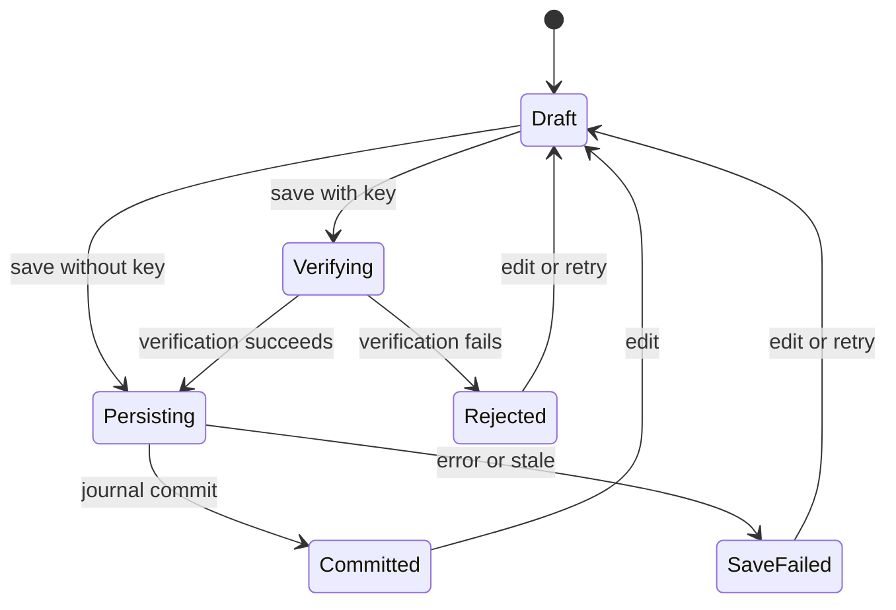
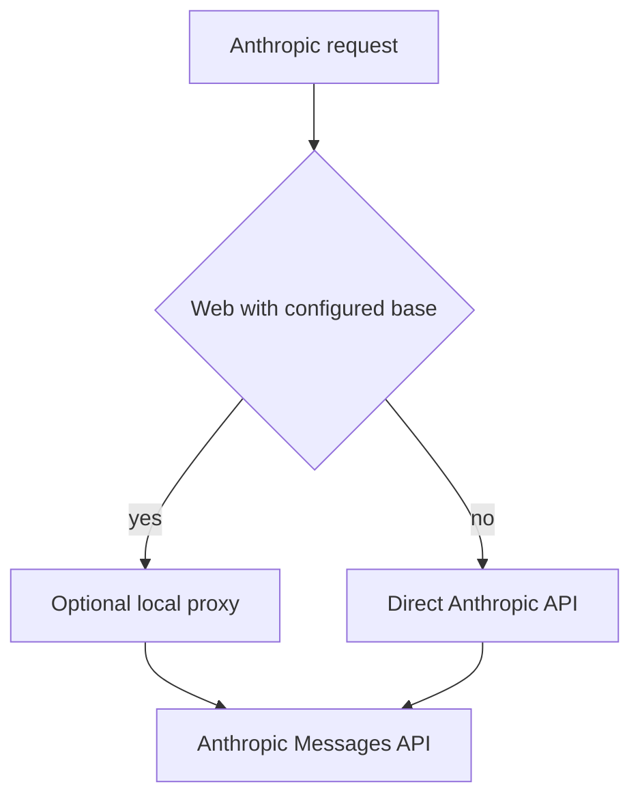

---
okf:
  version: 1
  kind: code-wiki
  status: grounded
  requirement: RQ-01
  scope: Configuración BYOK, persistencia y verificación de proveedores de IA móviles
type: concepto de configuración
title: Configuración BYOK de proveedores
description: Contratos de configuración, credenciales, verificación, descubrimiento y transporte BYOK para OpenAI, Anthropic, Google y servidores compatibles con OpenAI en la aplicación móvil.
summary: Ciclo de vida de credenciales, modelos, verificación, descubrimiento y transporte por plataforma.
tags: [agent, configuration, providers, credentials, byok, mobile, openai-compatible]
related:
  - ./runtime.md
  - ./provider-streaming.md
  - ../operations/runtime-behavior.md
  - ../services/anthropic-proxy.md
verified:
  - by: openwiki/0.6.0
    at: 2026-11-08T14:36:51.071Z
sources:
  - id: openwiki-source-88e87a6a49f8c4bba044cff2
    resource: repo://apps/anthropic_proxy/README.md
  - id: openwiki-source-2e89f734760be2c893fbd66e
    resource: repo://apps/mobile/agent/anthropicModels.ts
  - id: openwiki-source-74a8135d887c0dcfb2d83938
    resource: repo://apps/mobile/agent/customOpenAIChat.ts
  - id: openwiki-source-8386aa6f62e471c6ed28f6e0
    resource: repo://apps/mobile/agent/customOpenAIModels.ts
  - id: openwiki-source-851640bf701b674c49b731d8
    resource: repo://apps/mobile/agent/customOpenAIUrl.ts
  - id: openwiki-source-dc42304b20e8518ef65b4b63
    resource: repo://apps/mobile/agent/googleContextBudget.ts
  - id: openwiki-source-f310c5fb576ae69a7753918c
    resource: repo://apps/mobile/agent/googleStreamTransport.ts
  - id: openwiki-source-9cad4ef8944c5d67ea03dec8
    resource: repo://apps/mobile/agent/providerChatClient.ts
  - id: openwiki-source-e4b8b3a3e8fb5e339227c3fd
    resource: repo://apps/mobile/agent/providerConfiguration.test.ts
  - id: openwiki-source-0d2384426991583d96044996
    resource: repo://apps/mobile/agent/providerConfiguration.ts
  - id: openwiki-source-04c01bf94878938a4aa2dfd8
    resource: repo://apps/mobile/agent/providerConfigurationPersistence.test.ts
  - id: openwiki-source-98e300a08b181f278443549a
    resource: repo://apps/mobile/agent/providerConfigurationPersistence.ts
  - id: openwiki-source-150caf6747c75c64a081007d
    resource: repo://apps/mobile/agent/providerCredentials.ts
  - id: openwiki-source-0bfe6194a595817dd215a286
    resource: repo://apps/mobile/agent/providerTransport.contract.test.ts
  - id: openwiki-source-c5c28138a849ad0b9daed017
    resource: repo://apps/mobile/agent/providerTransport.test.ts
  - id: openwiki-source-cc29928f3ae5e1998f27d57a
    resource: repo://apps/mobile/agent/providerTransport.ts
  - id: openwiki-source-c80e54251b903682e229caf2
    resource: repo://apps/mobile/agent/providerVerification.ts
  - id: openwiki-source-a6ba9053969a3e00cd971742
    resource: repo://apps/mobile/app.config.ts
  - id: openwiki-source-929e8e1df23628a3f3848ff8
    resource: repo://apps/mobile/App.tsx
generated: { by: "openwiki/0.6.0", at: "2026-11-08T14:36:51.071Z" }
---

# Configuración BYOK de proveedores

La aplicación móvil admite cuatro configuraciones BYOK: `openai`, `anthropic`, `google` y `custom_openai`. Las tres primeras llaman a APIs conocidas; la última conecta con un servidor HTTPS que implemente OpenAI Chat Completions. La configuración pertenece al dispositivo: no se deben registrar, incluir en documentación ni compartir claves reales.

Esta página cubre el límite entre Ajustes y las solicitudes al proveedor. Para el streaming y las continuaciones con herramientas, consulte [Streaming de proveedores](./provider-streaming.md). Para el recorrido completo de un turno y sus límites operativos, consulte [Comportamiento en ejecución y oportunidades](../operations/runtime-behavior.md).

## Contrato normalizado

`ProviderConfiguration` contiene `provider`, `is_active`, `api_key`, `model`, `base_url?`, `workspace_id?` y `reasoning_effort?`. `ProviderDraft` no incluye `is_active`: editar un borrador no cambia el proveedor publicado. `PROVIDERS` establece el orden canónico `openai`, `anthropic`, `google`, `custom_openai`.

La normalización devuelve siempre una entrada por proveedor y exactamente una activa. Conserva la primera marcada activa según ese orden; si no hay ninguna, activa OpenAI. También recorta clave y modelo, completa modelos vacíos de OpenAI, Anthropic y Google con sus predeterminados y migra los predeterminados heredados. En cambio, `custom_openai` conserva el modelo vacío para obligar a elegirlo explícitamente.

Los campos específicos no se trasladan entre proveedores: `base_url` solo se conserva para `custom_openai`, `workspace_id` para Anthropic y `reasoning_effort` para OpenAI. El esfuerzo de razonamiento se vuelve a normalizar al cambiar de modelo: solo se conserva si pertenece a la familia soportada; en otro caso se prefiere `medium`, luego la primera alternativa válida, o `null` si ese modelo no admite esfuerzo.

Anthropic normaliza el Workspace ID y, si se proporciona al guardar, exige el prefijo `wrkspc_`. Lo transmite como `anthropic-workspace-id`; los errores que indican que falta se convierten en una instrucción para añadirlo. La configuración de `thinking` se decide al construir la petición: Claude 3 y 4.5 usan el modo heredado con presupuesto; los demás modelos, incluidos los desconocidos, usan el modo adaptativo resumido.

## Servidor OpenAI Chat Completions compatible

Una configuración `custom_openai` con clave necesita además un ID de modelo y `base_url`. Antes de guardar o consultar, `normalizeCustomOpenAIBaseUrl` exige una URL HTTPS absoluta, host válido y sin credenciales, espacios, consulta, fragmento, barras invertidas ni separadores de ruta codificados ambiguos. Conserva el origen y un prefijo de API opcional, quitando solamente las barras finales. A partir de esa base solo se construyen las rutas `models` y `chat/completions`.

Las solicitudes omiten credenciales HTTP del navegador y envían la clave BYOK como `Authorization: Bearer`. Esto evita que una URL configurada por la persona inyecte autenticación de URL o rutas arbitrarias, pero no elimina el riesgo de exponer la clave a ese servidor. En web, el servidor debe admitir CORS para que el navegador pueda leer la respuesta.

El descubrimiento de `GET /models` es opcional. Los estados 404, 405 y 501 significan «no disponible», no un bloqueo: la persona puede escribir el ID manualmente y guardar; la verificación lo comunica como advertencia. El botón de prueba envía una petición de chat no streaming y, por tanto, puede consumir API. En conversación se intenta SSE; solo se repite como JSON no streaming si el error HTTP y su detalle declaran que el streaming no está soportado. Las herramientas son otra capacidad independiente: no se debe inferir su disponibilidad por tener catálogo o streaming.

El cliente limita el catálogo a 1 MiB, las respuestas de error a 16 KiB y las respuestas de chat JSON a 2 MiB; cancela al excederlos. También oculta la clave si el servidor la reproduce en un error. Un stream debe acabar con `[DONE]`, no puede dejar datos residuales ni cambiar el ID o el tipo de una llamada de herramienta ya iniciada.

## Persistencia y secretos

`ProviderConfigurationRepository` es la autoridad durable de la configuración. Serializa los commits y usa un diario de esquema 1 con `revision`, `committed` y `pending`: primero escribe el candidato pendiente, comprueba que la operación todavía es actual y después escribe el commit final. Si falla una escritura o el candidato se vuelve obsoleto, intenta restaurar el snapshot anterior. Al hidratar, un `pending` superviviente nunca se promociona: se recupera el último `committed` y se repara el diario de forma conservadora.

| Plataforma | Almacenamiento canónico | Copia en AsyncStorage |
|---|---|---|
| Web | Diario dedicado en AsyncStorage | Contiene las credenciales; la plataforma web no aporta el aislamiento de SecureStore. |
| Nativo con SecureStore | Diario en SecureStore | Espejo saneado, con `api_key: ""`. |
| Nativo sin SecureStore disponible | No se crea repositorio de proveedores | No se persiste una configuración nueva; la anterior sigue en uso y la interfaz informa el fallo. |

El agregado general se sanea mediante `stripProviderApiKeys`, por lo que no se convierte en una segunda fuente de secretos. Las copias de seguridad no exportan claves. Al importar, se sanea el archivo y se mantienen la clave y el Workspace ID Anthropic que ya existían localmente; un backup no puede inyectar ni sustituir esos secretos.



*El candidato se hace visible solo tras un commit confirmado; borrar una clave no dispara una verificación de red.*

## Guardado, selección y concurrencia

Guardar normaliza el borrador. Con una clave no vacía, valida los requisitos particulares y verifica la conexión antes de persistir; con una clave vacía persiste la eliminación sin red. Guardar una clave activa el candidato; borrar una no cambia la selección activa. La selección explícita de chat también confirma primero el repositorio y solo después cambia `chatProvider` y el estado visible. Por ello, un fallo de escritura no cambia silenciosamente el proveedor en uso.

Las revisiones de borrador, guardado, descubrimiento y configuración global son tokens de operaciones asíncronas. Editar, comenzar otro guardado o iniciar otro descubrimiento invalida el token previo: una respuesta antigua no actualiza interfaz ni persistencia. La clave hidratada puede mostrarse como pendiente de comprobar; ese estado no certifica conectividad ni bloquea a los consumidores.

La interfaz distingue `checking`, conectado, advertencia y error. Para confirmar un borrado toma y enmascara la clave persistida, nunca el texto transitorio del borrador.

## Verificación y descubrimiento

`fetchProviderConfiguration` aborta por defecto a los 15 segundos y traduce el aborto a un error legible. Sin clave, la verificación devuelve advertencia sin red; en modo fixture devuelve éxito local sin red.

| Proveedor | Verificación | Semántica especial |
|---|---|---|
| OpenAI | `GET https://api.openai.com/v1/models` | Cualquier 2xx confirma la conexión. |
| Anthropic directo | `POST https://api.anthropic.com/v1/messages` con `max_tokens: 1` | Un 404 confirma la clave y advierte que el modelo no está disponible. |
| Google | `GET .../v1beta/models/{model}` | Cualquier 2xx confirma la conexión. |
| OpenAI compatible | `GET {base_url}/models` | 404, 405 y 501 permiten guardar con advertencia; los demás errores rechazan. |

El catálogo orienta la selección, pero no es una lista de permitidos: el modelo continúa siendo editable. OpenAI consulta `/v1/models`. Google consulta `/v1beta/models`, quita el prefijo `models/`, deduplica y ordena, y omite modelos que declaran métodos incompatibles con `generateContent`. Anthropic pagina de 100 en 100, deduplica IDs, se limita a 20 páginas y comunica un resultado parcial o truncado en lugar de presentarlo como completo.

## Rutas directas, proxy y privacidad

OpenAI y Google acceden directamente tanto en web como en nativo. Google genera mediante Interactions con `store: false`, mientras que verificación y catálogo usan Models; aparecer en el catálogo no garantiza que el modelo funcione con Interactions. Un endpoint Google local solo se admite con un puerto válido en Development y la clave ficticia `e2e-local-fake-key`; cualquier otra combinación falla en vez de redirigir tráfico real.

Anthropic también es directo por defecto. En web añade `anthropic-dangerous-direct-browser-access` para que la página pueda leer la respuesta CORS; nativo no lo envía. El proxy es opcional: solo se selecciona en web cuando `EXPO_PUBLIC_API_BASE_URL`, tras recortar y eliminar barras finales, no está vacío. No existe fallback automático al proxy después de un fallo directo.



*El proxy depende de una decisión explícita de configuración web, no es un backend obligatorio de la aplicación.*

Con proxy, catálogo, verificación y mensajes usan respectivamente `/chat/providers/anthropic/models`, `/verify` y `/messages`. La aplicación entrega la clave en JSON para que el proxy la convierta en cabecera upstream. Sus límites de confianza y uso local se describen en [Proxy CORS de Anthropic para navegador](../services/anthropic-proxy.md).

Los consumidores omiten configuraciones sin clave; `custom_openai` también se omite si faltan modelo o URL. El estimador de alimentos prueba en orden Google, OpenAI, Anthropic y OpenAI compatible. El modo `fake` solo puede elegirse en desarrollo mediante `DEV_PROVIDER_MODE`: por defecto, desarrollo usa fixtures y staging/producción usan BYOK. Chat principal, chat con herramientas y estimador cortocircuitan antes de la red en ese modo y no incorporan una clave real de desarrollo.

## Cambios seguros y pruebas

Al añadir o cambiar un proveedor, actualice conjuntamente el tipo y normalizadores, persistencia y saneamiento, requisitos de guardado, verificación, catálogo, transporte y consumidores. Mantenga la autenticación fuera de URLs, el único proveedor activo, los tokens de invalidez y los límites de tamaño y tiempo. Para un servidor compatible, no relaje HTTPS ni suponga que `/models`, SSE o tools existen: son capacidades separadas.

Ejecute las pruebas focalizadas desde la raíz:

```bash
npx vitest run --config apps/mobile/vitest.config.mts apps/mobile/agent/providerConfiguration.test.ts apps/mobile/agent/providerConfigurationPersistence.test.ts apps/mobile/agent/providerCredentials.test.ts apps/mobile/agent/providerVerification.test.ts apps/mobile/agent/providerCatalog.test.ts apps/mobile/agent/customOpenAIChat.test.ts apps/mobile/agent/providerTransport.test.ts apps/mobile/agent/providerTransport.contract.test.ts
```

Estas pruebas fijan contratos de normalización, rollback, aislamiento de secretos, tokens obsoletos, verificación, catálogo y transporte. No prueban disponibilidad, coste, CORS desplegado ni latencia de servicios remotos.
