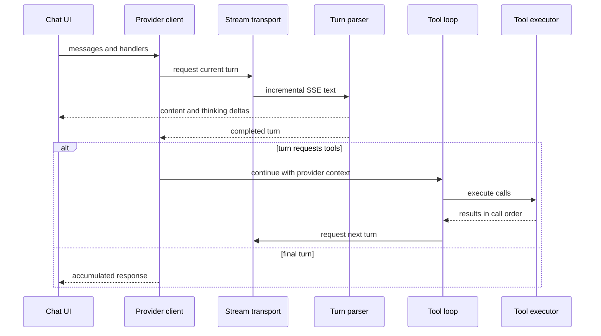

# Streaming, continuaciones y fallos de proveedores

`requestProviderToolChat` es la entrada del chat con herramientas en `apps/mobile`. Compone el prompt de sistema, elige la ruta del proveedor, propaga deltas a la UI y entrega un turno ya ensamblado al bucle de herramientas. El transporte **no** ejecuta herramientas ni conserva una conversación: solo solicita, decodifica y valida un turno. Los bucles de `providerToolLoop.ts` y la ruta `custom_openai` conservan el contexto de su protocolo, ejecutan efectos permitidos y solicitan la continuación.



*Flujo de una solicitud: el parser valida un turno antes de que el bucle ejecute sus herramientas o lo use como continuación.*

## Frontera SSE y validez del turno

`splitSSEEvents` tolera CRLF, emite solo eventos terminados por una línea vacía y deja el sufijo incompleto en el buffer. `parseSSEEvent` ignora comentarios, toma `message` como evento predeterminado y une las líneas `data:`. Por tanto, Fetch y XHR pueden entregar cortes arbitrarios sin que el transporte tenga que conocer fronteras de JSON o SSE.

Se crea un parser por turno. OpenAI y Anthropic acumulan bloques por índice, emiten deltas de contenido y razonamiento, y señalan `truncated` si no llega el terminal esperado (`response.completed` o `message_stop`). OpenAI conserva `responseId`, elementos de salida y argumentos de función fragmentados; Anthropic conserva bloques `text`, `thinking` —incluida su firma— y `tool_use`, y solo materializa el JSON de la herramienta al cerrar el bloque. `requestProviderToolChat` mantiene acumuladores fuera de las rondas: tanto los callbacks como el resultado final abarcan todos los turnos, no solamente el último.

Google Interactions tiene un contrato más estricto. Su parser exige `interaction.created`, índices de pasos consecutivos y el ciclo `step.start`/`step.delta`/`step.stop`; exige además pasos cerrados, al menos un paso, uso válido y un cierre `completed` o `requires_action` coherente con las llamadas observadas. Repetir el mismo inicio o cierre no reinicia los datos acumulados. Una colisión de paso, firma, llamada o identidad, argumentos que no sean objeto, o un evento fuera de orden produce `GoogleStreamError`. `finish()` falla si queda SSE pendiente, falta el terminal o ya falló el parser: un stream parcial nunca llega al ejecutor como turno válido.

Con `store: false`, Google puede omitir `id` y metadatos de ciclo de vida. El parser representa el ID omitido como `""`; `null` queda reservado para un stream que aún no abrió. Acepta la omisión consistente, pero mantiene las comprobaciones de apertura única, orden, terminal, pasos, llamadas y uso. Por ello dos rondas sin ID pueden continuar localmente, mientras que una creación repetida o una identidad explícita contradictoria siguen siendo errores.

## Transporte, timeout y cancelación

| Proveedor | Web | Nativo | Semántica relevante |
|---|---|---|---|
| OpenAI Responses | Fetch con `TextDecoder` incremental | XHR con progreso | 120 s; el bucle rechaza el turno truncado antes de ejecutar herramientas. |
| Anthropic Messages | XHR con progreso | XHR con progreso | 120 s; la ausencia de `message_stop` rechaza el stream como truncado. |
| Google Interactions | Fetch con `TextDecoder` incremental | XHR con progreso | 120 s; puede usar un fallback XHR bufferizado muy limitado. |
| `custom_openai` Chat Completions | `fetch` o `expo/fetch` | `expo/fetch` | 120 s; streaming SSE con fallback a JSON solo cuando el servidor declara que no lo admite. |

En XHR con progreso, cada notificación entrega al parser únicamente el sufijo desde `lastOffset`; Fetch decodifica bytes en modo streaming y vacía el `TextDecoder` al final. HTTP no exitoso, error de red, timeout y error de parsing rechazan la solicitud. En Fetch, un `AbortController` se aborta al vencer los 120 segundos y la excepción se traduce al mensaje de timeout del proveedor; no existe una señal de cancelación de usuario expuesta por `requestProviderToolChat`.

Para Google, Fetch, XHR incremental y XHR bufferizado alimentan el mismo `createGoogleStreamParser`. En nativo, el fallback se permite **una vez** únicamente si XHR incremental falla exactamente con el error de conexión antes de que un callback visible haya emitido contenido o razonamiento. No se activa por timeout, estado HTTP o error de parser, ni tras un delta visible: así no se duplica texto ni se reintenta un turno cuyo protocolo ya resultó inválido.

## Servidores Chat Completions compatibles

`custom_openai` usa la URL normalizada configurada y solicita `chat/completions` con `redirect: "error"`, `credentials: "omit"`, `Authorization: Bearer` y timeout de 120 s. La ruta intenta primero `stream: true` y espera `text/event-stream`. Su parser exige `[DONE]`, rechaza datos posteriores, JSON SSE inválido, llamadas de herramienta incompletas o cambios de ID durante el stream; también limita un evento SSE a 1 MiB y las respuestas leídas a tamaños acotados. Los mensajes de error sustituyen la API key por `[clave oculta]`.

Un servidor compatible puede contestar JSON aunque se pidiera streaming; en ese caso se analiza como una respuesta Chat Completions no incremental. Solo si un `CustomOpenAIError` HTTP 400, 404, 405, 422 o 501 nombra explícitamente que streaming/SSE no está soportado, se repite una vez con `stream: false`. No hay fallback para errores de red, credenciales, timeout, contenido malformado o una incompatibilidad ambigua; evitarlo impide convertir un fallo de generación en una segunda petición con efectos o semántica distinta.

En el Coach, un rechazo explícito de `tools` no reduce silenciosamente la capacidad: se informa que ese modelo no admite las herramientas requeridas. Si los argumentos de una llamada no son un objeto JSON, el ejecutor no se invoca; se devuelve un resultado de entrada inválida para que el modelo pueda corregirlo en una ronda posterior.

## Continuaciones y ejecución de herramientas

OpenAI añade al contexto los `outputItems` del turno y un `function_call_output` por `call_id`, y rechaza IDs de llamada repetidos. Anthropic añade los bloques completos del asistente y un mensaje de usuario con `tool_result` correlacionado por `tool_use_id`; conservar bloques completos preserva pensamiento y datos de protocolo, no solo texto visible. Google añade `function_result` con el mismo `call_id` y conserva los pasos recibidos. La ruta `custom_openai` mantiene mensajes Chat Completions: añade el mensaje de asistente con `tool_calls` y, después, un mensaje `tool` por cada ID.

Google trata su formato de cable como formato local de continuación. `GoogleConversationTurn` persiste pasos e interacciones, y `buildGoogleHistory` vuelve a inyectar una copia profunda de esos pasos para un mensaje de asistente validado. Las firmas de pensamiento y campos desconocidos de los pasos son opacos: no se convierten a texto ni se regeneran. La validación rechaza llamadas pendientes, firmas ausentes y resultados mal correlacionados, por lo que hidratar historial no transforma trabajo pendiente en ejecución.

Las llamadas de una ronda se preparan y devuelven al proveedor en su orden original. La ejecución puede solapar lecturas consecutivas, pero `executeToolBatch` trata escrituras y herramientas desconocidas como barreras secuenciales. Un fallo fatal deja de iniciar lecturas nuevas y espera las ya iniciadas. Cada llamada recibe un sobre con proveedor, ID remoto y ocurrencia. `executeToolSafely` no filtra excepciones crudas al modelo o usuario: una excepción de lectura se vuelve un resultado seguro, pero una escritura fallida se marca indeterminada para impedir un reintento ciego.

Los cuatro bucles aplican `MAX_TOOL_ROUNDS = 10`. Al llegar al límite con llamadas pendientes, no las ejecutan: añaden resultados sintéticos y hacen una única petición de cierre con herramientas prohibidas e instrucción explícita de informar el límite. Si esa petición falla, llega truncada, carece de contenido final cuando corresponde o vuelve a pedir una herramienta, se lanza `ToolRoundLimitError`; no se presenta una respuesta intermedia como final.

## Google: historial local y presupuesto

`buildGoogleInteractionRequest` envía historial local como `input` con `stream: true` y `store: false`; no depende de `previous_interaction_id`. En el bucle, un ID de interacción no vacío identifica un replay solo si representa exactamente los mismos pasos. Como `""` no identifica replays entre rondas, los IDs de herramienta siguen sin poder reutilizarse entre rondas distintas.

Antes de abrir red, `prepareGoogleInteractionRequest` elige los últimos intercambios completos —cada uno comienza en `user_input`— y mide el JSON sin imágenes y el cuerpo completo. Sus límites predeterminados son 10 intercambios, 512 KiB sin imágenes y 19 000 000 bytes totales; Coach sustituye solo el máximo de intercambios por `COACH_CONTEXT_MESSAGE_LIMIT` (20). Primero elimina imágenes inline de intercambios antiguos, conservando texto o un marcador, y después descarta intercambios completos desde el más antiguo. Si el intercambio activo ya excede un límite, lanza `GoogleContextBudgetError` sin mutar el historial. `onGoogleContextReport` es diagnóstico: si el callback falla no bloquea la petición ni oculta el error de presupuesto.

## Pruebas y cambios seguros

Las pruebas de `googleInteractions.test.ts` cubren IDs vacíos y metadatos de ciclo de vida omitidos, continuación de herramientas, persistencia/restauración de pasos, truncamiento, estados incompatibles, argumentos inválidos y secuencias reordenadas. `providerToolLoop.test.ts` cubre las invariantes del límite, la correlación y la ejecución; `customOpenAIChat.test.ts` cubre el ensamblado de SSE y tool calls, el fallback explícito sin streaming, saneamiento de errores y la negativa del Coach ante herramientas no soportadas.

Al cambiar un dialecto, actualice conjuntamente parser, transporte, contrato de continuación y pruebas. Conserve IDs de llamadas, firmas y bloques de razonamiento al persistir o continuar. Añada una fixture completa y variantes que corten eventos y JSON en fronteras distintas; para Google incluya ID vacío y ciclo de vida omitido, y para `custom_openai` compruebe que el fallback ocurre solo ante la incompatibilidad explícita. En todos los casos, una respuesta incompleta debe quedar fuera del ejecutor.

```bash
npm exec -- vitest run --config apps/mobile/vitest.config.mts apps/mobile/agent/sse.test.ts apps/mobile/agent/providerToolLoop.test.ts apps/mobile/agent/googleInteractions.test.ts apps/mobile/agent/customOpenAIChat.test.ts
```
