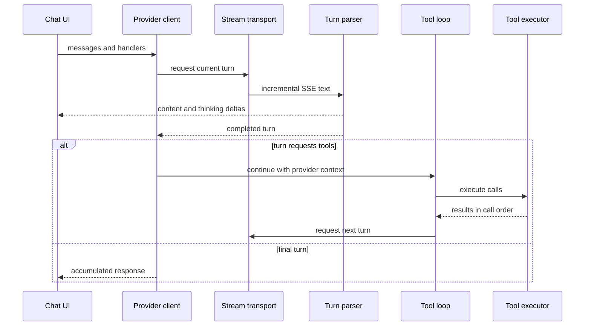

# Streaming y continuaciones de proveedores

`requestProviderToolChat` es la entrada del chat con herramientas en `apps/mobile`. Compone el prompt de sistema, elige la implementación de transporte según proveedor y plataforma, reenvía deltas a la UI y entrega cada turno ya ensamblado a un bucle de herramientas. El transporte no decide continuaciones: `providerToolLoop.ts` conserva el contexto específico de cada API, ejecuta los efectos permitidos y solicita el siguiente turno.



*Flujo de una solicitud: el parser termina un turno antes de que el bucle pueda ejecutar sus herramientas.*

## Fronteras SSE y resultado de un turno

`splitSSEEvents` tolera CRLF, emite solo eventos acabados por una línea vacía y deja el sufijo incompleto en el buffer. `parseSSEEvent` ignora comentarios, toma `message` como evento por defecto y une las líneas `data:`. Así Fetch y XHR pueden entregar cortes arbitrarios sin conocer fronteras de JSON ni de SSE.

Se crea un parser por turno. Los de OpenAI y Anthropic acumulan bloques por índice, publican deltas de contenido y razonamiento y marcan `truncated` cuando falta el evento terminal (`response.completed` o `message_stop`). OpenAI conserva `responseId`, elementos de salida y fragmentos de argumentos; Anthropic reúne bloques `text`, `thinking` (incluida su firma) y `tool_use`, y convierte el JSON parcial de la herramienta al cerrarse el bloque. `requestProviderToolChat` mantiene acumuladores externos a las rondas, por lo que los callbacks y el resultado final incluyen deltas de todos los turnos, no solo del último.

Google Interactions aplica un contrato más estricto: exige `interaction.created`, índices consecutivos de pasos, el ciclo `step.start`/`step.delta`/`step.stop`, pasos cerrados y un cierre `completed` o `requires_action` consistente con las llamadas observadas. Repetir el mismo `step.start` o `step.stop` no borra el contenido reunido; una colisión de paso, firma, llamada o identidad, un argumento no-objeto o un evento fuera de orden causa `GoogleStreamError`. El parser no permite aceptar un stream parcial como turno válido.

## Transporte, timeout y fallos

| Proveedor | Web | Nativo | Semántica relevante |
|---|---|---|---|
| OpenAI | Fetch con `TextDecoder` incremental | XHR con progreso | Timeout de 120 s; el bucle rechaza un turno truncado antes de ejecutar herramientas. |
| Anthropic | XHR con progreso | XHR con progreso | Timeout de 120 s; la ausencia de `message_stop` deja el turno truncado. |
| Google | Fetch con `TextDecoder` incremental | XHR con progreso | Timeout de 120 s; si falla la ruta incremental nativa antes de un delta visible, reintenta una vez con XHR bufferizado. |

En XHR, cada progreso entrega al parser únicamente el sufijo posterior a `lastOffset`; Fetch decodifica bytes en modo streaming. HTTP no exitoso, error de red, timeout y error de parseo rechazan la petición. El fallback de Google queda prohibido después de publicar contenido o razonamiento, para no duplicar texto visible.

## Continuación por proveedor y ejecución de herramientas

OpenAI añade al contexto los `outputItems` del turno y un `function_call_output` por `call_id`. Rechaza IDs de llamada repetidos; si los argumentos no son un objeto JSON, no invoca al ejecutor y devuelve al modelo un resultado de entrada inválida. Anthropic añade los bloques completos del asistente y un mensaje de usuario con `tool_result` correlacionado por `tool_use_id`; conservar los bloques completos preserva pensamiento y datos de protocolo, no solo texto visible. Google añade un `function_result` con el mismo `call_id` y conserva los pasos recibidos para la siguiente interacción.

Las llamadas de una ronda se preparan y se devuelven al proveedor en orden. Su ejecución no es necesariamente secuencial: `executeToolBatch` solapa hasta cuatro lecturas consecutivas, pero trata escrituras y herramientas desconocidas como barreras secuenciales. Un fallo fatal deja de iniciar nuevas lecturas y espera las ya iniciadas. Cada llamada recibe un sobre con proveedor, ID remoto y ocurrencia; `executeToolSafely` no expone excepciones crudas y marca un fallo de escritura como indeterminado para impedir un reintento ciego.

Los tres bucles usan `MAX_TOOL_ROUNDS = 10`. Al alcanzar el tope con llamadas pendientes, no las ejecutan: agregan resultados sintéticos y solicitan un único turno de cierre con las herramientas prohibidas. Si la llamada de cierre falla, llega truncada o vuelve a pedir una herramienta, el resultado es `ToolRoundLimitError`, no una respuesta intermedia presentada como final.

## Google Interactions: historial y presupuesto

`buildGoogleInteractionRequest` envía el historial local como `input` con `stream: true` y `store: false`; no depende de `previous_interaction_id`. En el bucle, un ID de interacción no vacío puede detectar un replay solo si representa exactamente los mismos pasos; como `store: false` puede producir `""`, ese valor no identifica replays. También se rechazan IDs de herramienta reutilizados entre rondas.

`GoogleConversationTurn` persiste los pasos e interacciones del turno. Al restaurar el historial, los turnos Google validados aportan sus pasos técnicos y un mensaje sin ese metadato se convierte en texto. La validación rechaza llamadas pendientes, firmas de pensamiento ausentes y resultados mal correlacionados, por lo que la hidratación no ejecuta herramientas.

Antes de red, `prepareGoogleInteractionRequest` selecciona los últimos intercambios sin partir un intercambio —este comienza en `user_input`— y mide tanto JSON sin datos de imagen como el cuerpo completo. Sus límites predeterminados son 10 intercambios, 512 KiB sin imágenes y 19 000 000 bytes totales; el cliente de Coach sustituye solo el máximo de intercambios por `COACH_CONTEXT_MESSAGE_LIMIT` (20). El preparador primero elimina imágenes inline de intercambios anteriores, conservando texto o un marcador si la entrada era solo imagen, y luego descarta intercambios completos desde el más antiguo. Si aun el intercambio activo excede un límite, lanza `GoogleContextBudgetError`; el historial local no se muta. Puede informar un `GoogleContextReport` mediante `onGoogleContextReport`, pero el callback de diagnóstico no bloquea ni oculta el error de presupuesto.

## Operación y pruebas

Para la evidencia de comportamiento en ejecución y su interpretación operativa, véase [Comportamiento de runtime](../operations/runtime-behavior.md). Esta página describe contratos de código, no contenido de runs.

- **Observado.** El código configura las rutas de transporte anteriores, sus timeouts y las protecciones contra truncamiento; las pruebas reproducen fixtures SSE de los tres proveedores, con fragmentos repetidos y particiones arbitrarias. Cubren parser → herramienta → continuación, correlación de varias llamadas, argumentos inválidos, errores del proveedor y truncamiento de OpenAI y Anthropic.
- **Correlacionado.** El `GoogleContextReport` contiene contadores de selección, bytes, imágenes eliminadas y motivos. Es coherente con instrumentar el presupuesto, pero su callback opcional no demuestra que exista telemetría desplegada ni que se haya recibido tráfico real.
- **Hipótesis.** Si se añade observabilidad, debería registrar estados y contadores allowlistados —proveedor, transporte, timeout, truncamiento, rondas y reporte de presupuesto— sin mensajes, argumentos, firmas ni resultados de herramientas. Requiere revisión independiente de privacidad y destino de observabilidad.

Al cambiar un dialecto, actualice parser, contrato de continuación y transportes correspondientes. Mantenga IDs de llamadas, firmas y bloques de razonamiento al persistir o continuar. Añada una fixture que corte tanto eventos como JSON en fronteras distintas, además del stream completo.

```bash
npm exec -- vitest run --config apps/mobile/vitest.config.mts apps/mobile/agent/sse.test.ts apps/mobile/agent/providerPipeline.test.ts apps/mobile/agent/providerToolClient.roundLimit.test.ts apps/mobile/agent/googleInteractions.test.ts
```
