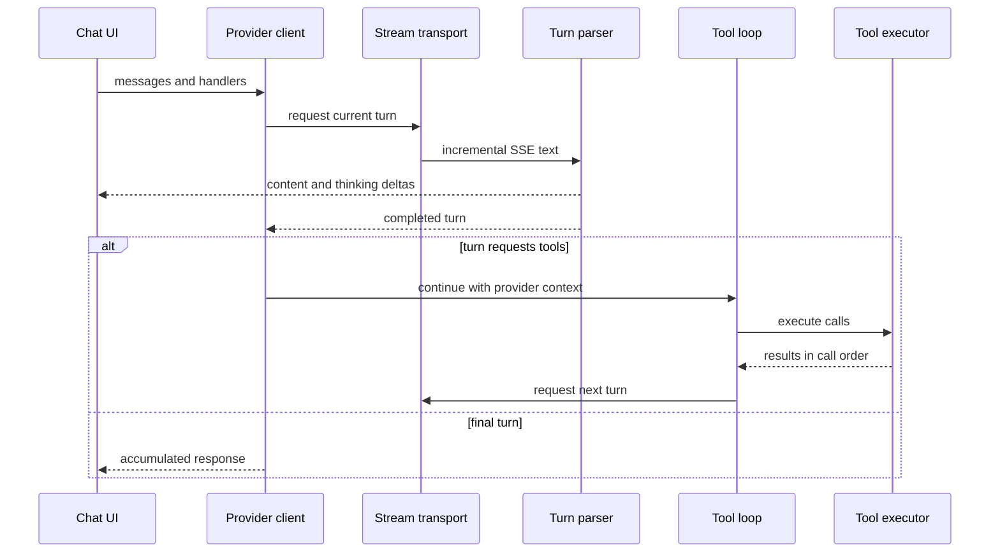

# Streaming y continuaciones de proveedores

`requestProviderToolChat` es la entrada del chat con herramientas en `apps/mobile`. Compone el prompt de sistema, selecciona el transporte según proveedor y plataforma, reenvía deltas a la UI y entrega cada turno ensamblado al bucle de herramientas correspondiente. El transporte solo obtiene y parsea un turno; `providerToolLoop.ts` conserva el contexto específico de la API, ejecuta los efectos permitidos y solicita la continuación.



*Flujo de una solicitud: el parser debe completar y validar un turno antes de que el bucle pueda ejecutar sus herramientas.*

## Fronteras SSE y resultado de un turno

`splitSSEEvents` tolera CRLF, emite únicamente eventos terminados por una línea vacía y conserva el sufijo incompleto en el buffer. `parseSSEEvent` ignora comentarios, usa `message` como evento por defecto y une las líneas `data:`. Por ello Fetch y XHR pueden entregar cortes arbitrarios sin conocer fronteras de JSON ni de SSE.

Se instancia un parser por turno. Los de OpenAI y Anthropic acumulan bloques por índice, publican deltas de contenido y razonamiento y marcan `truncated` si falta el evento terminal (`response.completed` o `message_stop`). OpenAI conserva `responseId`, elementos de salida y fragmentos de argumentos; Anthropic reúne bloques `text`, `thinking` —incluida la firma— y `tool_use`, y convierte el JSON parcial de la herramienta al cerrarse el bloque. `requestProviderToolChat` mantiene acumuladores fuera de las rondas, de modo que los callbacks y el resultado final incluyen los deltas de todos los turnos, no únicamente el último.

Google Interactions tiene un contrato deliberadamente más estricto. El parser exige `interaction.created`, índices consecutivos y el ciclo `step.start`/`step.delta`/`step.stop`; también exige que todos los pasos estén cerrados, que haya al menos un paso y que el cierre `completed` o `requires_action` concuerde con las llamadas observadas. Repetir el mismo `step.start` o `step.stop` no borra el contenido acumulado; una colisión de paso, firma, llamada o identidad, argumentos que no sean un objeto, o un evento fuera de orden produce `GoogleStreamError`. Un `finish()` con datos SSE pendientes, sin terminal o tras un fallo también falla: un stream parcial nunca se entrega al bucle como turno válido.

El modo `store: false` de Google puede omitir `id` y metadatos de ciclo de vida en vez de enviar una identidad remota. El parser representa el ID omitido como `""` —`null` queda reservado para un stream que aún no abrió— y acepta la omisión consistente de esos campos, pero no relaja las comprobaciones de apertura única, secuencia, terminal, pasos cerrados, herramientas ni uso. Así, dos rondas sin ID pueden continuar y restaurarse localmente, mientras que una creación repetida o una identidad explícita contradictoria siguen siendo errores.

## Transporte, timeout y fallos

| Proveedor | Web | Nativo | Semántica relevante |
|---|---|---|---|
| OpenAI | Fetch con `TextDecoder` incremental | XHR con progreso | Timeout de 120 s; el bucle rechaza un turno truncado antes de ejecutar herramientas. |
| Anthropic | XHR con progreso | XHR con progreso | Timeout de 120 s; la ausencia de `message_stop` deja el turno truncado. |
| Google | Fetch con `TextDecoder` incremental | XHR con progreso | Timeout de 120 s; ante el error de conexión de la ruta incremental nativa y antes de un delta visible, reintenta una vez con XHR bufferizado. |

En XHR, cada progreso entrega al parser solo el sufijo posterior a `lastOffset`; Fetch decodifica bytes en modo streaming. HTTP no exitoso, error de red, timeout y error de parseo rechazan la petición. Para Google, Fetch, XHR incremental y XHR bufferizado alimentan `createGoogleStreamParser`; el fallback no se activa ante un error de parser o timeout, ni después de publicar contenido o razonamiento, lo que evita duplicar texto visible.

## Continuación por proveedor y ejecución de herramientas

OpenAI añade al contexto los `outputItems` del turno y un `function_call_output` por `call_id`. Rechaza IDs de llamada repetidos; si los argumentos no son un objeto JSON, no invoca al ejecutor y devuelve al modelo un resultado de entrada inválida. Anthropic añade los bloques completos del asistente y un mensaje de usuario con `tool_result` correlacionado por `tool_use_id`; conservar los bloques completos preserva pensamiento y datos de protocolo, no solo el texto visible. Google añade un `function_result` con el mismo `call_id` y conserva los pasos recibidos para la siguiente interacción.

Las llamadas de una ronda se preparan y se devuelven al proveedor en orden. Su ejecución no es necesariamente secuencial: `executeToolBatch` puede solapar lecturas consecutivas, pero trata escrituras y herramientas desconocidas como barreras secuenciales. Un fallo fatal deja de iniciar nuevas lecturas y espera las ya iniciadas. Cada llamada recibe un sobre con proveedor, ID remoto y ocurrencia; `executeToolSafely` no expone excepciones crudas y marca un fallo de escritura como indeterminado para impedir un reintento ciego.

Los tres bucles usan `MAX_TOOL_ROUNDS = 10`. Al alcanzar el tope con llamadas pendientes, no las ejecutan: agregan resultados sintéticos y solicitan un único turno de cierre con las herramientas prohibidas. Si la llamada de cierre falla, llega truncada o vuelve a pedir una herramienta, se lanza `ToolRoundLimitError`, no se presenta una respuesta intermedia como final.

## Google Interactions: historial y presupuesto

`buildGoogleInteractionRequest` envía el historial local como `input` con `stream: true` y `store: false`; no depende de `previous_interaction_id`. En el bucle, un ID de interacción no vacío detecta un replay únicamente si representa exactamente los mismos pasos. Como `store: false` puede producir `""`, ese valor no identifica replays entre rondas; aun así, los IDs de herramienta no pueden reutilizarse entre rondas distintas.

`GoogleConversationTurn` persiste los pasos e interacciones del turno. Al restaurar el historial, los turnos Google validados aportan sus pasos técnicos y un mensaje sin ese metadato se convierte en texto. La validación rechaza llamadas pendientes, firmas de pensamiento ausentes y resultados mal correlacionados, por lo que la hidratación no convierte trabajo pendiente en ejecución.

Antes de abrir red, `prepareGoogleInteractionRequest` selecciona los últimos intercambios completos —un intercambio comienza en `user_input`— y mide tanto el JSON sin datos de imagen como el cuerpo completo. Sus límites predeterminados son 10 intercambios, 512 KiB sin imágenes y 19 000 000 bytes totales; el cliente de Coach sustituye solamente el máximo de intercambios por `COACH_CONTEXT_MESSAGE_LIMIT` (20). El preparador elimina primero las imágenes inline de intercambios anteriores, conserva texto o un marcador si una entrada contenía solo imagen, y después descarta intercambios completos desde el más antiguo. Si incluso el intercambio activo excede un límite, lanza `GoogleContextBudgetError` sin mutar el historial local. Puede informar un `GoogleContextReport` mediante `onGoogleContextReport`; ese callback de diagnóstico no bloquea la petición ni oculta el error de presupuesto.

## Operación, extensión y pruebas

Para evidencia de comportamiento en ejecución y su interpretación operativa, véase [Comportamiento de runtime](../operations/runtime-behavior.md). Esta página documenta contratos de código, no contenido de runs.

Las pruebas de `googleInteractions.test.ts` cubren respuestas sin ID y también rondas sin los metadatos de ciclo de vida opcionales: continúan una llamada de herramienta, persisten pasos e interacciones con IDs vacíos y restauran el historial validado. En paralelo, prueban que truncamiento, pasos sin cerrar, estados incompatibles, argumentos inválidos y secuencias reordenadas se rechazan antes de que se ejecute una herramienta. Las pruebas de pipeline y SSE cubren fixtures de los tres proveedores, fragmentos repetidos y particiones arbitrarias.

Al añadir o cambiar un dialecto, actualice conjuntamente el parser, el contrato de continuación y los transportes que lo alimentan. Conserve IDs de llamadas, firmas y bloques de razonamiento al persistir o continuar. Añada una fixture completa y variantes que corten tanto eventos como JSON en fronteras distintas; para Google incluya explícitamente ID vacío y metadatos de ciclo de vida omitidos, y compruebe que una respuesta incompleta no alcanza el ejecutor.

```bash
npm exec -- vitest run --config apps/mobile/vitest.config.mts apps/mobile/agent/sse.test.ts apps/mobile/agent/providerPipeline.test.ts apps/mobile/agent/providerToolClient.roundLimit.test.ts apps/mobile/agent/googleInteractions.test.ts
```
