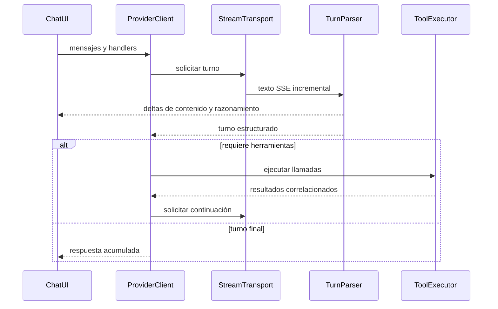

---
okf:
  version: 1
  kind: code-wiki
  status: grounded
  scope: provider stream transports, parsers, and continuation protocols
type: arquitectura de streaming
title: Transporte y streaming de proveedores
description: Describe el transporte SSE, los parsers, las continuaciones con herramientas y el presupuesto de contexto para OpenAI, Anthropic y Google en el chat móvil.
tags: [agent, streaming, sse, openai, anthropic, google]
related:
  - ./runtime.md
  - ./provider-configuration.md
  - ../operations/runtime-behavior.md
sources:
  - id: openwiki-source-c2d1a0c89805fc4fc01238e2
    resource: repo://apps/anthropic_proxy/cors-proxy.py
  - id: openwiki-source-dc42304b20e8518ef65b4b63
    resource: repo://apps/mobile/agent/googleContextBudget.ts
  - id: openwiki-source-63dae4a27346d91c6139697b
    resource: repo://apps/mobile/agent/googleInteractions.test.ts
  - id: openwiki-source-df22d5c1fa6f9ff9bb908437
    resource: repo://apps/mobile/agent/googleInteractions.ts
  - id: openwiki-source-f310c5fb576ae69a7753918c
    resource: repo://apps/mobile/agent/googleStreamTransport.ts
  - id: openwiki-source-c65a19b98fa314cba98ace44
    resource: repo://apps/mobile/agent/providerPipeline.test.ts
  - id: openwiki-source-6b9b666faa646a8fd83706ea
    resource: repo://apps/mobile/agent/providerStreamParsers.ts
  - id: openwiki-source-479fc45ac32d23cfffe17d8e
    resource: repo://apps/mobile/agent/providerStreamTransport.ts
  - id: openwiki-source-abc6fea468a7de09acfb0c4f
    resource: repo://apps/mobile/agent/providerToolClient.ts
  - id: openwiki-source-b14a4ecd65e83b5561f88e2a
    resource: repo://apps/mobile/agent/providerToolLoop.ts
  - id: openwiki-source-c5c28138a849ad0b9daed017
    resource: repo://apps/mobile/agent/providerTransport.test.ts
  - id: openwiki-source-cc29928f3ae5e1998f27d57a
    resource: repo://apps/mobile/agent/providerTransport.ts
  - id: openwiki-source-63f2fbe9450b42dc3369441f
    resource: repo://apps/mobile/agent/sse.test.ts
  - id: openwiki-source-42008b636d0a1be0e91188e0
    resource: repo://apps/mobile/agent/sse.ts
  - id: openwiki-source-1ad5b6a5e6488611c8796fe1
    resource: repo://apps/mobile/agent/toolBatch.ts
  - id: openwiki-source-929e8e1df23628a3f3848ff8
    resource: repo://apps/mobile/App.tsx
verified:
  - by: openwiki/0.6.0
    at: 2026-10-17T11:49:19.843Z
generated: { by: "openwiki/0.6.0", at: "2026-10-17T11:49:19.843Z" }
---

# Transporte y streaming de proveedores

`requestProviderToolChat` es la entrada del chat móvil con herramientas. Compone la instrucción de sistema, elige el adaptador del proveedor según plataforma, propaga deltas a la UI y entrega la ejecución de herramientas a `executeTool`. El transporte convierte una respuesta HTTP/SSE en un turno estructurado; `providerToolLoop.ts` conserva el contexto de protocolo y decide si hay otra ronda.



*Flujo de un turno y sus continuaciones; los deltas visibles y el contexto de continuación tienen propietarios distintos.*

## Encuadre y parsers por turno

`splitSSEEvents` normaliza CRLF, solo emite registros terminados por una línea vacía y retiene el sufijo incompleto. `parseSSEEvent` ignora comentarios, usa `message` como evento predeterminado y concatena las líneas `data:`. Así Fetch y XHR pueden entregar cualquier partición de bytes/texto sin que el adaptador conozca fronteras JSON o SSE.

Se crea un parser para cada petición. OpenAI reúne items de salida por índice, `responseId` y argumentos de `function_call`; Anthropic reúne bloques `text`, `thinking` —incluida su firma— y `tool_use`, y convierte el JSON parcial de una herramienta al cerrar el bloque. Ambos publican deltas de contenido y razonamiento. `requestProviderToolChat` mantiene acumuladores fuera de las rondas: el callback y el resultado final no se reducen al último turno.

Google Interactions aplica una máquina de validación más estricta. Exige `interaction.created`, índices consecutivos de pasos, el ciclo `step.start`/`step.delta`/`step.stop`, firmas en pensamientos cerrados y un cierre `completed` o `requires_action` consistente con las llamadas. Errores de JSON, identidad, orden, argumento o cierre se rechazan antes de que el bucle ejecute herramientas. Repetir exactamente la apertura o el cierre de un paso no borra contenido ni argumentos ya acumulados.

## Transporte, latencia y fallos visibles

| Proveedor | Web | Nativo | Comportamiento de fallo |
|---|---|---|---|
| OpenAI | Fetch y `TextDecoder` incremental | `XMLHttpRequest` con progreso | Timeout de 120 s, HTTP/no red/error de parser rechazan la petición; un turno truncado se rechaza antes de ejecutar tools. |
| Anthropic | `XMLHttpRequest` con progreso | `XMLHttpRequest` con progreso | Timeout de 120 s; incluso HTTP 2xx se rechaza si falta `message_stop`. |
| Google | Fetch y `TextDecoder` incremental | `XMLHttpRequest` con progreso | Timeout de 120 s; solo repite una vez con XHR bufferizado si el XHR incremental falla por conexión antes de un delta visible. |

En XHR se pasa al parser únicamente el sufijo nuevo de `responseText`, desde `lastOffset`; Fetch decodifica de forma incremental y hace lo mismo. El fallback de Google reutiliza el mismo parser pero queda prohibido después de emitir contenido o razonamiento, evitando duplicar texto en pantalla. Los mensajes de HTTP, timeout y red son errores de la solicitud, no contenido final.

## Continuaciones con herramientas

OpenAI conserva los `outputItems` del turno y requiere un `responseId`/`call_id` válido para correlacionar `function_call_output`. Anthropic añade el bloque completo del asistente y un mensaje de usuario con `tool_result` asociado a `tool_use_id`. Google conserva `GoogleStep` tal como llega —incluidas firmas opacas— y agrega `function_result` con el mismo `call_id`. No debe sustituirse ese contexto por el texto mostrado: perdería información necesaria para el siguiente turno.

Los tres bucles permiten hasta `MAX_TOOL_ROUNDS = 10`. Al llegar al límite, no ejecutan las llamadas pendientes: incorporan `ROUND_LIMIT_TOOL_RESULT` y hacen un único turno de cierre con `tool_choice: "none"`. Si el cierre falla, llega truncado, sigue pidiendo herramientas o no produce una respuesta final válida, exponen `ToolRoundLimitError` en vez de presentar una respuesta intermedia como definitiva.

Las identidades de las llamadas se asignan en orden del proveedor antes de ejecutar. La ejecución conserva ese orden en los resultados, pero no es necesariamente secuencial: `executeToolBatch` puede solapar hasta cuatro lecturas consecutivas; escrituras y herramientas de efecto desconocido actúan como barreras. Una excepción de una escritura no se convierte en reintento ciego; una lectura fallida se transforma en un resultado seguro para el modelo.

## Google Interactions: historial y presupuesto

`buildGoogleInteractionRequest` envía `stream: true`, `store: false` y el historial local en `input`, sin depender de `previous_interaction_id`. Un `GoogleConversationTurn` persistible guarda pasos e interacciones del turno completo. Al restaurarlo, se validan firmas, correlaciones y la ausencia de llamadas pendientes; la hidratación no ejecuta herramientas. Con `store: false`, un ID vacío no identifica un replay, por lo que el bucle solo deduplica IDs de interacción no vacíos y rechaza identidades contradictorias o IDs de herramienta repetidos.

Antes de abrir red, `prepareGoogleInteractionRequest` trabaja sobre una copia: conserva los intercambios más recientes, elimina primero imágenes inline de intercambios anteriores y después descarta intercambios completos sin dividirlos. El presupuesto predeterminado es 10 intercambios, 512 KiB sin imágenes y 19 000 000 bytes de cuerpo. El chat principal sustituye solo el límite de intercambios por `COACH_CONTEXT_MESSAGE_LIMIT` (20); conserva los límites de bytes. Si el único intercambio imprescindible aún no cabe, se lanza `GoogleContextBudgetError` con un informe y el historial local no se muta. `onContextReport` es diagnóstico opcional: sus propios fallos no bloquean ni ocultan el error de presupuesto.

## Acceso web de Anthropic

En web, Anthropic se llama directamente por defecto y añade `anthropic-dangerous-direct-browser-access`. El proxy se usa solo con `EXPO_PUBLIC_API_BASE_URL`; es un adaptador de desarrollo local con restricción loopback, no backend de producción. La configuración de razonamiento usa `enabled` con presupuesto para Claude 3 y 4.5, y `adaptive` con `display: "summarized"` para modelos posteriores o desconocidos.

## Runtime y operación

Esta página documenta el comportamiento implementado. Para el comportamiento operativo, señales de runtime y límites de observabilidad, véase [Comportamiento de runtime](../operations/runtime-behavior.md); esa página debe enlazar aquí como detalle de transporte y streaming.

- **Observado.** El código implementa adaptadores SSE, detección de truncamiento, validación de Google, presupuesto local y fallback nativo de Google. Las pruebas con fixtures son evidencia determinista del repositorio, no tráfico de producción.
- **Correlacionado.** El informe de presupuesto permite a un llamador exponer diagnóstico de reducción/rechazo, y los errores descritos son los que el cliente puede devolver a la interfaz. Eso no demuestra que exista telemetría desplegada ni que se haya observado una latencia concreta en producción.
- **Hipótesis.** Si se instrumenta este camino, conviene registrar solo proveedor, tipo de transporte, timeout, truncamiento, número de rondas y contadores del informe de presupuesto; mensajes, argumentos, firmas y resultados de tools no deberían entrar en telemetría sin revisión de privacidad.

## Pruebas focalizadas y cambios seguros

`providerPipeline.test.ts` fragmenta fixtures SSE de los tres proveedores —incluidas particiones arbitrarias y repetidas— y cubre continuaciones, correlación, argumentos inválidos, errores y truncamiento Anthropic. Las pruebas de Google cubren la máquina de estados, replays, restauración, presupuesto y paridad Fetch/XHR; `providerToolClient.roundLimit.test.ts` cubre el turno de cierre y `sse.test.ts` protege el encuadre.

Al cambiar un dialecto, actualice conjuntamente parser, contrato de continuación y transportes aplicables. Añada fixtures que corten tanto eventos SSE como JSON. No descarte IDs de llamada, firmas ni bloques de razonamiento al persistir o continuar: son datos de protocolo.

```bash
npm exec -- vitest run --config apps/mobile/vitest.config.mts apps/mobile/agent/sse.test.ts apps/mobile/agent/providerPipeline.test.ts apps/mobile/agent/providerToolClient.roundLimit.test.ts apps/mobile/agent/googleInteractions.test.ts
```
