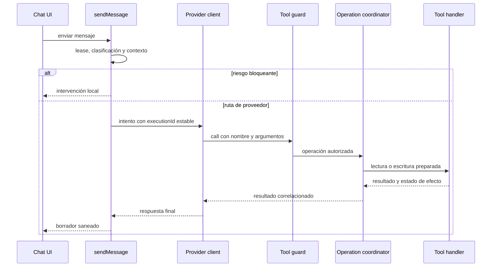
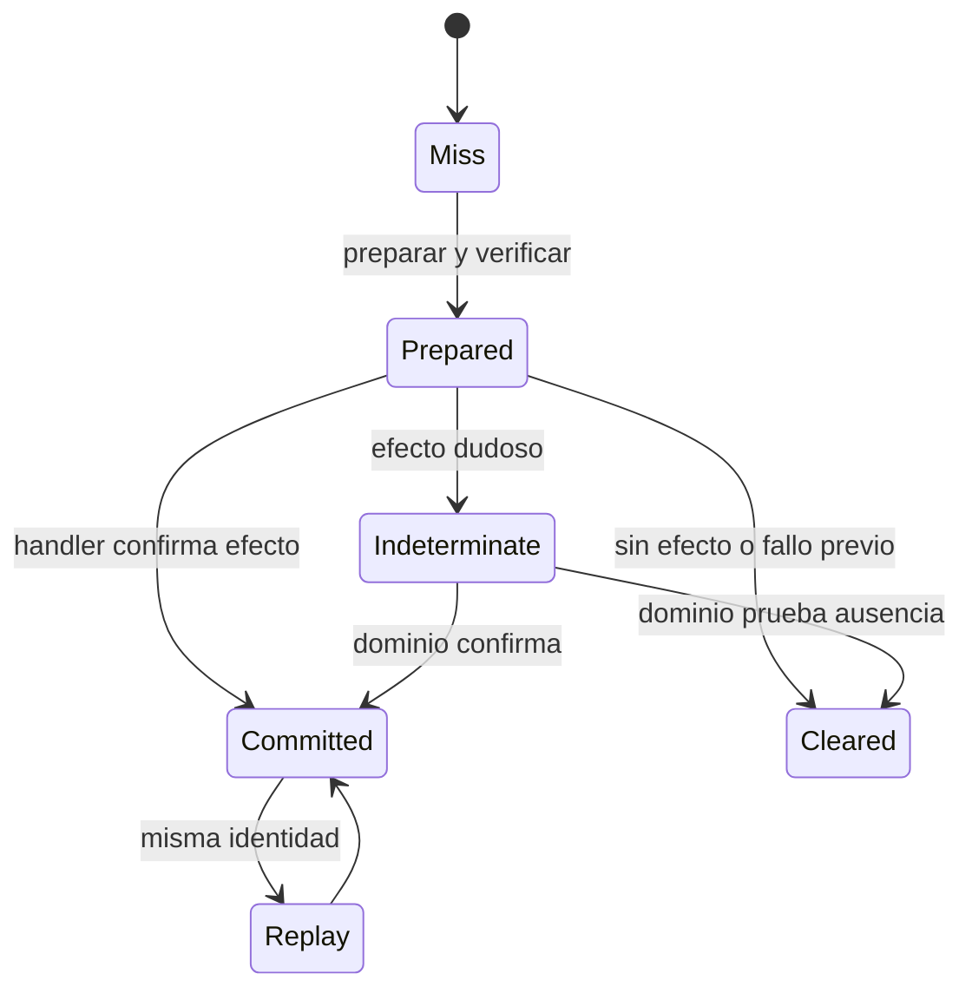

# Runtime del agente y herramientas

El runtime de Coach vive en `apps/mobile`: `sendMessage` prepara un turno, `requestProviderToolChat` adapta el protocolo de cada proveedor y el coordinador de operaciones protege las escrituras. Esta página documenta los contratos que deben conservarse al cambiar ese recorrido. La lectura operacional de señales agregadas, sin copiar prompts, argumentos ni resultados, está en [Comportamiento en ejecución y oportunidades](../operations/runtime-behavior.md); esa página debe remitir aquí cuando una observación requiera interpretar rondas, reintentos o estados de commit.

## Observado

- El turno adquiere un solo `AgentPolicyLease` antes de clasificar la entrada. El lease congela prompt, política sanitaria, contexto y estado para que un borrador, una respuesta local y las continuaciones no mezclen versiones de política.
- La ruta normal excluye divulgaciones locales y selecciona la misma ventana de 20 mensajes para todos los proveedores. La memoria personal no se inyecta en el prompt: se consulta exclusivamente mediante tools.
- Un riesgo bloqueante evita la llamada al proveedor. Un riesgo `elevated` puede ser reevaluado por el proveedor solo con consentimiento; la reevaluación tiene timeout de diez segundos y conserva la decisión base si falla.
- Las mutaciones pasan por clasificación de efecto, validación de argumentos, journal persistente y, cuando existe, reconciliación de dominio. El runtime prefiere una incertidumbre explícita a repetir una acción cuyo efecto no puede demostrarse.

## Correlacionado: turno, proveedor y tools



*El turno conserva el contexto de política y la identidad de ejecución mientras las tools atraviesan autorización y coordinación de efectos.*

### Entrada, streaming y reintentos

`sendMessage` valida proveedor y credencial, crea el mensaje de usuario y adquiere el lease. Si no hay bloqueo, persiste un borrador `is_streaming`; `createStreamDraftFlusher` agrupa sus repintados cada 40 ms. El contenido acumulado atraviesa el gate sanitario al llegar y al finalizar; la respuesta final puede sustituirse por una intervención local.

La llamada principal admite tres intentos. Solo repite errores cuya firma indica red, timeout, sobrecarga o 429/503/529, con esperas de 2 y 4 segundos; una respuesta vacía consume el intento siguiente sin espera. Cada reintento reinicia contenido, razonamiento y gate del borrador. El `executionId` es el ID del mensaje de usuario y se conserva entre intentos. Al agotarse o aparecer un error no reintentable, el borrador termina como `technical_error`. No se debe interpretar ese error como rollback de tools ya ejecutadas.

La ventana de Coach se selecciona antes de adaptar al proveedor. Para Google, la ruta eleva `maxExchanges` de su presupuesto genérico a 20 para no acortar esa selección; después aplica límites de 512 KiB sin imágenes y 19 000 000 bytes totales. Recorta imágenes antiguas e intercambios completos y rechaza antes de red si el intercambio activo no cabe. Véanse también [Configuración de proveedores](./provider-configuration.md) y [Streaming de proveedores](./provider-streaming.md).

### Autorización y validación mínima

`AGENT_TOOL_DEFINITIONS` es el catálogo de nombre, descripción, esquema y efecto (`read`, `local_write` o `external_write`), del que derivan los formatos de `CHAT_TOOLS` para OpenAI, Anthropic y Google. `executeGuardedTool` vuelve a clasificar tanto la entrada original como `nombre + argumentos` serializados y rechaza nombres desconocidos o efectos incompatibles.

| Riesgo efectivo | Efectos permitidos |
|---|---|
| `none` | `read`, `local_write`, `external_write` |
| `elevated` | Solo `read` |
| `high` o `critical` | Ninguno; la entrada ya evitó la ruta principal del proveedor |

El guard no sustituye la validación del dominio. El handler valida su input contra el esquema y después comprueba referencias, fecha, catálogo o almacenamiento antes de mutar. Los fallos se convierten en resultados controlados: no se exponen excepciones crudas al modelo. La sanitización de datos personales es una frontera de forma, no una autorización; conserva las claves literales porque las lecturas las comparan por igualdad exacta.

### Rondas y lotes

Cada proveedor mantiene un loop de hasta diez rondas de tools. Las ocurrencias se asignan en orden del proveedor a partir de `nombre + argumentos` canónicos antes de iniciar trabajo. Una call con argumentos OpenAI que no sea un objeto JSON válido recibe un error de input y no llega al ejecutor.

Una ronda **no es necesariamente secuencial**: `executeToolBatch` ejecuta en paralelo solo un tramo consecutivo de lecturas conocidas, con máximo cuatro. Una escritura o nombre desconocido es una barrera y se espera antes de continuar. Si falla una lectura fatal, no empiezan lecturas nuevas, pero el lote espera las ya iniciadas; por tanto el turno no termina con trabajo previo en vuelo. Los resultados se vuelven a colocar en el orden de las calls, no en el orden de terminación.

Al alcanzar el límite, las calls pendientes no se ejecutan: reciben `ROUND_LIMIT_TOOL_RESULT` y se solicita un cierre con tools prohibidas. Si esa llamada falla, se trunca o vuelve a pedir tools, se produce `ToolRoundLimitError`. OpenAI y Google además rechazan IDs de call repetidos en una ronda o entre rondas; Google puede reutilizar los resultados de una interacción no vacía idéntica, sin crear ocurrencias ni efectos nuevos.

## Idempotencia, commit y recuperación

`identifyToolOperation` calcula el `operationId` SHA-256 sobre versión, `executionId`, proveedor, nombre, argumentos JSON canónicos y `occurrence`. `providerCallId` solo sirve para el protocolo de continuación y no pertenece a la identidad durable. La misma identidad puede unirse a `inFlight` o reproducir un commit desde memoria o ledger sin volver a invocar el handler; las lecturas, en cambio, siempre invocan el ejecutor. Dentro de una continuación, una call idéntica aumenta `occurrence` y es una operación diferente.



*El ledger evita reejecutar escrituras dudosas; reconciliar puede confirmar o descartar, pero no hace rollback.*

Para una escritura nueva, el coordinador consulta primero memoria, trabajo en vuelo y ledger; reconcilia el dominio y persiste/relee `prepared` antes del handler. El handler debe llamar a `markEffectCommitted` inmediatamente después de su persistencia irreversible. Puede marcar `indeterminate`; una excepción posterior a `markEffectCommitted` sigue clasificándose como `committed`, mientras que `no_effect` y `failed_before_commit` permiten descartar `prepared`.

Si no se puede registrar el commit final, el coordinador consulta el recibo o estado de dominio. Si no puede confirmarlo, conserva/devuelve `indeterminate` y no repite automáticamente el efecto. Esto no proporciona transacción atómica ni rollback del almacenamiento subyacente. En la hidratación, `reconcileUnresolved` recorre las entradas pendientes: confirma las reconocidas, descarta solo ausencia demostrada y mantiene las ambiguas sin invocar otra vez el handler.

El ledger persistente usa `prepared`, `committed` e `indeterminate`, verifica las escrituras por relectura y falla cerrado si la lectura es corrupta o no está disponible. Tiene capacidad 256: los commits caducan a los siete días y pueden expulsarse; las entradas no resueltas no caducan ni se expulsan para hacer sitio. Una colisión no ejecuta el efecto y `clear()` incrementa una generación para que una operación que termine después no repueble el ledger ni la caché.

Los recibos de dominio locales contienen `operationId`, `toolName` y `committedAt`, se deduplican y se retienen hasta 256 entradas durante siete días. La ausencia demuestra que no hubo efecto solo mientras, desde `preparedAt`, ese recibo no pudo caducar ni ser expulsado. Este contrato afecta directamente a [Mediciones](../mobile/measurements.md) y a [Dieta y estimación de alimentos](../mobile/diet-and-food-estimation.md), cuyas mutaciones locales añaden recibos junto con sus datos.

## Hipótesis para operación y cambios

1. Una aparente repetición remota debe separarse en reintento de turno, continuación de tools y replay local; correlacionar por `executionId`, proveedor, nombre, argumentos canónicos y ocurrencia, nunca por `providerCallId`.
2. Para explicar latencia, distinguir proveedor, intento, ronda, lote de lecturas, barrera de escritura y cierre. No inferir que un lote observadamente paralelo contiene escrituras paralelas.
3. Ante un error después de una mutación, inspeccionar journal y recibo de dominio: `indeterminate` significa «no repetir automáticamente», no «se revirtió».
4. Al añadir una tool, registrar esquema, efecto, handler y reconciliador/recibo. Sin prueba de ausencia o commit, el comportamiento seguro será conservadoramente indeterminado.

## Pruebas focalizadas

Desde la raíz:

```bash
npm exec -- vitest run --config apps/mobile/vitest.config.mts apps/mobile/agent/providerPipeline.test.ts apps/mobile/agent/providerToolClient.roundLimit.test.ts apps/mobile/agent/providerToolLoop.test.ts apps/mobile/agent/toolDefinitions.test.ts apps/mobile/agent/toolExecutor.test.ts apps/mobile/agent/toolOperationLedger.test.ts apps/mobile/agent/toolOperationReceipts.test.ts
```

- `providerPipeline.test.ts` y `providerToolLoop.test.ts` cubren protocolos, orden de resultados, concurrencia limitada de lecturas y barreras de escritura.
- `providerToolClient.roundLimit.test.ts` protege truncamiento, resultado sintético y cierre sin tools.
- `toolDefinitions.test.ts` y `toolExecutor.test.ts` fijan catálogo, validación, despacho y punto de commit.
- `toolOperationLedger.test.ts` y `toolOperationReceipts.test.ts` cubren identidad, replay, unión concurrente, incertidumbre, capacidad, retención y recuperación.

Estas pruebas son contratos locales, no métricas de producción. Para la interpretación de señales agregadas y sus límites, volver a [Comportamiento en ejecución y oportunidades](../operations/runtime-behavior.md).
