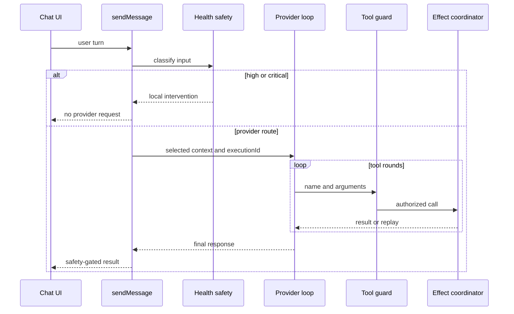
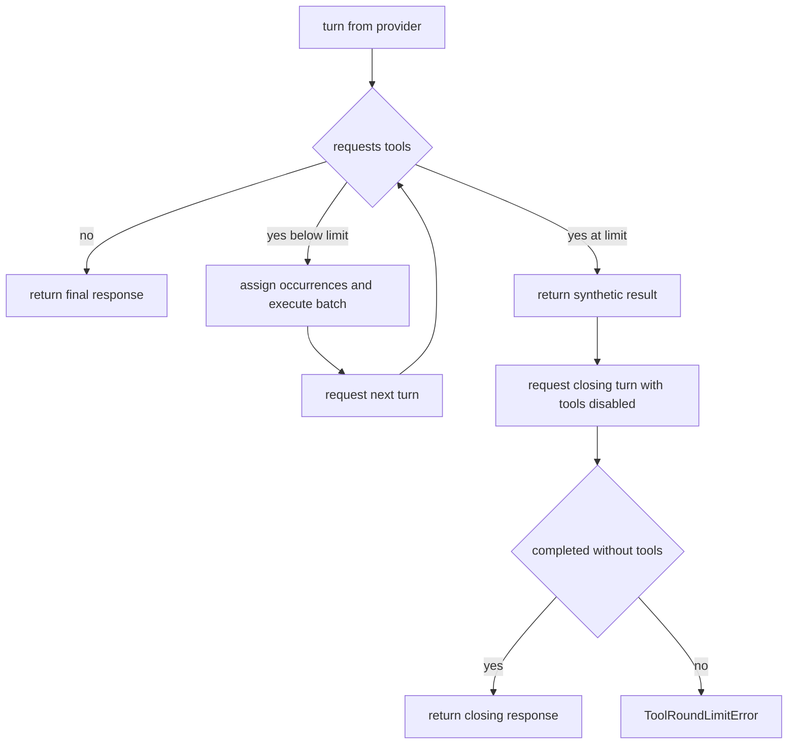

# Runtime del agente Coach y observabilidad

Coach es un turno local-first: `sendMessage` selecciona política y contexto, llama al proveedor, hace continuaciones para tools y finalmente persiste o sustituye el borrador. Esta página documenta los contratos que hay que conservar al modificar ese loop. Para configuración y transporte, véanse [Configuración de proveedores](provider-configuration.md) y [Streaming de proveedores](provider-streaming.md). Para el diagnóstico general del dispositivo, privacidad del exportador de trazas y degradación fuera del loop, véase [Comportamiento operativo, trazas y degradación](../operations/runtime-behavior.md).

## Turno de Coach: fronteras que no se deben mover

`sendMessage` adquiere un solo `AgentPolicyLease` profundamente congelado antes de clasificar la entrada y mantiene su `PolicyContext` en el borrador y en respuestas locales. La entrada `high` o `critical` evita por completo la ruta del proveedor; en `elevated` solo se puede consultar al evaluador remoto con consentimiento para ese proveedor. Ese evaluador tiene un timeout de diez segundos y cualquier fallo conserva la decisión determinista base. La decisión también se aplica a la salida en streaming.

Antes de pedir al proveedor, la ruta elimina divulgaciones locales y retiene los últimos 20 mensajes para todos los proveedores. Google recibe esa misma selección y cambia su presupuesto de intercambios de 10 a 20; sus límites de bytes siguen pudiendo recortar historia antigua o rechazar la petición antes de red. La memoria personal no se añade al prompt: se expone únicamente por tools.



*Un lease y un `executionId` abarcan el turno; el proveedor no se contacta cuando el riesgo bloquea la entrada.*

La UI crea un borrador `is_streaming` antes de la llamada. `createStreamDraftFlusher` limita sus repintados a una ventana de 40 ms; al reintentar se vacían contenido, razonamiento y gate, pero no cambia el `executionId` (`userMessage.id`). Hay hasta tres intentos: solo errores reconocibles de red, timeout, sobrecarga o 429/503/529 esperan 2 y luego 4 segundos; una respuesta vacía consume el siguiente intento sin espera. Un error terminal convierte el borrador en `technical_error`. Un cambio aquí no debe suponer que deshacer la UI deshace un efecto de tool ya comprometido.

## Rondas, orden y repetición de tools

Los loops de OpenAI, Anthropic, Google y OpenAI compatible asignan `occurrence` por nombre y argumentos JSON canónicos **antes** de iniciar ejecución. El historial que reenvían incluye los resultados anteriores en orden. OpenAI y Google además detectan IDs nativos repetidos; esos IDs sirven al protocolo, pero no son la identidad durable de una escritura.



*Diez rondas pueden ejecutar tools; las calls pendientes de la siguiente no se ejecutan y habilitan una única llamada de cierre.*

El límite es `MAX_TOOL_ROUNDS = 10`. Al agotarlo, la call pendiente recibe `ROUND_LIMIT_TOOL_RESULT` y se solicita un cierre con tools prohibidas. Un cierre que falle, quede truncado o vuelva a pedir tools produce `ToolRoundLimitError`; no se debe reutilizar texto intermedio de rondas como respuesta final.

Una lectura conocida con la misma huella se ejecuta como máximo dos veces por loop. Desde la ocurrencia 2 retorna el error recuperable `repeated_tool_call` sin invocar el ejecutor. El corte no se aplica a escrituras: su seguridad procede del ledger. `executeToolBatch` conserva el orden de resultados, permite hasta cuatro lecturas conocidas contiguas en paralelo y trata escrituras y nombres desconocidos como barreras secuenciales. Ante un fallo fatal deja de iniciar lecturas, espera las activas y propaga el primer error según el orden del proveedor.

## Autorización y efectos: no reintentar una mutación a ciegas

`AGENT_TOOL_DEFINITIONS` es la fuente de nombre, esquema y efecto (`read`, `local_write` o `external_write`) que deriva los catálogos para los tres protocolos. `executeGuardedTool` vuelve a clasificar `nombre + argumentos` además de la entrada inicial: una tool desconocida o incompatible devuelve un resultado controlado antes del handler. Con riesgo `elevated` se permiten solo lecturas no restringidas; con `high` o `critical`, ninguna.

La identidad de una escritura combina versión, `executionId`, proveedor, nombre, argumentos canónicos y `occurrence`; excluye `providerCallId`. Por tanto, un reintento remoto equivalente puede unirse a `inFlight` o reproducir un commit, mientras dos calls iguales intencionales dentro de una continuación reciben ocurrencias distintas. Para una escritura nueva el coordinador persiste y relee `prepared` antes del handler. El handler debe marcar el commit inmediatamente después del efecto irreversible. Si no se puede demostrar el estado, el resultado queda `indeterminate` y no autoriza repetir la mutación.

El ledger persistente conserva `prepared`, `committed` e `indeterminate`, verifica cada escritura y falla cerrado si no puede leerlo correctamente. Limita el historial a 256 entradas: los commits expiran a los siete días, mientras lo no resuelto no expira ni se expulsa para abrir espacio. Los recibos de dominio mínimos (`operationId`, `toolName`, `committedAt`) tienen el mismo límite y caducidad; su ausencia solo prueba ausencia de efecto cuando no pudieron caducar ni ser expulsados.

Tras hidratar el almacenamiento se reconcilian una vez las operaciones no resueltas sin invocar handlers: confirmar un recibo o el estado de dominio permite memorizar el commit, una ausencia demostrada permite descartarlo y la duda permanece `indeterminate` con aviso. No hay rollback general.

Las continuaciones de Google también son locales y sin estado remoto: se reconstruyen con `GoogleStep`, `store: false` y sin `previous_interaction_id`. Solo persiste un turno terminado que valida firmas de pensamiento, IDs de calls no repetidos y un resultado correspondiente para cada call; una call pendiente o un historial corrupto no se restaura como trabajo ejecutable. En el loop, un ID de interacción no vacío contradictorio o un ID de tool repetido aborta antes de ejecutar otro efecto.

## Instrumentación del loop

La instrumentación se activa solamente en `requestProviderToolChat` cuando no es `fakeMode` y se recibe `toolLoopDiagnostics`. Envuelve cada petición al proveedor sin modificar su payload; al finalizar emite `round` y `loop_finished`. Cada `round` contiene proveedor, número de ronda, si es cierre, longitud y número de mensajes del contexto enviado, duración del proveedor, tokens que éste informe y el resultado de cada call. El evento final agrega rondas, calls, fallos, tokens disponibles, tamaño final y duración.

La atribución de una call a su resultado es deliberadamente diferida: se guarda al recibir el turno del proveedor y se resuelve contra el contexto de la petición siguiente. Por ello, si el loop termina antes de que exista esa petición, la call queda como `unanswered`; una pendiente cortada por el límite es `not_executed`. No cambie ese orden sin cambiar a la vez el modelo de medición y sus pruebas.

Las métricas contienen solo números, nombres canónicos de tools, efecto, si los argumentos pudieron analizarse, códigos de error fijos y conteos de problemas. No incluyen argumentos, resultados, texto de usuario o modelo, IDs del proveedor ni nombres inventados; estos últimos se convierten en `unknown`. Los sinks de `ToolLoopDiagnostics` y `ToolBatchDiagnostics` son de mejor esfuerzo: una excepción al emitir no cambia el chat ni el lote. La app reenvía estos eventos a `pushTrace`, que es almacenamiento local y no una frontera automática de saneamiento; mantenga el esquema acotado al añadir dimensiones.

No hay integración de LangSmith en los símbolos revisados para este loop. Por ello no existe aquí una observación, correlación ni hipótesis de runs de LangSmith; no se deben inferir entradas, salidas, coste o comportamiento remoto desde estas trazas locales. Cualquier extracción agregada es evidencia volátil para investigar un caso, no una estadística de flota.

## Cambio seguro y validación

1. Mantenga estable el `executionId`, la canonicalización y la asignación previa de `occurrence`; no sustituya la identidad durable por un ID del proveedor.
2. Conserve la llamada de cierre y su prohibición de tools al modificar el máximo de rondas o un protocolo de proveedor.
3. No aumente concurrencia ni convierta escrituras en trabajo paralelo para resolver latencia; preserve barreras, orden y espera de operaciones activas.
4. Si añade una tool con efecto, defina efecto/esquema, autorización sanitaria, marca de commit y reconciliación antes de exponerla al modelo.
5. Si amplía métricas, no registre contenido, argumentos, resultados, IDs remotos o excepciones crudas; preserve que medir no altere la petición.

Ejecute desde la raíz el conjunto focalizado:

```bash
npm exec -- vitest run --config apps/mobile/vitest.config.mts apps/mobile/agent/coachContext.test.ts apps/mobile/agent/healthSafety.test.ts apps/mobile/agent/providerToolClient.metrics.test.ts apps/mobile/agent/providerToolClient.roundLimit.test.ts apps/mobile/agent/providerToolLoop.test.ts apps/mobile/agent/providerToolLoop.repeatedReads.test.ts apps/mobile/agent/toolBatch.test.ts apps/mobile/agent/toolBatchDiagnostics.test.ts apps/mobile/agent/toolLoopMetrics.test.ts apps/mobile/agent/toolExecutor.test.ts apps/mobile/agent/toolOperationLedger.test.ts
```

Estas pruebas son contratos locales con proveedores falsos. No prueban disponibilidad, latencia, coste, tokens ni frecuencia en producción; para el procedimiento de triage y el manejo del volcado vuelva a [Comportamiento operativo, trazas y degradación](../operations/runtime-behavior.md).
