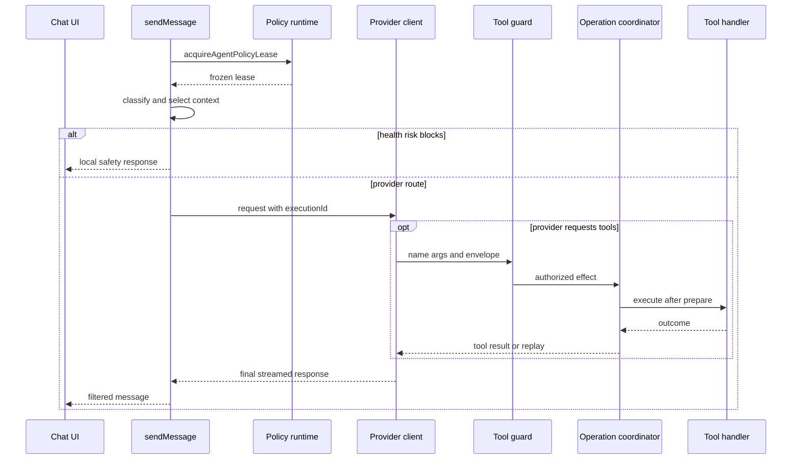
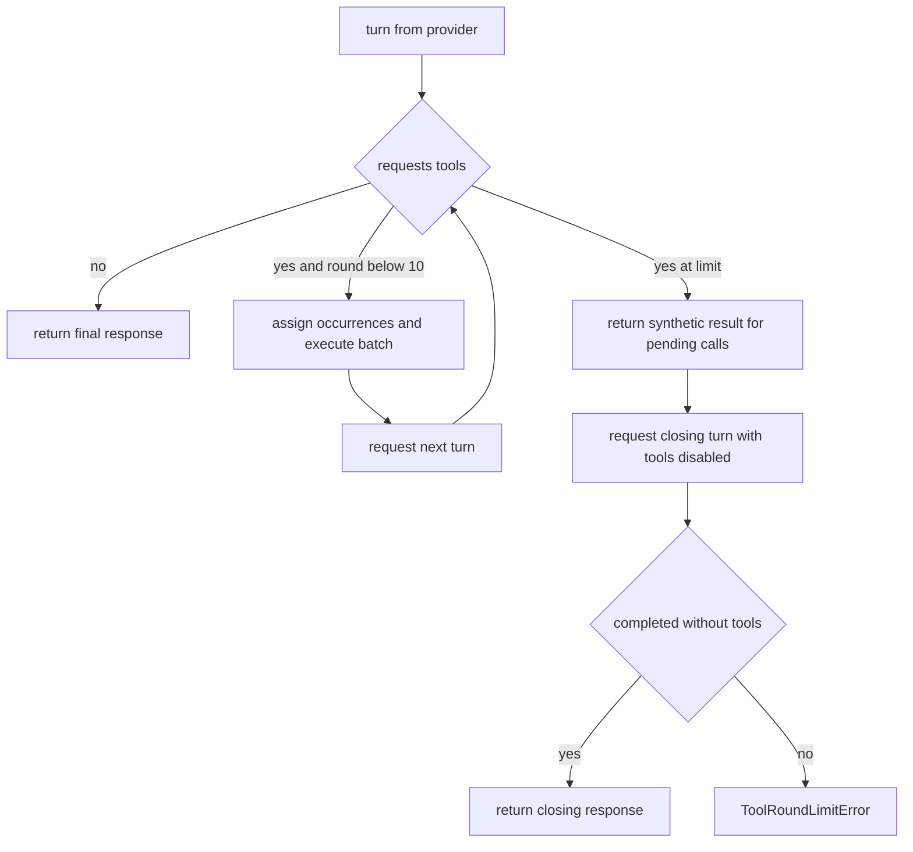
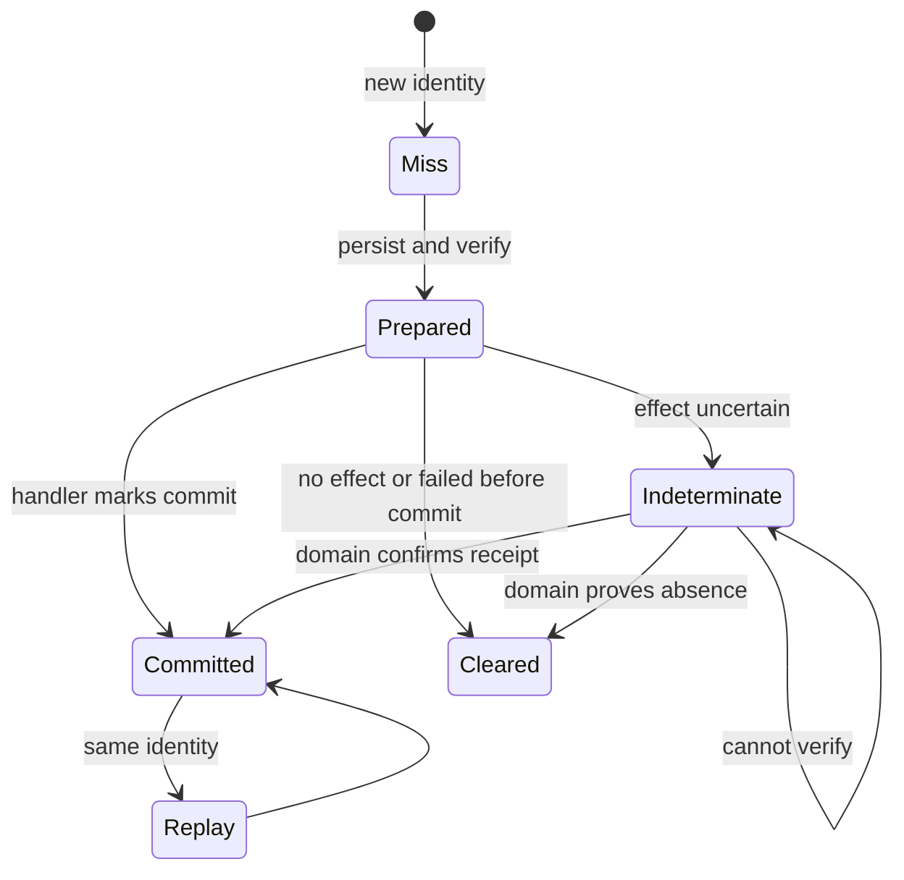

# Runtime del agente Coach y ejecución de herramientas

Esta página delimita el turno de Coach en `apps/mobile`: política, selección de contexto, proveedor, tools y efectos durables. El informe consolidado [Comportamiento en ejecución y oportunidades](../operations/runtime-behavior.md) conserva los agregados completos y las oportunidades operativas; este documento solo traduce las señales observadas a límites y pruebas que importan al cambiar el loop o una tool. Ambos documentos se enlazan para que una muestra no sustituya los contratos del código.

## Señales operativas agregadas, no contratos

### Observado

**Observado:** `ops/openwiki-runtime-telemetry.json` contiene una muestra de siete días marcada como truncada. Para tokens y coste declara `unavailable` y cobertura parcial; por tanto, sus ceros no miden consumo nulo. El archivo expone contadores, categorías y percentiles agregados, no contenido de ejecuciones, prompts, argumentos, resultados de tools, razonamiento, URLs ni identificadores de traza. El [informe consolidado](../operations/runtime-behavior.md) conserva sus valores agregados.

La muestra no es una tasa de flota ni prueba de disponibilidad, frecuencia, coste o latencia poblacional. Úsela para priorizar una investigación; use los contratos y tests de las secciones siguientes para decidir qué límite o invariante verificar. No infiera una escritura repetida solo a partir de más llamadas de modelo o de una duración de tool.

### Correlación con contratos ejecutables

- **Llamadas de modelo por turno.** Una llamada adicional puede proceder del evaluador sanitario consentido, de hasta tres intentos del turno, de una ronda de continuación, de un cierre al límite de rondas o de un fallback de transporte. `App.sendMessage`, `evaluateHealthSafetyWithProvider` y los loops de `providerToolLoop.ts` son rutas distintas; no atribuir una llamada adicional a una escritura repetida sin correlacionarla.
- **Presión de contexto.** `selectCoachContext` elige los últimos 20 mensajes antes de adaptar el proveedor. En la rama Google de `requestProviderToolChat`, el símbolo `DEFAULT_GOOGLE_CONTEXT_BUDGET` se sobrescribe a 20 intercambios; `prepareGoogleInteractionRequest` puede aún retirar imágenes antiguas o intercambios completos por bytes y rechaza antes de red si no cabe el último intercambio.
- **Tools lentas o repetidas.** `executeToolBatch` solo solapa lecturas conocidas contiguas y `ToolOperationCoordinator.execute` hace replay o unión `inFlight` únicamente para efectos. Por tanto, una duración agregada de tool no revela por sí misma ni handler, ni paralelismo, ni una mutación adicional.
- **Escritura seguida de error.** `createDetailedAgentToolExecutor` y `ToolOperationCoordinator.executeOnce` distinguen ausencia de efecto, commit e incertidumbre; una incapacidad de confirmar el registro no autoriza repetir la mutación.

### Hipótesis y comprobación focalizada

| Discrepancia observada | Límite o invariante que vigilar | Prueba focalizada |
| --- | --- | --- |
| Más de una llamada asociada a un turno | Separar evaluador, intento remoto, ronda, cierre y fallback. Mantener `executionId` estable en `sendMessage`. | `providerToolLoop.test.ts` y `providerToolClient.roundLimit.test.ts` |
| Contexto Google grande o rechazo previo a red | Ventana Coach de 20 mensajes; 512 KiB sin imágenes y 19 000 000 bytes de petición; último intercambio no se descarta. | `coachContext.test.ts` y `googleInteractions.test.ts` |
| Tool repetida o escritura duplicada | Identidad por `executionId`, proveedor, nombre, JSON canónico y `occurrence`, sin `providerCallId`; revisar replay y `inFlight`. | `toolOperationLedger.test.ts` |
| Turno con demasiadas continuaciones | Máximo de diez rondas ejecutables; la call pendiente recibe resultado sintético y se exige un cierre sin tools. | `providerToolClient.roundLimit.test.ts` y `providerToolLoop.test.ts` |
| Error después de una escritura | `prepared` no se vuelve a ejecutar a ciegas; reconciliar recibo o estado de dominio y conservar `indeterminate` ante duda. | `toolExecutor.test.ts`, `toolOperationLedger.test.ts` y `toolOperationReceipts.test.ts` |

Estas son **hipótesis de diagnóstico**, no afirmaciones sobre la distribución de producción. Instrumentar solo proveedor, intento, ronda, cierre, categoría/estado de tool, duración y estado de commit como agregados; nunca contenido, argumentos, resultados o datos que reconstruyan un run.

## Turno, política y contexto

`App.sendMessage` valida proveedor y credencial, adquiere exactamente un `AgentPolicyLease` para el límite `new-conversation` o `turn`, y solo entonces clasifica la entrada. `acquireAgentPolicyLease` devuelve un objeto profundamente congelado que agrupa prompt, política sanitaria, `PolicyContext` y estado. En canal `Local` procede del bundle; en un canal firmado `createSignedAgentPolicyLease` fusiona y valida la política sanitaria antes de entregarla. No mezcle datos de leases distintos dentro del mismo turno.



*Un único lease cruza el turno; una escritura autorizada pasa por preparación durable antes del handler.*

Un riesgo `high` o `critical` persiste el mensaje de usuario y una intervención local sin contactar al proveedor. Para `elevated`, `evaluateHealthSafetyWithProvider` solo se usa si existe consentimiento para ese proveedor, vence a los 10 segundos y, ante timeout, JSON inválido u otro fallo, conserva la decisión base con fuente `evaluator-failure`. El borrador conserva el `PolicyContext`; la respuesta final pasa por el gate sanitario.

Antes de crear la solicitud, `sendMessage` excluye divulgaciones locales y `selectCoachContext` conserva los últimos 20 mensajes para **todos** los proveedores. El prompt de sistema proviene exclusivamente de `systemPromptSelection.content`; `composeAiSystemPrompt` añade transparencia después. La memoria personal no entra en el prompt y solo se accede mediante tools. El saneador de esa memoria es una frontera de forma, no de autorización: sus claves permanecen literales porque las lecturas comparan igualdad exacta.

Para Google, `buildGoogleHistory` transforma esa ventana en pasos y `requestProviderToolChat` fija `maxExchanges` a `COACH_CONTEXT_MESSAGE_LIMIT` (20), en lugar del valor genérico 10. `prepareGoogleInteractionRequest` conserva el intercambio más reciente, elimina datos de imágenes en intercambios anteriores, y después elimina intercambios antiguos hasta cumplir 512 KiB no-imagen y 19 000 000 bytes de solicitud. Si el contexto imprescindible sigue sin caber, lanza `GoogleContextBudgetError` antes de abrir red. `GoogleContextReport` ofrece solo contadores y razones aptos para agregación; no registre cuerpos ni historial.

### Continuación Google: historial local validado, no sesión remota

Google Interactions se usa en modo sin estado: cada solicitud lleva el historial de `GoogleStep` y el contrato incluye `store: false`, sin `previous_interaction_id`. Una respuesta de asistente terminada puede conservar un `GoogleConversationTurn` versión 1 —modelo, pasos e identificadores/uso de interacciones— para reconstruir el contexto en el siguiente turno; no se conserva ni reanuda una llamada pendiente.

Antes de restaurar esos pasos, `isGoogleConversationTurn` exige tipos válidos, `thought.signature`, IDs de `function_call` no repetidos y un `function_result` con el mismo `call_id` y nombre para cada call. Rechaza `user_input` incrustado y cualquier call sin resultado. `buildGoogleHistory` falla si el turno persistido no pasa esa validación y clona los objetos antes de entregarlos al parser o transporte. Así, un historial corrupto o una operación inconclusa no se convierte en trabajo ejecutable al hidratar ni puede ser mutada accidentalmente por una nueva petición.

Durante una continuación de tools, `runGoogleToolLoop` acumula los pasos y resultados locales. Puede aceptar `interactionId` vacío —normal con `store: false`—, pero solo reutiliza una interacción no vacía cuando su representación canónica es idéntica; una identidad contradictoria o un `function_call.id` repetido entre rondas aborta antes de un segundo efecto. El reintento de todo el turno sigue protegido por `executionId`, nombre, argumentos canónicos y `occurrence` en el ledger, aun si Google asigna nuevos IDs de interacción o de call.

## Reintentos, rondas y lote

Tras persistir el usuario y un borrador `is_streaming`, `createStreamDraftFlusher` agrupa repintados en ventanas de 40 ms. `sendMessage` intenta la ruta principal hasta tres veces: reintenta únicamente firmas reconocidas de red, timeout, sobrecarga o 429/503/529, con espera de 2 y 4 segundos; un resultado vacío consume intento sin espera. Cada intento posterior limpia contenido, razonamiento y gate, pero conserva `userMessage.id` como `executionId`. El fallo terminal convierte el borrador en `technical_error`; no deshace efectos de tools que ya ocurrieron.

Los loops `runOpenAIToolLoop`, `runAnthropicToolLoop`, `runGoogleToolLoop` y la ruta `custom_openai` asignan `occurrence` en orden de proveedor, por nombre y argumentos canónicos, **antes** de ejecutar. OpenAI y Google además rechazan IDs de tool repetidos; Google reutiliza resultados de una interacción no vacía idéntica y rechaza identidades o `call_id` contradictorios entre rondas. Los IDs nativos sirven para continuar cada protocolo (`call_id`, `tool_use_id` o `function_result.call_id`), no para identificar durablemente una escritura.



*Diez rondas pueden ejecutar tools; la siguiente call no se ejecuta y solo habilita un cierre sin tools.*

`executeToolBatch` preserva el orden de resultados, aunque una racha contigua de lecturas conocidas se ejecute con hasta cuatro operaciones solapadas. Una escritura o tool desconocida es una barrera secuencial. Ante un fallo fatal deja de iniciar nuevas lecturas, espera las que ya estaban activas y propaga el primer error en orden de proveedor: el turno no termina con un lote anterior aún activo. Si se agotan las rondas, las calls pendientes reciben `ROUND_LIMIT_TOOL_RESULT` y se pide un cierre con tools prohibidas; un cierre truncado, fallido o que vuelve a pedir tools produce `ToolRoundLimitError`.

## Autorización, ejecución y recuperación de efectos

`AGENT_TOOL_DEFINITIONS` es la fuente común de nombre, descripción, esquema y efecto (`read`, `local_write`, `external_write`); de ella se derivan `CHAT_TOOLS.openai`, `CHAT_TOOLS.anthropic` y `CHAT_TOOLS.google`. Al añadir una tool, añadir su definición y handler no basta: debe validarse su dominio antes de mutar y decidir su recibo y reconciliador.

En `callProviderChatAPIWithTools`, `executeGuardedTool` clasifica tanto la entrada original como `nombre + argumentos`. Una tool desconocida o incompatible devuelve un error controlado antes del ejecutor. La regla efectiva es:

| Riesgo efectivo | Tools permitidas |
| --- | --- |
| `none` | `read`, `local_write`, `external_write` |
| `elevated` | solo `read` |
| `high` o `critical` | ninguna; además la ruta principal del proveedor queda bloqueada |

`createDetailedAgentToolExecutor` valida el esquema y convierte excepciones de handlers en resultados controlados. Un handler debe llamar a `markEffectCommitted` justo después de la persistencia irreversible; puede señalar `markEffectIndeterminate` si el resultado pudo ocurrir pero no se confirma. Las salidas son `no_effect`, `failed_before_commit`, `committed` o `indeterminate`. Una excepción posterior a la marca de commit sigue siendo `committed`: no existe rollback general del almacenamiento.

Para efectos, `identifyToolOperation` calcula SHA-256 sobre versión, `executionId`, proveedor, nombre, argumentos JSON canónicos y `occurrence`; `providerCallId` se excluye. `ToolOperationCoordinator` puede unir la misma operación en vuelo y reproducir un commit desde memoria o ledger sin volver a invocar el handler. Las lecturas no pasan por esa deduplicación durable. Por ello, dos calls iguales intencionales en un mismo loop tienen ocurrencias distintas, mientras un reintento remoto equivalente puede recuperar la misma operación.



*El ledger evita repetir una escritura dudosa; reconciliar puede confirmar el efecto o demostrar su ausencia, nunca deshacerlo.*

El coordinador consulta memoria y ledger, reconcilia el dominio para entradas nuevas o no resueltas, y persiste/relee `prepared` antes del handler. Si el resultado es `no_effect` o `failed_before_commit`, descarta la preparación; si es `indeterminate`, la conserva. Si falla el registro final de un commit, intenta el reconciliador del dominio y, sin confirmación, devuelve `indeterminate` en vez de repetir. Una colisión de fingerprint no ejecuta la mutación.

El ledger de esquema 2 verifica por relectura cada escritura y falla cerrado ante lectura corrupta o inaccesible. Retiene como máximo 256 entradas: los commits expiran a los siete días y pueden expulsarse por antigüedad; `prepared` e `indeterminate` no expiran ni se expulsan para abrir hueco. Si llenan la capacidad, una escritura nueva falla antes del efecto. `clear()` incrementa una generación para que una operación que termine después no repueble caché ni ledger.

Las escrituras locales incluyen recibos mínimos con `operationId`, `toolName` y `committedAt`, también limitados a 256 entradas y siete días. La ausencia de un recibo solo demuestra ausencia de efecto si, desde `preparedAt`, no pudo caducar ni ser expulsado. Tras hidratar, `reconcileUnresolved` recorre las entradas pendientes sin ejecutar handlers: confirma las que el dominio reconoce, elimina las de ausencia demostrada y conserva las ambiguas como `indeterminate`, con aviso para revisión.

## Cambio seguro y validación

1. Mantenga un solo `AgentPolicyLease` inmutable por turno y la selección de contexto antes de la adaptación al proveedor.
2. No describa la ruta Coach de Google con el límite genérico de 10: su límite de intercambios es 20, pero los límites de bytes siguen siendo efectivos.
3. No convierta reintento, fallback, continuación, cierre, unión `inFlight` y replay en una única noción de «repetición».
4. Para una nueva escritura, conserve `executionId`, canonicalización y `occurrence`; no incluya `providerCallId` en su identidad. Valide antes del efecto, marque commit inmediatamente después y proporcione recibo/reconciliador.
5. No introduzca paralelismo en escrituras ni dependa del orden de finalización de lecturas. Mantenga la barrera y el máximo de cuatro lecturas de `executeToolBatch`.
6. No registre contenido sensible. Para correlacionar una anomalía basta con dimensiones agregadas de intento, ronda, cierre, categoría, duración y estado de commit.

Desde la raíz, ejecute el conjunto focalizado:

```bash
npm exec -- vitest run --config apps/mobile/vitest.config.mts apps/mobile/agent/agentPolicyRuntime.test.ts apps/mobile/agent/coachContext.test.ts apps/mobile/agent/providerToolClient.roundLimit.test.ts apps/mobile/agent/providerToolLoop.test.ts apps/mobile/agent/toolBatch.test.ts apps/mobile/agent/toolDefinitions.test.ts apps/mobile/agent/toolExecutor.test.ts apps/mobile/agent/toolOperationLedger.test.ts apps/mobile/agent/toolOperationReceipts.test.ts apps/mobile/agent/googleInteractions.test.ts
```

Estas pruebas verifican contratos locales de lease, presupuesto, protocolo, lote, autorización, commit y recuperación; no miden disponibilidad, coste, latencia o frecuencia en producción. Para esas señales y sus cautelas, vuelva al [informe consolidado](../operations/runtime-behavior.md).
