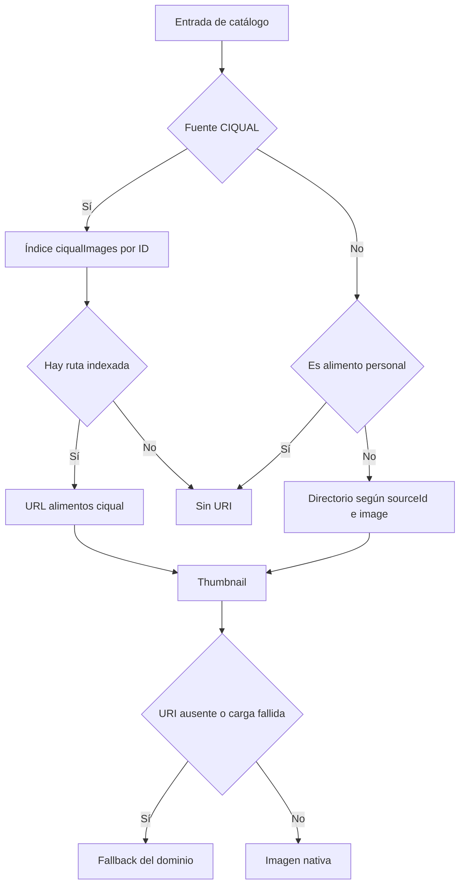
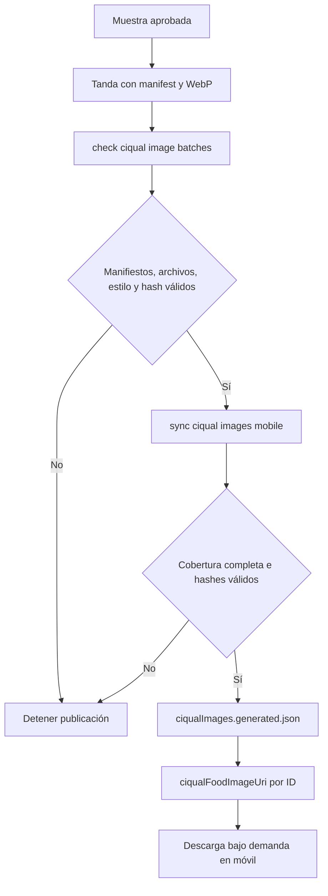

# Generación y entrega de imágenes de catálogo

Las imágenes son recursos versionados del repositorio, no resultados que la aplicación solicite a un modelo. El cliente móvil construye URL hacia la rama `main` de `raw.githubusercontent.com` y descarga únicamente las imágenes que necesita mostrar. Por tanto, una modificación segura abarca el recurso, su índice o referencia, el contrato del resolvedor y las pruebas de la superficie afectada.

Hay dos flujos que no deben confundirse:

- **CIQUAL (vigente):** ilustraciones IA curadas en muestras y tandas, con manifiestos, hashes e índice móvil generado. Es el mecanismo que entrega imágenes a la fuente `anses_ciqual_2025`.
- **Alimentos y ejercicios curados (herramienta histórica ejecutable):** `image-generation/generate_images.py` aún genera WebP mediante Spaces de Gradio y después invoca el generador común de catálogos. No genera ni publica las imágenes CIQUAL; no debe usarse como descripción del proceso de tandas CIQUAL.

## Resolución y degradación en móvil

`imageUris.ts` es el límite entre un registro del catálogo y una URI descargable. Para alimentos personales devuelve `null`. Para una entrada CIQUAL, busca su ID en `ciqualImages.generated.json`; si está indexado, compone `alimentos/ciqual/<ruta-indexada>`. Para las demás fuentes de alimentos, compone `alimentos/images/<image>`, `productos_comerciales/images/<image>` o `recetas/images/<image>` según `sourceId`. Los ejercicios conservan rutas relativas de variante y se resuelven bajo `ejercicios`.

En consecuencia, las fichas curadas no deben almacenar una URL absoluta: sus nombres y rutas relativas forman parte del contrato con el resolvedor. En CIQUAL, la asociación editorial vive fuera de la ficha nutricional, en el artefacto generado; el ID estable es la clave de unión.



*Resolución perezosa y degradación local: la ausencia del índice, de red o un error de carga no bloquean el registro del alimento.*

`Thumbnail` no decide la URI ni el sustituto: los wrappers de cada dominio se los entregan. Si no hay URI o si el `Image` notifica un error para la URI actual, renderiza el `fallback`; si la URI cambia, puede intentar cargar la nueva. Esto mantiene funcionales búsqueda, consulta y registro aunque una descarga falle.

Para una comida creada desde catálogo, `dietItemFromCatalog` guarda la URI resuelta en `image_uri` junto con el enlace estable. Para comidas CIQUAL antiguas que no la tenían, `dietItemImageUri` vuelve a resolverla desde `catalog_link` al dibujarla; no altera sus macros ni la instantánea histórica.

## CIQUAL: curación, integridad y publicación del índice

Las 3.484 fichas CIQUAL son datos nutricionales locales; sus imágenes son ilustraciones de Gymnasia, no material proporcionado ni validado por ANSES. La atribución se incorpora al artefacto móvil y debe aparecer donde corresponda en la UI. Los WebP no se empaquetan todos con la app: se solicitan desde el repositorio público al mostrarse, y la disponibilidad offline de una imagen depende de la caché de plataforma.

El estado publicable se construye desde una muestra de estilo aprobada y las tandas `image-batches/NNNN`. Cada manifiesto aporta el ID, el archivo, el hash y la referencia a una muestra aprobada. La verificación de tandas rechaza IDs duplicados, archivos no declarados o ausentes, referencias de estilo no aprobadas y hashes distintos; también calcula qué alimentos aún no tienen imagen. El comando `--next <1..50>` solo lista una porción de pendientes: no genera ni publica recursos.

Al sincronizar móvil, `ciqual-mobile-images.mjs` carga la muestra y todas las tandas, exige que el estilo esté aprobado y que haya exactamente una imagen por cada alimento, verifica cada SHA-256 y escribe el mapa ordenado `id → ruta` junto con la atribución en `apps/mobile/catalogs/generated/ciqualImages.generated.json`. No edite ese JSON manualmente: se detectaría como deriva.



*Flujo vigente de CIQUAL: la cobertura completa y la integridad de los bytes preceden al índice que consume el resolvedor móvil.*

Desde la raíz, las operaciones son:

```bash
npm run check:ciqual:images
npm run next:ciqual:images -- 50
npm run sync:ciqual:images:mobile
npm run check:ciqual:images:mobile
npm run check:ciqual:mobile
```

`check:ciqual:mobile` incluye la comprobación del índice de imágenes. Tras cambiar imágenes o manifiestos, ejecute la sincronización antes de los checks; el check compara el archivo versionado con la salida esperada.

## Generación curada de alimentos y ejercicios

`image-generation/generate_images.py` es una utilidad manual para los catálogos curados `alimentos` y `ejercicios`. Carga `HF_TOKEN` desde el entorno o el `.env` de la raíz, conecta a un backend de Gradio y, al terminar su recorrido, llama a `scripts/catalogs/generate.mjs --write --domain ...`. El generador compartido, no Python, es la barrera que valida catálogos y escribe sus agregados.

```bash
cd image-generation
uv sync
uv run generate_images.py exercises --id press-banca
uv run generate_images.py --backend z-image-turbo foods --id arroz-blanco
```

La opción global `--backend` va antes del subcomando. Sin ella se intenta `nano-banana`, `z-image-turbo` y `flux2-dev` en ese orden, pero el respaldo solo ocurre si falla la conexión; un fallo de predicción no cambia de proveedor. Solo Nano Banana recibe la proporción del dominio. Los otros dos solicitan 1024×1024, así que una imagen de ejercicio generada con ellos debe superar posteriormente el contrato 16:9. Sus semillas se aleatorizan, por lo que una generación no es reproducible solo por repetir el comando.

El script recorre fichas ordenadas, omite agregados y solo genera IDs que existan en `FOOD_PROMPTS` o `EXERCISE_PROMPTS`. Produce `alimentos/images/<id>.webp` o `ejercicios/images/<id>-male.webp` y `<id>-female.webp`. Un destino existente se omite; no hay sobrescritura ni regeneración forzada. Conserve el recurso anterior y elimine o mueva deliberadamente el destino si se ha aprobado una regeneración.

Los prompts son material ejecutable indexado por ID; los documentos Markdown y ejemplos son auxiliares. La salida del proveedor debe revisarse visualmente y no sustituye la validación: los catálogos exigen WebP decodificable, rutas seguras y exactas, ausencia de huérfanos, y proporciones 1:1 para nutrición y 16:9 para ejercicios.

## Verificación enfocada

Para cambios en imágenes, fichas o artefactos curados, ejecute:

```bash
npm run check:catalogs
npm run test:catalogs
npm run test:catalogs:e2e
```

Los tests unitarios ejercitan la generación estable, la limpieza de páginas paginadas obsoletas, contratos de imágenes, rutas y rollback. El E2E exporta el cliente web y reemplaza red por fixtures; además de los escenarios de consumo, búsqueda, enlaces por ID, caché/migración y degradación, verifica ahora imágenes CIQUAL reales en catálogo, detalle, búsqueda y dieta. Comprueba la URI esperada, que el elemento `img` terminó de cargar con ancho natural 1024, la atribución, la persistencia de `image_uri` y el fallback sin red. Es una comprobación de integración web de URI/carga, no una aprobación estética o biomecánica del contenido generado.

## Procedimiento de cambio

1. Para CIQUAL, añada o cambie el WebP y su manifiesto de muestra o tanda; mantenga ID, nombre de archivo, referencia aprobada y SHA-256 coherentes.
2. Ejecute `npm run check:ciqual:images`, sincronice el índice y ejecute los checks CIQUAL. No modifique la ficha nutricional para guardar una URL.
3. Para alimentos o ejercicios curados, corrija primero la ficha y la referencia relativa; solo después añada el prompt y genere un ID si procede.
4. Revise el resultado visualmente y confirme formato, dimensiones, ruta y mayúsculas. Ejecute los checks de catálogo y el E2E cuando cambie una superficie móvil.
5. Revise `git diff`: un cambio CIQUAL debe incluir el recurso/manifiesto y el índice móvil derivado; un cambio curado debe incluir los artefactos de catálogo que produzca el generador compartido.

Para el contrato general de catálogos, véase [Catálogos locales y artefactos generados](repositories.md). Para las superficies de consumo, véanse [Dieta y estimación de alimentos](../mobile/diet-and-food-estimation.md) y [Plantillas de entrenamiento](../mobile/training.md); la matriz general de validación está en [Compilación, publicación y validación](../operations/build-release-and-testing.md).
