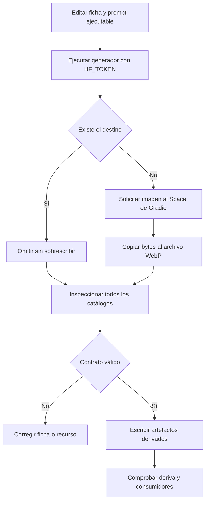

# Generación y publicación de imágenes de catálogo

La generación de imágenes es una operación manual, externa y no determinista; no ocurre durante la ejecución de la aplicación móvil. `image-generation/generate_images.py` solicita imágenes a Spaces de Gradio para alimentos y ejercicios y, al terminar, usa el generador común de catálogos. El resultado publicable no es la respuesta del modelo: son los recursos versionados que superan la validación y sus agregados derivados.

## Qué se edita, qué se genera y qué se valida

| Clase | Contenido | Regla de edición |
| --- | --- | --- |
| Fuentes editables | Fichas `alimentos/<id>.json`, `ejercicios/<id>.json` y los mapas `FOOD_PROMPTS` / `EXERCISE_PROMPTS` de `image-generation/generate_images.py` | Se modifican para incorporar o corregir un elemento y describir la imagen que se va a solicitar. |
| Recursos generados o incorporados | Archivos WebP en `*/images/` | No son la fuente de verdad de una ficha: deben estar referenciados desde ella y revisarse visualmente antes de conservarlos. |
| Artefactos generados | `all.json`, los `index.json`, `ejercicios/catalog-v1/` y `apps/mobile/catalogs/generated/foodBaseline.generated.json` | No se editan a mano. `scripts/catalogs/generate.mjs` los reconstruye desde las fichas ordenadas. |
| Validaciones ejecutables | `check:catalogs`, pruebas unitarias y E2E | Bloquean la publicación de referencias, imágenes o agregados incoherentes. |

La generación con IA solo cubre alimentos y ejercicios. Productos comerciales y recetas pueden tener una imagen opcional, pero no tienen subcomando ni mapa de prompts: si se añade una por otro medio, sigue el mismo contrato nutricional y pasa la sincronización general.

## Contrato de fichas e imágenes

| Dominio | Ficha y referencia | Recurso esperado | Proporción |
| --- | --- | --- | --- |
| Alimentos | `alimentos/<id>.json`, `image: "<archivo>.webp"` | `alimentos/images/<archivo>.webp` | 1:1 |
| Ejercicios | `ejercicios/<id>.json`, `image_male` e `image_female` | `ejercicios/images/<id>-male.webp` y `ejercicios/images/<id>-female.webp` | 16:9 |
| Productos comerciales | `productos_comerciales/<id>.json`, `image` opcional | `productos_comerciales/images/<archivo>.webp` | 1:1 |
| Recetas | `recetas/<id>.json`, `image` opcional | `recetas/images/<archivo>.webp` | 1:1 |

Para ejercicios, las rutas declaradas deben ser exactamente las derivadas del ID y del género. Para los dominios nutricionales, `image` es solamente el nombre del archivo, sin el prefijo `images/`. Se puede compartir una imagen nutricional entre fichas; las imágenes de ejercicio, en cambio, están ligadas a su ID y variante.

La puerta de publicación valida el schema y el ID de cada ficha, duplicados dentro del dominio y entre los dominios nutricionales, rutas seguras y coincidencia de mayúsculas. También rechaza imágenes ausentes, huérfanas o no decodificables. Comprueba los bytes con `sharp`: una extensión `.webp` o una instrucción en el prompt no prueba que el recurso sea WebP ni que tenga la relación requerida.

## Flujo de generación a publicación



*El flujo muestra que la generación produce un candidato; la inspección común es la que autoriza los agregados que se publican.*

El script recorre las fichas JSON de hoja ordenadas, ignorando `all.json`, `index.json` y `package.json`. Una ficha sin clave en su mapa de prompts se registra y se omite. `--id` solo filtra el recorrido: no diagnostica de forma especial un ID inexistente y aun así el proceso termina intentando sincronizar el dominio.

Los destinos existentes no se sobrescriben. Cambiar un prompt no regenera una imagen aceptada y una imagen corrupta existente tampoco se repara con una ejecución normal. No existe `--force`; para regenerar hay que conservar una copia para comparar y mover o eliminar deliberadamente el archivo de destino antes de ejecutar el ID.

## Ejecutar el generador

El proyecto de generación usa Python y `uv`. Carga `HF_TOKEN` desde el entorno o el `.env` de la raíz del repositorio; el token es obligatorio y no debe confirmarse en Git.

```bash
cd image-generation
uv sync
uv run generate_images.py exercises --id press-banca
uv run generate_images.py --backend z-image-turbo foods --id arroz-blanco
```

`--backend` es una opción del analizador superior y debe situarse antes del subcomando. Si no se indica, intenta conectar en este orden: `nano-banana`, `z-image-turbo` y `flux2-dev`. El modo automático cambia al siguiente únicamente cuando falla la conexión; un error durante `predict` no activa otro backend. Al fijar un backend, un fallo de conexión termina el proceso.

| Backend | Invocación remota | Relación solicitada | Consideración operativa |
| --- | --- | --- | --- |
| `nano-banana` | `multimodalart/nano-banana`, `Nano Banana 2`, `fn_index=2` | La del dominio: 16:9 o 1:1 | Es el único que recibe la relación requerida. Depende de la firma del Space remoto. |
| `z-image-turbo` | `mrfakename/Z-Image-Turbo`, `/generate_image` | 1024×1024 | Un ejercicio normalmente fallará la comprobación posterior 16:9. |
| `flux2-dev` | `black-forest-labs/FLUX.2-dev`, `/infer` | 1024×1024 | Un ejercicio normalmente fallará la comprobación posterior 16:9. |

Los dos últimos declaran una semilla pero solicitan `randomize_seed=True`; Nano Banana tampoco fija una semilla aquí. Sumado a modelos y Spaces remotos no versionados, la regeneración no es reproducible. Revise visualmente el sujeto, composición, ausencia de texto o marcas de agua y, para ejercicios, postura, equipo y seguridad de ambas variantes antes de aceptar un archivo.

Los prompts que controlan el proceso son los diccionarios ejecutables indexados por el `id` de la ficha. Los Markdown de prompts y el docstring son documentación auxiliar, no configuración de ejecución. `ejercicios/SOURCES.md` conserva la procedencia de metadatos e instrucciones: permite adaptar texto y estructura del dataset indicado, pero excluye reutilizar imágenes y GIF de Gym Visual; las ilustraciones del catálogo deben generarse desde cero con el estilo propio.

## Sincronización y consumo

Al terminar el recorrido de alimentos o ejercicios, el script invoca respectivamente:

```bash
node scripts/catalogs/generate.mjs --write --domain alimentos
node scripts/catalogs/generate.mjs --write --domain ejercicios
```

Antes de escribir, el generador inspecciona los cuatro dominios. Si cualquiera infringe un contrato, no publica el dominio solicitado. Con `--domain` limita la escritura a sus artefactos: alimentos produce `all.json`, `index.json` y la línea base de alimentos de la app; ejercicios produce además el catálogo paginado `catalog-v1/`. Sin esa opción también se actualiza el schema TypeScript generado para el cliente móvil.

La escritura es protegida frente a fallos: prepara temporales, reemplaza primero el contenido, elimina páginas paginadas obsoletas y publica el manifiesto de ejercicios al final. Si falla una sustitución o limpieza, intenta restaurar los reemplazos y borrados. Esto no vuelve transaccional la llamada remota de IA: puede haber dejado recursos nuevos antes de que falle una predicción o la sincronización.

La aplicación no consume un servicio de generación de imágenes. Para alimentos incorpora `foodBaseline.generated.json` en una instalación nueva y puede sustituirlo por un catálogo remoto validado; para ejercicios activa una versión paginada solamente después de validar el manifiesto y su primera página. Por ello, una modificación de imagen debe publicar ficha, recurso y artefactos derivados juntos, y verificarse en los consumidores de dieta y entrenamiento.

## Validaciones y procedimiento de cambio

Ejecute estas comprobaciones después de cambiar una ficha, un recurso, un prompt o un artefacto de catálogo:

```bash
npm run check:catalogs
npm run test:catalogs
npm run test:catalogs:e2e
```

`check:catalogs` valida todos los dominios y la deriva de artefactos; no admite limitar el dominio. Los unitarios cubren agregados estables, páginas paginadas obsoletas, schemas, rutas, contrato de imágenes y rollback de escritura. El E2E exporta el cliente web de desarrollo y controla las respuestas remotas para comprobar consumo, caché, uso sin red, disponibilidad parcial y estados degradados. No reemplaza la revisión visual ni una comprobación en cliente nativo cuando el cambio lo requiera.

Procedimiento recomendado:

1. Cree o corrija la ficha y su referencia. Verifique el nombre del fichero, `id` y rutas exactas antes de generar.
2. Añada el ID al mapa de prompts ejecutable si es un alimento o ejercicio. Mantenga la documentación auxiliar como acompañamiento, no como sustituto.
3. Genere primero un único ID. Para ejercicios, prefiera un backend que solicite 16:9.
4. Revise el candidato y sus bytes, dimensiones, ruta y mayúsculas. Restaure o retire el resultado si no es aceptable.
5. Ejecute las tres comprobaciones y revise `git diff`. Deben aparecer solamente fichas, prompts, recursos y artefactos derivados esperados.
6. Confirme esos cambios juntos y compruebe miniaturas y detalle en dieta y entrenamiento.

Para el contrato general y el funcionamiento local-first, véase [Catálogos locales y artefactos generados](repositories.md). Para las superficies de alimentos, véase [Dieta y estimación de alimentos](../mobile/diet-and-food-estimation.md); la matriz general de comprobaciones está en [Compilación, publicación y validación](../operations/build-release-and-testing.md).
