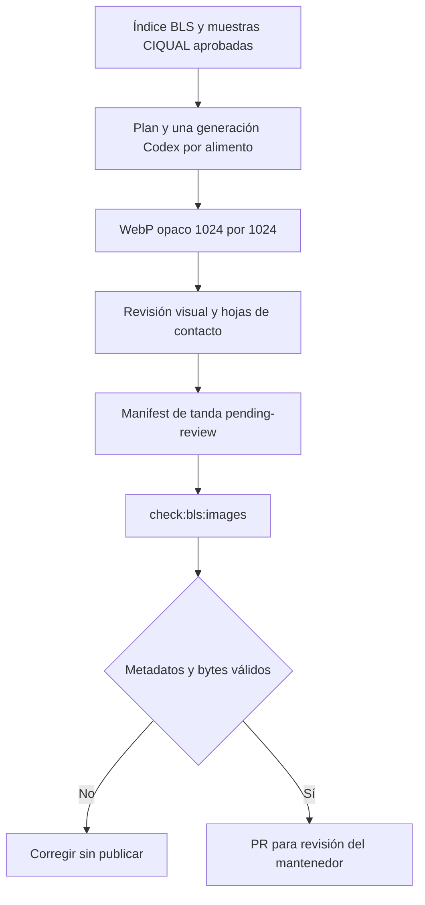
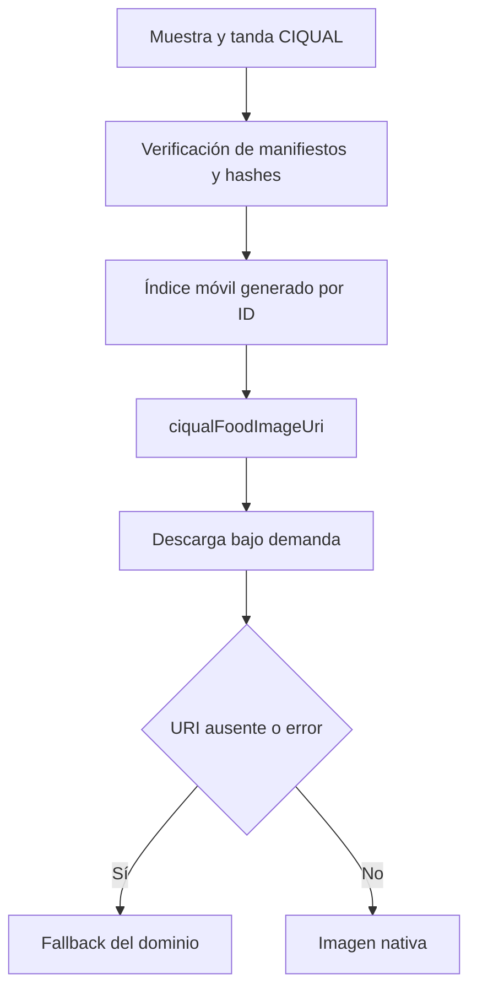

# Generación y validación de imágenes de alimentos

Las imágenes son recursos versionados, no resultados que la aplicación solicite a un modelo. Este repositorio contiene tres responsabilidades que conviene no mezclar:

- **Tandas BLS:** ilustraciones editoriales independientes del catálogo BLS y de la aplicación. Se revisan y se entregan en `alimentos/bls/image-batches/`.
- **CIQUAL:** el flujo ya integrado en móvil, con índice editorial por ID y un artefacto móvil generado.
- **Alimentos y ejercicios curados:** la utilidad manual `image-generation/generate_images.py`, que llama a proveedores Gradio y después regenera los agregados de catálogo.

Una imagen BLS es una ilustración de Gymnasia, no una imagen proporcionada ni validada por Max Rubner-Institut. No demuestra receta, ingredientes exactos, alérgenos, composición nutricional ni una porción de 100 g. Los nombres oficiales alemanes e ingleses de BLS son la referencia que debe respetar la representación; no se cambia una ficha nutricional para acomodar una imagen.

## Tandas BLS: artefactos editoriales y límite de integración

Cada directorio `alimentos/bls/image-batches/NNNN/` contiene exclusivamente `manifest.json` y los WebP que declara. Una tanda reúne como máximo 100 alimentos y tiene estado `pending-review`: que Codex haya revisado visualmente las salidas no equivale a la aprobación del mantenedor. Las muestras aprobadas de CIQUAL se usan únicamente como referencia de estilo; las fotografías de esas muestras no se reutilizan.

El manifiesto es el registro duradero de la tanda. Para cada imagen conserva el ID BLS, nombres oficiales DE/EN, una huella SHA-256 de esos nombres, el nombre de archivo permitido, hash de los bytes, prompt, referencia de estilo y hash de la referencia. Su sección de revisión debe enumerar, en el mismo orden, todos los IDs declarados. Así, una modificación de datos BLS, una referencia de estilo alterada, una salida sustituida o una revisión parcial no se confunden con una imagen aprobable.



*La tanda BLS conserva evidencia editorial e integridad de archivos, pero no publica imágenes en el cliente móvil.*

La preparación y revisión visual suceden antes del manifiesto: se usa una llamada integrada de Codex por alimento, se conserva el prompt y el recibo de la salida original, se normaliza el resultado a WebP opaco de 1024×1024 y se revisan todos los WebP finales mediante hojas de contacto, abriendo los dudosos a tamaño completo. Los planes, recibos, notas y hojas de contacto son auxiliares de recuperación o QA; los WebP y el manifiesto versionados son los entregables de la tanda. No añada esos auxiliares a la carpeta numerada.

BLS permanece fuera de la app: al añadir una imagen no se modifican `apps/mobile/**`, fichas BLS oficiales, agregados, erratas, traducciones ni CIQUAL. En particular, no hay índice móvil BLS ni una URL que deba añadirse a una ficha. Una variante BLS recibe su propia imagen; no se reutilizan los mismos bytes para alimentos distintos.

### Comandos y fallos que bloquean la entrega

```bash
npm run check:bls:images
npm run next:bls:images -- 100
npm run test:bls
npm run test:catalogs
npm run check:catalogs
npm run check:bls
```

`check:bls:images` y `next:bls:images` son de solo lectura. El primero recorre las tandas, devuelve el inventario generado y pendiente, y falla si hay enlaces simbólicos, nombres o huellas de fuente desactualizados, prompts incompletos, referencias no aprobadas o alteradas, hashes incorrectos, WebP inválidos, archivos no declarados, IDs repetidos o bytes repetidos entre variantes. El segundo usa ese mismo inventario y lista una porción determinista de entre 1 y 100 pendientes; no genera, descarga ni publica nada.

La validación no acepta la extensión como prueba: comprueba el SHA-256 y que los bytes sean un WebP real, opaco y de 1024×1024. También exige una correspondencia exacta entre los archivos de la carpeta y el manifiesto. `test:bls` cubre específicamente este contrato, incluidas mutaciones de corrupción, PNG disfrazado, tamaño o alfa erróneos, huérfanos, duplicados y enlaces simbólicos. `test:catalogs` y `check:bls` añaden la coherencia del catálogo y sus artefactos nutricionales; no convierten la revisión visual en una aprobación editorial.

## Utilidad manual para catálogos curados

`image-generation/generate_images.py` es una operación manual para `alimentos` y `ejercicios`, no el generador de las tandas BLS ni un proceso de ejecución móvil. Carga `HF_TOKEN` desde el entorno o el `.env` de la raíz, conecta a un backend de Gradio y, al terminar el recorrido, ejecuta `scripts/catalogs/generate.mjs --write --domain ...`. El generador JavaScript compartido valida todos los catálogos y escribe los agregados del dominio; Python solo produce los recursos candidatos.

```bash
cd image-generation
uv sync
uv run generate_images.py exercises --id press-banca
uv run generate_images.py --backend z-image-turbo foods --id arroz-blanco
```

La opción global `--backend` va antes del subcomando. Sin ella se prueban `nano-banana`, `z-image-turbo` y `flux2-dev` en ese orden, pero el respaldo solo ocurre si falla la conexión; un fallo de predicción no cambia de proveedor. Solo Nano Banana recibe la proporción del dominio. Los otros dos solicitan 1024×1024 y aleatorizan la semilla, por lo que una imagen de ejercicio generada con ellos debe superar posteriormente el contrato 16:9 y no se reproduce simplemente al repetir el comando.

El script recorre fichas ordenadas, omite agregados y solo genera IDs presentes en `FOOD_PROMPTS` o `EXERCISE_PROMPTS`. Produce `alimentos/images/<id>.webp` o `ejercicios/images/<id>-male.webp` y `<id>-female.webp`; un destino existente se omite, sin sobrescritura ni regeneración forzada. Los prompts indexados por ID son el material ejecutable; Markdown y ejemplos son auxiliares. Revise la salida visualmente antes de conservarla: el catálogo exige WebP decodificable, rutas seguras y exactas, ausencia de huérfanos y proporciones 1:1 para nutrición y 16:9 para ejercicios.

## Entrega móvil CIQUAL y degradación

CIQUAL tiene un contrato distinto de BLS. El sincronizador de imágenes CIQUAL valida muestras de estilo, manifiestos de tanda, IDs, archivos y hashes; después exige cobertura exacta y vuelve a verificar los hashes antes de escribir `apps/mobile/catalogs/generated/ciqualImages.generated.json`. Ese índice generado asocia el ID con la ruta editorial y la atribución; no se edita a mano.



*CIQUAL, a diferencia de BLS, publica un índice que el cliente usa para resolver una imagen en tiempo de ejecución.*

El cliente móvil resuelve imágenes contra la rama `main` de `raw.githubusercontent.com`. Para un alimento personal devuelve `null`; para CIQUAL consulta el índice por ID y forma una ruta bajo `alimentos/ciqual`; para las demás fuentes escoge el directorio según `sourceId`. Los ejercicios conservan una ruta relativa de variante bajo `ejercicios`. `Thumbnail` solo degrada: muestra el fallback si no recibe URI o si la carga emite `onError`; la elección de URI y fallback pertenece al wrapper de cada dominio. Las comidas CIQUAL antiguas sin `image_uri` pueden resolverla desde su `catalog_link` al mostrarse sin modificar sus macros ni su instantánea guardada.

Desde la raíz, los comandos del flujo CIQUAL son:

```bash
npm run check:ciqual:images
npm run next:ciqual:images -- 50
npm run sync:ciqual:images:mobile
npm run check:ciqual:images:mobile
npm run check:ciqual:mobile
```

Tras cambiar una tanda CIQUAL, sincronice el índice antes de los checks. `check:ciqual:mobile` incluye la comprobación del índice de imágenes.

## Validación transversal y cambio seguro

Para un cambio que afecte recursos curados, fichas o sus agregados, ejecute además:

```bash
npm run check:catalogs
npm run test:catalogs
npm run test:catalogs:e2e
```

El generador común inspecciona los cuatro catálogos antes de escribir. Con `--write --domain` publica solo los artefactos del dominio solicitado, mientras que `--check` detecta deriva sin escribir; la publicación usa temporales y deja el manifiesto paginado para el final, de modo que una interrupción no puede pasar la comprobación. Los tests unitarios cubren generación estable, limpieza de páginas paginadas obsoletas, contratos de imágenes, rutas y rollback.

El E2E exporta el cliente web y usa fixtures controladas para consumo, búsqueda, vínculos por ID, caché y estados degradados. Para CIQUAL también verifica en catálogo, detalle, búsqueda y dieta la URI esperada, que el `img` cargó con ancho natural 1024, la atribución, la persistencia de `image_uri` y el fallback sin red. Es una prueba de integración de URI y carga, no una aprobación estética de una imagen alimentaria ni biomecánica de una imagen de ejercicio.

### Lista de cambio

1. Para BLS, seleccione pendientes con `next:bls:images`; conserve el plan y recibo antes de convertir una salida. Añada solo WebP y `manifest.json` a una nueva carpeta de tanda.
2. Revise todos los finales, complete nombres DE/EN, huellas, prompt, referencia, hashes y `reviewed_ids`; ejecute `check:bls:images` y las verificaciones BLS y de catálogos. Abra una PR para revisión, sin asumir que `pending-review` autoriza fusionar.
3. Para CIQUAL, cambie el recurso y manifiesto de tanda, sincronice el índice móvil derivado y ejecute sus checks. No guarde la URL en la ficha nutricional.
4. Para alimentos o ejercicios curados, corrija primero ficha y referencia relativa; añada el prompt y genere solo si procede. Revise formato, dimensiones, ruta y mayúsculas antes de los checks.
5. Revise `git diff`: una tanda BLS no debe contener cambios de datos nutricionales ni móvil; un cambio CIQUAL debe incluir el recurso, manifiesto e índice derivado; un cambio curado debe incluir los artefactos que escriba el generador compartido.

Para el contrato general de catálogos, véase [Catálogos locales y artefactos generados](repositories.md). Para las superficies de consumo, véase [Dieta y estimación de alimentos](../mobile/diet-and-food-estimation.md), y para la matriz general de validación, [Compilación, publicación y validación](../operations/build-release-and-testing.md).
