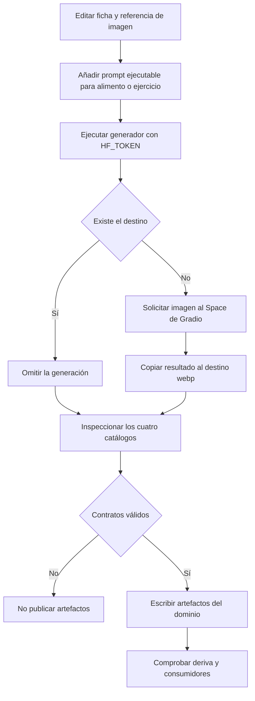

# Generación y uso de imágenes de catálogo

La generación es una operación manual, externa y no determinista sobre catálogos versionados; no se ejecuta dentro de la app móvil. `image-generation/generate_images.py` solicita imágenes a Spaces de Gradio para **alimentos** y **ejercicios**, copia el resultado a los directorios de contenido y llama al generador común de catálogos. La app consume los JSON y artefactos ya versionados y validados, no un resultado directo de IA.

El código y las pruebas son la fuente de verdad. Los Markdown de prompts y los ejemplos del docstring son apoyo editorial: las asignaciones `FOOD_PROMPTS` y `EXERCISE_PROMPTS`, las plantillas y el validador común son el comportamiento ejecutable.

## Contrato de contenido

| Dominio | Ficha editable | Referencia | Recurso y proporción exigidos |
| --- | --- | --- | --- |
| Alimentos | `alimentos/<id>.json` | `image: "<archivo>.webp"` | `alimentos/images/<archivo>.webp`, 1:1 |
| Ejercicios | `ejercicios/<id>.json` | `image_male`, `image_female` | `ejercicios/images/<id>-male.webp` y `...-female.webp`, 16:9 |
| Productos comerciales | `productos_comerciales/<id>.json` | `image` opcional | `productos_comerciales/images/<archivo>.webp`, 1:1 |
| Recetas | `recetas/<id>.json` | `image` opcional | `recetas/images/<archivo>.webp`, 1:1 |

El script de IA automatiza únicamente alimentos y ejercicios. Productos y recetas pueden recibir imágenes por otro procedimiento, pero siguen el contrato y la inspección de todos los dominios. Las imágenes nutricionales pueden ser compartidas por fichas; las de ejercicio deben tener exactamente el nombre derivado de su ID y género.

La puerta de publicación valida JSON y schema, nombre de ficha frente a ID, duplicados —también entre dominios nutricionales—, referencias seguras y con mayúsculas exactas. Además rechaza recursos ausentes o huérfanos, extensiones incorrectas, bytes que no sean WebP decodificable y dimensiones no válidas. En particular, se exige `width === height` para nutrición y `width * 9 === height * 16` para ejercicios: ni la extensión `.webp` ni una instrucción en el prompt prueban el contrato.

### Resolución en el cliente móvil

El catálogo transporta nombres o rutas relativas, no una URL absoluta de imagen. `foodCatalogImageUri` construye la URL de `raw.githubusercontent.com/maximofn/gymnasia/main` con el directorio que corresponde a `sourceId`: alimentos por defecto, `productos_comerciales` o `recetas`; devuelve `null` para alimentos personales y CIQUAL aunque tengan un campo `image`. `exerciseCatalogImageUri` conserva `image_male` o `image_female` del catálogo y lo antepone a `ejercicios`. Por ello, cambiar la raíz, el directorio o el formato de una referencia exige cambiar a la vez el contrato de contenido y este resolvedor; no se debe guardar una URL remota en la ficha.

Los tipos hacen obligatorio `image_male` e `image_female` en una entrada de ejercicio, pero `image` es opcional en una entrada nutricional. La obligatoriedad efectiva de los archivos de ejercicio procede además del schema y del validador de nombres; para nutrición solo se valida un recurso cuando la ficha declara `image`.

## Flujo y límites de la operación



*El flujo de una ejecución de imágenes: la generación no convierte ni redimensiona el archivo; el generador de catálogos es la barrera de publicación.*

Para cada dominio el script ordena los JSON de ficha y excluye `all.json`, `index.json` y `package.json`. Una ficha sin entrada en su mapa de prompts se registra y se salta. `--id` solo filtra; no diagnostica especialmente un ID inexistente y aun así el recorrido acaba en la sincronización si había fichas. Alimentos producen `images/<id>.webp`; ejercicios producen una solicitud para `man`/`male` y otra para `woman`/`female`.

Un destino existente **nunca se sobrescribe**. Cambiar un prompt no regenera una imagen y un archivo corrupto existente tampoco se repara automáticamente. No hay `--force`: para regenerar, conservar una copia para comparación y mover o borrar deliberadamente el destino antes de repetir el ID. La operación completa tampoco es transaccional: una predicción, copia o sincronización posterior puede fallar después de haber creado recursos.

## Preparación, CLI y proveedores

El proyecto requiere Python 3.12 o posterior y usa `uv`. Carga `HF_TOKEN` del entorno o del `.env` de la raíz; el texto de error que menciona `image-generation/.env` no refleja esa carga. El token es obligatorio antes de conectar, incluso para los clientes que se construyen sin él. No debe confirmarse en Git.

```bash
cd image-generation
uv sync
uv run generate_images.py exercises --id press-banca
uv run generate_images.py --backend z-image-turbo foods --id arroz-blanco
```

`--backend` es una opción del parser superior y debe ir antes del subcomando. Si se omite, el script intenta `nano-banana`, `z-image-turbo` y `flux2-dev`, en ese orden; solo cambia al siguiente si la **conexión** falla. Una excepción de `predict` no activa un respaldo y un backend elegido explícitamente falla el proceso si no conecta.

| Backend | Llamada remota | Relación solicitada | Consecuencia práctica |
| --- | --- | --- | --- |
| `nano-banana` | `multimodalart/nano-banana`, `Nano Banana 2`, `fn_index=2` | La del dominio | Es el único que recibe 16:9 para ejercicios y 1:1 para alimentos. Depende de la firma del endpoint remoto. |
| `z-image-turbo` | `mrfakename/Z-Image-Turbo`, `/generate_image` | 1024×1024 | Normalmente no superará la validación 16:9 de ejercicios. |
| `flux2-dev` | `black-forest-labs/FLUX.2-dev`, `/infer` | 1024×1024 | Normalmente no superará la validación 16:9 de ejercicios. |

Los dos respaldos pasan una semilla pero solicitan `randomize_seed=True`; Nano Banana tampoco fija una semilla en este script. Junto con Spaces y modelos remotos no versionados, esto impide asumir reproducibilidad. Revise visualmente el resultado y conserve el recurso anterior hasta aceptarlo.

## Prompts, procedencia y revisión humana

Las claves de `FOOD_PROMPTS` y `EXERCISE_PROMPTS` son IDs de fichas. Las plantillas añaden el estilo común: fotografía de estudio cuadrada para alimentos e ilustración fitness 16:9, género y vista para ejercicios, sin texto ni marca de agua. El proveedor puede ignorar esas instrucciones, así que el prompt no sustituye ni la revisión humana ni el validador.

Al incorporar contenido, haga coincidir nombre de archivo, campo `id`, referencia de imagen y clave del mapa. Para ejercicios, revise ambas variantes por postura y biomecánica, extremidades, equipo, texto, marca de agua y representación segura. Para alimentos, confirme sujeto, legibilidad como miniatura y ausencia de texto o alegaciones nutricionales engañosas.

`ejercicios/SOURCES.md` conserva la procedencia de metadatos e instrucciones. La licencia documentada permite adaptar texto y estructura del dataset indicado, pero excluye copiar, redistribuir o usar como referencia las imágenes y GIF de Gym Visual: las ilustraciones del catálogo se generan desde cero con el estilo propio.

## Sincronización de artefactos

Al finalizar el recorrido, el script ejecuta uno de estos comandos desde la raíz:

```bash
node scripts/catalogs/generate.mjs --write --domain ejercicios
node scripts/catalogs/generate.mjs --write --domain alimentos
```

Antes de escribir, `generate.mjs` inspecciona los cuatro dominios. Cualquier infracción impide publicar incluso si se seleccionó uno solo. Si pasa, `--domain` limita los artefactos escritos: alimentos actualiza `all.json`, `index.json` y `apps/mobile/catalogs/generated/foodBaseline.generated.json`; productos comerciales y recetas actualizan su `all.json`; ejercicios actualiza `all.json`, `index.json` y `ejercicios/catalog-v1/`. Sin `--domain`, también se escribe el schema TypeScript generado para el runtime móvil.

La escritura prepara archivos temporales, publica primero el contenido, elimina páginas paginadas obsoletas y deja el manifiesto de `catalog-v1` al final. Si falla un reemplazo o limpieza, intenta restaurar tanto artefactos sustituidos como borrados. No sustituya este mecanismo con un escritor Python ni edite agregados a mano.

`--check` siempre valida todo y compara los artefactos presentes contra el contenido esperado; no admite `--domain`. Es la comprobación que detecta faltantes, deriva y JSON paginado que ya no pertenece al manifiesto.

## Verificaciones focalizadas

Después de cambiar imágenes, fichas o prompts, ejecute:

```bash
npm run check:catalogs
npm run test:catalogs
npm run test:catalogs:e2e
```

Los unitarios cubren generación estable, limpieza de páginas obsoletas, schema e identidad, imágenes con caso/MIME/corrupción/proporción incorrectos y huérfanos, rutas inseguras y rollback. El E2E exporta la app web de desarrollo, sirve el bundle local y sustituye GitHub y el proveedor por fixtures controladas; sus rutas también devuelven un fixture WebP para solicitudes de imagen. Comprueba el consumo de alimentos y del catálogo paginado de ejercicios, búsqueda y scroll, vínculos conservados por ID tras un renombre, caché offline y migración heredada, carga tardía durante una consulta del agente, disponibilidad parcial, arranque sin red y rechazo de una caché manipulada. No hay en este script una aserción de que un componente de UI haya renderizado una imagen concreta ni de su aspecto: el enrutamiento WebP evita que esas peticiones fallen durante los escenarios de catálogo, pero no sustituye la verificación visual o nativa cuando el cambio la requiera.

## Procedimiento seguro de cambio

1. Cree o corrija primero la ficha JSON y su referencia. En ejercicio las rutas han de ser exactamente `images/<id>-male.webp` e `images/<id>-female.webp`; en alimentos, `image` contiene solo el nombre del WebP, sin `images/`.
2. Añada el ID al mapa de prompts ejecutable si es alimento o ejercicio. Actualice documentación auxiliar únicamente como acompañamiento.
3. Genere un solo ID. Para ejercicios, prefiera Nano Banana cuando necesite que la solicitud sea 16:9; un respaldo cuadrado solo es aceptable si el validador posterior pasa.
4. Inspeccione el archivo y confirme bytes, dimensiones, ruta y mayúsculas. Restaure o retire el recurso si no es aceptable.
5. Ejecute las tres verificaciones anteriores y revise `git diff`. Deben cambiar solo fichas, prompts, recursos y artefactos derivados esperados.
6. Confirme esos cambios juntos y compruebe las superficies móviles afectadas: alimentos en dieta y ejercicios en entrenamiento.

Para el contrato de catálogos y el consumo local-first, véase [Catálogos locales y artefactos generados](repositories.md). Para las superficies de usuario, véanse [Dieta y estimación de alimentos](../mobile/diet-and-food-estimation.md) y [Plantillas de entrenamiento](../mobile/training.md); la matriz general está en [Compilación, publicación y validación](../operations/build-release-and-testing.md).
