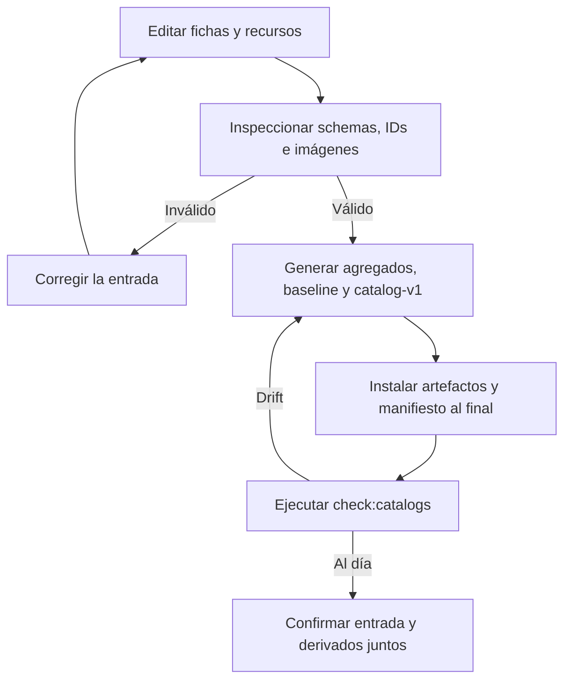
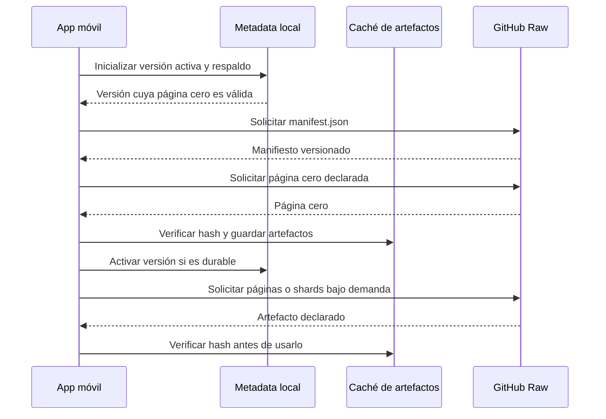

# Repositorios de contenido y catálogos

Los directorios `alimentos/`, `productos_comerciales/`, `recetas/` y `ejercicios/` contienen el contenido curado del producto. Sus fichas JSON y recursos declarados son la entrada editable; agregados, índices, baselines y artefactos de paginación son derivados reproducibles y se confirman junto con esa entrada. No tratar un derivado como una segunda fuente de verdad.

Hay un límite importante: `alimentos/ciqual/` es una importación versionada de ANSES-CIQUAL, no otra colección de fichas curadas a mano. Sus XML de origen, fichas, diccionarios e índices tienen un proceso propio; la app consume una proyección compacta integrada. Por otro lado, `user_personal_foods` pertenece al dispositivo: no tiene URL remota ni se publica en estos repositorios. Para el uso de alimentos y enlaces en comidas, véase [Dieta y estimación de alimentos](../mobile/diet-and-food-estimation.md).

## Qué se edita y qué se genera

| Dominio | Entrada que mantiene el repositorio | Derivados relevantes | Consumo móvil |
| --- | --- | --- | --- |
| `alimentos/` | `<id>.json` e imágenes declaradas | `all.json`, `index.json`, `foodBaseline.generated.json` | agregado remoto y baseline integrado |
| `productos_comerciales/` | `<id>.json` e imágenes declaradas | `all.json` | agregado remoto |
| `recetas/` | `<id>.json` e imágenes declaradas | `all.json` | agregado remoto |
| `ejercicios/` | `<id>.json` y las dos imágenes declaradas | `all.json`, `index.json`, `catalog-v1/` | manifiesto, páginas e índices bajo demanda |
| `alimentos/ciqual/` | XML importados y `translations.es.json` | fichas, índices, diccionarios y manifiesto CIQUAL | proyección `ciqualBaseline.generated.json` incluida en la app |
| `apps/mobile/catalogs/generated/` | No es entrada manual | schemas TypeScript y baselines | validación y disponibilidad local |

El generador de catálogos recorre las fichas por nombre de archivo y conserva ese orden en los agregados. Para alimentos crea un índice `{id, name}` y copia `alimentos/all.json` al baseline de la app; para ejercicios crea un índice de IDs y el catálogo paginado. También transpone los schemas de alimento y ejercicio a `catalogSchemas.generated.ts`, que usa el parser móvil. En consecuencia, un cambio de ficha o schema exige regenerar y revisar los derivados afectados.

Las fichas nutricionales comparten un schema estricto para identidad, nombre, categoría, nutrientes y porción. Las recetas se publican aquí como ficha nutricional calculada por 100 g, no como instrucciones ejecutables de preparación. Las fichas de ejercicio declaran metadatos, instrucciones e imágenes `images/<id>-male.webp` y `images/<id>-female.webp`; el ID debe coincidir con el nombre de su JSON.

La inspección bloquea JSON o schema inválido, discrepancia entre fichero e ID, IDs duplicados —incluidos duplicados entre los tres dominios nutricionales—, rutas inseguras o con distinta capitalización, recursos faltantes o huérfanos y bytes que no son WebP. Las imágenes nutricionales deben ser cuadradas; las de ejercicio, 16:9. Por tanto, `images/` no es un directorio de borradores: todo archivo debe estar referenciado por una ficha.

## Generación y guardas de publicación

Los puntos de entrada habituales desde la raíz son:

```bash
npm run sync:catalogs
npm run check:catalogs
npm run test:catalogs
npm run test:catalogs:e2e
```

`sync:catalogs` inspecciona las entradas y escribe derivados. `check:catalogs` inspecciona los cuatro dominios, compara todos los derivados esperados y detecta tanto drift como JSON inesperado en `ejercicios/catalog-v1/`. No acepta `--domain`: el check es deliberadamente global. En cambio, una regeneración enfocada sí puede usar `node scripts/catalogs/generate.mjs --write --domain alimentos`; úsela solo cuando se haya determinado qué derivados de ese dominio deben cambiar.

La escritura prepara archivos temporales, instala primero contenido y elimina artefactos de ejercicio obsoletos; `catalog-v1/manifest.json` se renombra al final. Ante una falla, revierte reemplazos y restaura los borrados que alcance a recuperar. Esta orden protege al consumidor de un manifiesto que describa páginas aún no publicadas, aunque una falla de rollback se comunica como error y debe investigarse antes de publicar.



*El pipeline de contenido valida antes de escribir y activa el manifiesto de ejercicios después de sus artefactos.*

`catalog-v1` fija una versión mediante el hash SHA-256 del catálogo canónico. Su manifiesto describe páginas de 30 fichas, sus hashes, shards de búsqueda de unigramas y bigramas normalizados, y shards de directorio por primer byte del ID. Cada artefacto declarado lleva su hash; `all.json` no participa en la exploración paginada del cliente.

## CIQUAL: importación distinta y baseline integrado

CIQUAL conserva 3.484 fichas locales procedentes de los cinco XML oficiales de la entrega ANSES 2025. Las fichas, índices, diccionarios y manifiesto se generan de forma determinista; `translations.es.json` es la superficie editorial para las traducciones y vincula cada nombre a las etiquetas originales mediante SHA-256. No se deben editar a mano los archivos generados de `alimentos/ciqual/`.

La importación puede descargar los XML fijados o usar una copia local. Comprueba hashes antes de convertir y `check:ciqual` valida la entrega sin red; con `--source-dir` además reconstruye y compara todos los archivos. Después de cambiar la importación o las traducciones, genere y compruebe la proyección móvil:

```bash
npm run import:ciqual -- --download
npm run check:ciqual
npm run sync:ciqual:mobile
npm run check:ciqual:mobile
```

La proyección integrada contiene los nombres, categoría y cinco valores por 100 g necesarios en la app. Conserva calificadores como límite, traza o dato ausente: no convierte incertidumbre en cero. Es una fuente independiente, `anses_ciqual_2025`, disponible en el primer arranque sin conexión y actualizable únicamente mediante una nueva versión de la app; no reemplaza IDs de los catálogos curados ni crea una caché remota de CIQUAL.

## Fuentes nutricionales, procedencia e imágenes

El registro móvil define tres fuentes nutricionales remotas —`gymnasia_foods`, `gymnasia_products` y `gymnasia_recipes`— cuyas URL GitHub Raw apuntan a su `all.json`. Cada una lleva claves de caché v2 y heredada v1, procedencia de repositorio y parser. Solo `gymnasia_foods` recibe el baseline curado integrado. CIQUAL se registra por separado y el alimento personal tiene `url: null`, procedencia `local://device` y almacenamiento privado.

El parser de los tres agregados remotos rechaza cualquier ficha que declare un `sourceId` o `source` distinto de la fuente esperada. Después de validar la ficha sin esos campos, añade de nuevo la procedencia canónica. La URI de imagen se deduce de `sourceId`: productos usa `productos_comerciales/images`, recetas usa `recetas/images` y el resto de catálogo curado usa `alimentos/images`. Los alimentos personales y CIQUAL devuelven `null`, incluso si se invoca el helper con una ficha que declara imagen; sus imágenes no se resuelven desde GitHub Raw.

Un snapshot nutricional actual encapsula versión, fuente, fecha, hash SHA-256 del JSON canónico, ETag opcional, procedencia y datos. Se valida de nuevo al leer. Si existe una caché actual inválida se rechaza y no se intenta una caída silenciosa a la clave heredada; si falta la clave actual, un array heredado puede migrarse como `stale`. Tras hidratar el almacenamiento, el runtime ofrece datos locales y refresca las fuentes remotas en paralelo. Un fallo de red conserva el snapshot previo; si no puede persistir una descarga válida, los datos sirven durante la sesión con aviso `cache_write_failed`, sin promesa de continuidad offline. Estados distintos entre fuentes producen disponibilidad agregada `partial`.

## Ejercicios: versión activa, artefactos y fallback

El runtime de ejercicios identifica la fuente como `gymnasia_exercises` y usa por defecto `ejercicios/catalog-v1` en GitHub Raw. Valida estrictamente `manifest.json`: versión e hashes, tamaño de página, conteos, rutas permitidas, estrategia de búsqueda y shards sin IDs repetidos. Si el manifiesto no está vacío, descarga y valida además la página cero antes de activar la nueva versión.

Los artefactos se almacenan con la clave `(catalogVersion, path)` y se vuelven a verificar contra el hash del descriptor tanto al leer caché como tras descargar. La metadata V4 conserva una versión activa y, cuando procede, su anterior. Solo sustituye metadata durable si la primera página de la nueva versión quedó verificadamente almacenada; aun si persiste falla, el resultado de red puede servir a la sesión y se marca `cache_write_failed`. Cuando la activación es durable, se podan las versiones distintas de activa y anterior si el almacenamiento permite enumerar y borrar claves.



*Una publicación remota solo se vuelve activa después de validar su manifiesto y su primera página; cada artefacto se verifica antes de uso o persistencia.*

Al iniciar, el runtime descarta metadata o primera página no verificable y prueba el respaldo anterior. Si la publicación remota falla o es inválida, conserva la versión válida ya activa. Si no hay una versión V4 utilizable, migra datos completos V2/V3 válidos a páginas locales marcadas `localMigration`; esa alternativa no tiene shards remotos de búsqueda ni directorio y se considera `stale`. Sin una caché válida ni migrable, el estado es `unavailable`.

La exploración carga una página por cursor. La búsqueda normaliza minúsculas, acentos y puntuación; usa el shard determinado por el primer ancla de consulta y filtra exactamente los candidatos por nombre, grupo muscular, músculo secundario, equipo y dificultad. Para referencias persistidas, primero busca en las páginas cacheadas de la versión activa y anterior y, si falta un ID, consulta el shard de directorio para cargar solo su página. Descargas simultáneas de la misma URL comparten una sola petición.

Si el shard de búsqueda no está disponible o es inválido, la búsqueda recorre las páginas cacheadas de la versión activa y anterior. El resultado avisa `remote_failed` y no declara cobertura global, excepto en el fallback `localMigration`, cuya cobertura es el catálogo migrado completo. El controlador del selector cancela la petición al cerrar, cambiar consulta o reemplazarla por una revisión nueva, y compara la revisión antes de aplicar resultados tardíos.

## Identidad persistida, extensiones y pruebas

Las referencias persistidas usan `{ schemaVersion, sourceId, itemId }` dentro de un enlace `linked`, o conservan un motivo `unresolved`; no dependen del nombre que ve la persona. Al resolver ejercicios enlazados se actualizan nombre, grupo muscular e imagen en las plantillas, por lo que un renombre publicado mantiene el vínculo. Para contenido heredado sin enlace, la migración automática solo acepta una coincidencia exacta o un alias con candidato único. Una coincidencia ambigua requiere selección manual.

Al añadir contenido, asigne un ID estable, declare y añada exactamente los recursos requeridos, ejecute `npm run sync:catalogs` y confirme el resultado. Cambiar IDs, schemas, rutas de imágenes o el formato de `catalog-v1` modifica un contrato de publicación, caché y referencias: requiere una estrategia explícita de compatibilidad o migración. Los puntos de extensión seguros son nuevas fichas que cumplen el schema y nuevos datos CIQUAL regenerados desde su fuente; no editar agregados, shards, baselines ni schemas generados directamente.

Las pruebas unitarias de catálogos cubren determinismo, drift, imágenes, rutas, limpieza de artefactos obsoletos y rollback de escritura. Las del runtime cubren manifiestos y hashes, activación, recuperación de caché, migración V2/V3, versiones anterior/activa y fallos de persistencia. La E2E exporta la app web e intercepta GitHub Raw para verificar agregados nutricionales, selector paginado con scroll y búsqueda, enlaces que sobreviven a un renombre, continuidad offline, migración, disponibilidad parcial, rechazo de caché manipulada y selección manual ante alimentos ambiguos. También cubre CIQUAL integrado sin red, sus datos incompletos y la escritura por referencia rechazada cuando faltan nutrientes.
