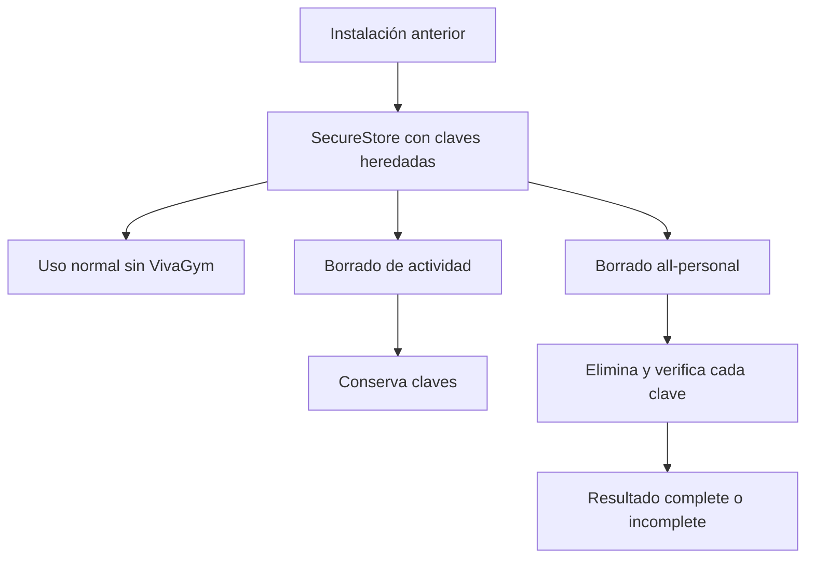
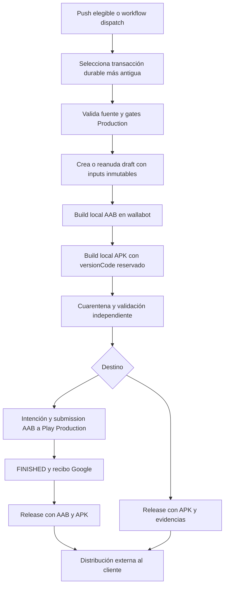
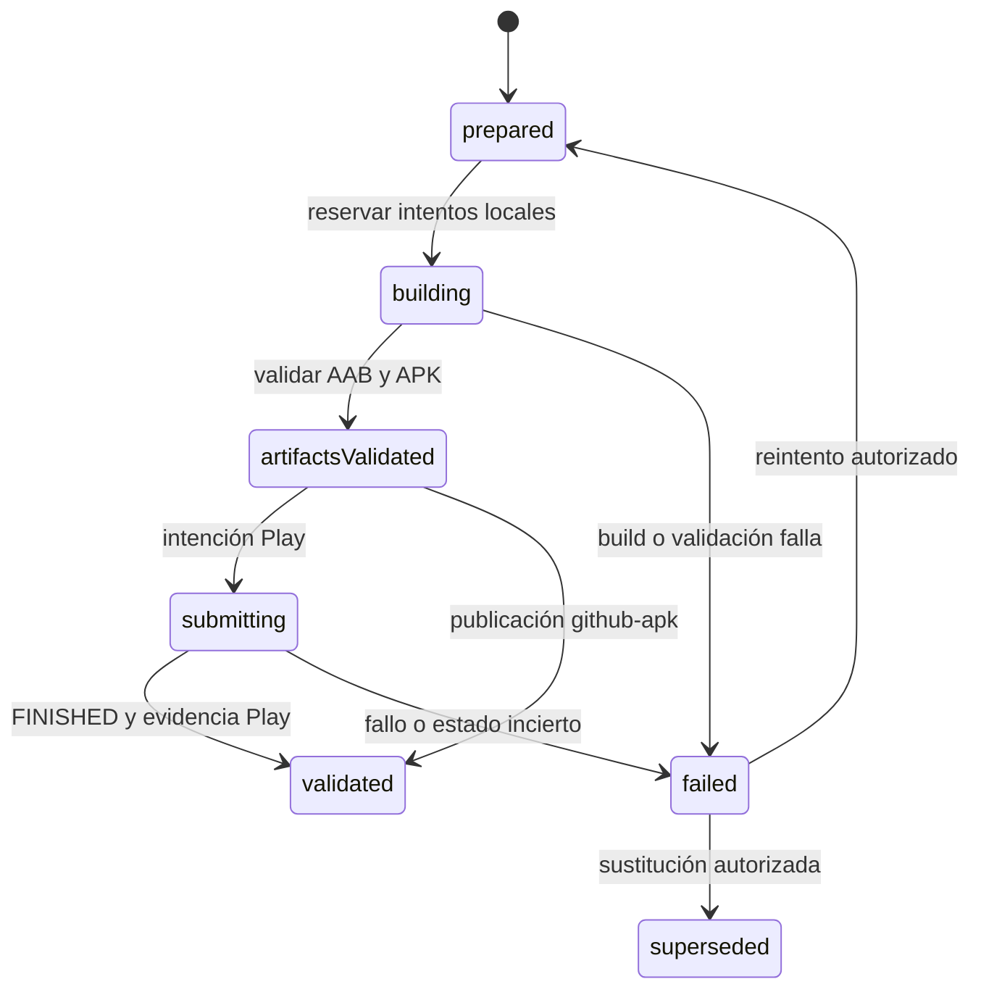

# VivaGym, distribución y actualizaciones

Gymnasia separa tres límites que no deben confundirse: VivaGym no forma parte del runtime, las pocas claves históricas solo sobreviven para poder borrarse, y la app no descarga ni instala actualizaciones. La compilación y distribución Android es una transacción externa y auditable. Para el estado local general, véase [Estado local, persistencia y copias](../mobile/local-state-and-backup.md); para permisos y operación, [Permisos Android](../operations/android-permissions.md) y [Build, release y pruebas](../operations/build-release-and-testing.md).

## VivaGym está retirado

`vivagymRemoval.contract.test.ts` recorre el runtime TypeScript/TSX y rechaza la interfaz, el protocolo MyVitale, el host, rutas de autenticación y QR, además de `react-native-qrcode-svg`. Por ello no existe una pestaña, autenticación, lectura de QR ni tráfico activo hacia VivaGym/MyVitale. La documentación histórica no es una especificación para reactivarlo: una integración futura necesitaría diseñar de nuevo autorización, privacidad, red, almacenamiento, borrado y pruebas positivas.

### Residuos de credenciales y borrado verificable

La lista cerrada `RETAINED_LEGACY_SECURE_STORE_KEYS` contiene únicamente `vivagym.email` y `vivagym.password`. El runtime no las lee ni escribe. El manifiesto de borrado las conserva en el borrado de actividad y las incluye en `all-personal`; este último crea destinos de SecureStore que eliminan y comprueban cada clave. Production usa la clave base y Development/Staging la namespecean, por lo que los ámbitos no comparten esas claves heredadas.

*Las claves de VivaGym son datos de migración pasivos: solo el borrado personal total intenta eliminarlas.*

El ejecutor procesa destinos en paralelo, con timeout para operación y comprobación. Omite verificar un destino cuyo borrado falló y clasifica incidencias como `delete`, `verify` o `timeout`; solo devuelve `complete` cuando todos los destinos fueron borrados y verificados. Esto permite reintento o recuperación sin comunicar un borrado no comprobado.

## No hay actualizador dentro del cliente

`updateRemoval.contract.test.ts` prohíbe el servicio, estado, UI, navegación y endpoint `/releases/latest` del actualizador anterior. `gymnasia.mobile.lastUpdateCheck` es una marca heredada: se limpia al arrancar y durante el borrado total, no inicia una consulta de versión. Las E2E web complementan el contrato: Production falla si Inicio o Ajustes muestran esos controles o solicitan GitHub Releases, y Development también rechaza VivaGym/MyVitale.

`REQUEST_INSTALL_PACKAGES` está bloqueado en `app.json` y en la política de permisos; las pruebas comprueban que ni configuración ni dependencias lo reintroduzcan y el verificador de artefactos vuelve a inspeccionar el manifest fusionado. Una persona puede descargar `gymnasia.apk` externamente, pero Gymnasia no tiene la capacidad de descargar o instalar paquetes.

La justificación de la política aún dice que Production se actualiza «exclusivamente mediante Google Play». Es una descripción obsoleta: la ruta ejecutable puede publicar un APK para instalación directa en GitHub. No cambia el límite de runtime ni habilita actualización automática.

## Entrega Android externa

`.github/workflows/build-apk.yml` construye siempre los dos resultados del mismo candidato: AAB con el perfil `production` y APK con `production-apk`, compartiendo `versionCode`. El destino manual `publication_target` se decide antes de crear la transacción y queda inmutable para sus reanudaciones:

- **`play`** es el predeterminado. Envía por path el AAB ya validado mediante EAS Submit al track **`production`**, con `releaseStatus: completed`; después publica una GitHub Release con `gymnasia.aab`, `gymnasia.apk` y las evidencias.
- **`github-apk`** no usa EAS Submit, credenciales de Google ni Play. Aun así compila y valida AAB y APK; la release publicada contiene el APK y las evidencias de fuente, AAB y APK, pero no adjunta el AAB ni evidencia de Play.

`Play Internal` es el GitHub Environment que protege el job de submission, no el nombre del track. La configuración actual en `eas.json` y `policy.json` usa `production`. El validador acepta `internal`, `alpha` y `production` para poder leer transacciones históricas; esto no convierte los tracks antiguos en destinos de nuevas transacciones.

*Los dos destinos exigen ambos binarios validados; solo `play` exige un submission terminado y evidencia de Google Play.*

### Entrada, cola y control manual

El workflow se activa manualmente o por cambios elegibles de `apps/mobile/**` en `main`; excluye scripts, Markdown, `public` y pruebas TypeScript. Solo opera en `maximofn/gymnasia` y `refs/heads/main`. La concurrencia `android-production-release` no cancela ejecuciones en curso.

Se atiende primero la transacción pendiente de menor versión semántica. `target_version`, si se proporciona, debe ser esa transacción: no permite saltar la cola. Las operaciones son:

- `reconcile`: crea, reanuda o verifica una release publicada;
- `retry-failed`: requiere una transacción `failed` y un motivo;
- `supersede-failed`: requiere fallo, motivo y que `main` tenga una versión posterior;
- `adopt-submission`: asocia el `submission_id` exacto a una intención Play incierta.

Una transacción existente no puede cambiar de destino. Tras una publicación Play o una sustitución, `enqueue-next` puede solicitar la reconciliación de una versión posterior ya presente en `main`; la ruta `github-apk` no encadena otra publicación.

### Fuente, compilación y cuarentena

`validate-production` genera una única `ProductionSourceEvidenceV2` para ambos artefactos. Comprueba commit, limpieza y versión del checkout, controles remotos, destino de publicación y gates Production; rechaza tanto un gate fallido como una mutación del checkout producida por esos gates. El draft durable conserva esa evidencia, el snapshot y bundle de política, y los inputs de versión. Al reanudar, se restauran en lugar de recalcularse.

La compilación ocurre únicamente en el job autoalojado `compile-android`, protegido por el environment `Production`, sobre el runner `wallabot` desechable. Se reservan intentos locales separados con hashes de inputs inmutables. `run-local-build.mjs` ejecuta `eas build --local --non-interactive --freeze-credentials`: `production` reserva el `versionCode` con `autoIncrement`, y `production-apk` lo reutiliza con `autoIncrement: false`. No se crean builds EAS cloud. Cada intento registra commit, perfil, toolchain, hash SHA-256 y tamaño; los binarios se transfieren como no confiables a un job independiente y el material temporal se elimina.

`verify-artifacts` los descarga en `/tmp/quarantine` y valida AAB y APK por separado contra fuente, política y snapshot: configuración embebida, manifest, firma/certificado, permisos, recursos, versión, tamaño, hash y MIME. La evidencia `ProductionArtifactEvidenceV2` se escribe incluso ante violaciones, antes de que el comando falle. Ambos resultados deben tener el mismo `versionCode`, y el AAB debe superar el suelo configurado de Play.

### Estado durable, Play y publicación

La transacción V2 tiene patas `aab`, `apk` y `play`. Las binarias evolucionan por `prepared`, `building`, `built`, `validated` o `failed`; Play solo puede prepararse cuando ambas están validadas. Para `github-apk`, la pata Play debe permanecer `prepared`, sin intentos ni submission, y la validación global sucede después de los dos artefactos. Para `play`, la validación global exige submission `FINISHED` y evidencia Play.

*El estado global distingue los artefactos validados de una publicación Play verificada; GitHub APK no puede iniciar transiciones de Play.*

Antes de contactar EAS, la ruta Play persiste una intención ligada al hash del AAB validado y al `versionCode`, y sube solo ese archivo por `--path`. Conserva el submission ID, espera el estado terminal, verifica con la cuenta de servicio de Google el bundle y track recibidos, y crea evidencia ligada al receipt antes de publicar el draft. Si EAS pudo aceptar la petición sin devolver ID, el estado es `uncertain`: se prohíbe la re-subida automática y se requiere `adopt-submission`. Si un submission conocido termina `ERRORED` o `CANCELED`, un reintento motivado usa su ID sin volver a cargar el AAB.

La publicación final vuelve a comprobar draft, commit, dos binarios, tamaños, MIME, hashes y la cadena de evidencias. La ruta Play requiere los assets de AAB/APK, evidencia de fuente y de ambos artefactos, evidencia Play, receipt de Google y transacción; la ruta GitHub APK rechaza AAB y evidencia Play como assets publicados, aunque exige las evidencias AAB/APK para probar el candidato común.

## Comprobaciones focalizadas

| Cambio o riesgo | Comprobación | Qué acredita |
| --- | --- | --- |
| Reaparición de VivaGym, MyVitale, QR o dependencia QR | `npm run test:deterministic` | Ausencia de protocolo/interfaz y uso de claves limitado al borrado. |
| Reaparición del actualizador | `npm run test:deterministic` | Ausencia de UI, servicio y endpoint, y limpieza de marca heredada. |
| Superficies o peticiones retiradas | `npm run test:agent:e2e` y `npm run test:update-removal:e2e` | Las variantes no muestran ni solicitan los flujos retirados. |
| Permisos Android | `npm run check:android-permissions && npm run test:android-permissions` | Bloqueo de permisos, incluidos los aportados por dependencias. |
| Fuente y artefactos Production | `npm run verify:production-source` y `npm run verify:production-artifact` | Correspondencia de candidato, política, snapshot y binario. |
| Recuperación y publicación | `npm run test:production-release` | Cola, transiciones, inputs inmutables, submission por path, incertidumbre y aislamiento de `github-apk`. |

Los tests de `release-transaction.mjs` y `workflow.test.mjs` son el foco al cambiar recuperación o entrega: cubren la selección semver, destino inmutable, la no duplicación de submission incierto, reintentos por ID, assets permitidos y la separación de la ruta manual `github-apk` de credenciales y herramientas de Play.
