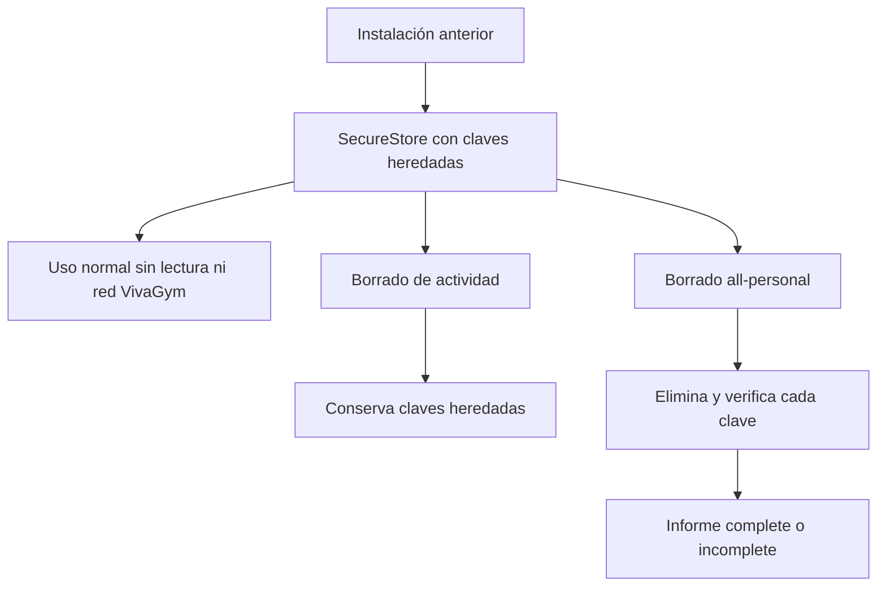
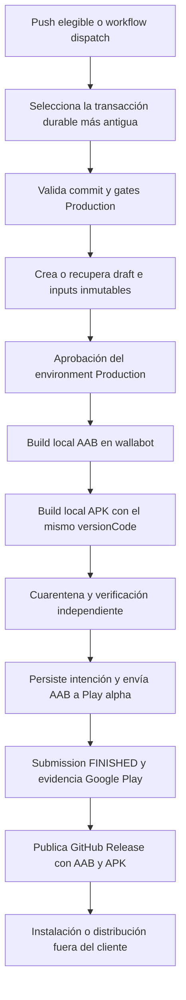
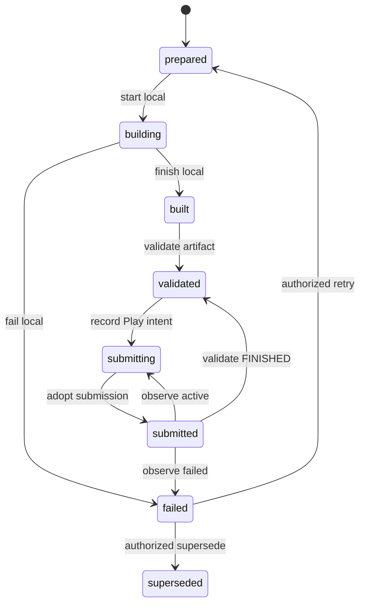

# VivaGym, actualizaciones y entrega móvil

Gymnasia separa deliberadamente tres contratos:

1. **VivaGym no pertenece al runtime actual.** No hay autenticación, red, QR ni interfaz activa para MyVitale/VivaGym.
2. **Dos claves históricas solo se conservan para poder eliminarlas.** Su inventario de borrado no reactiva la integración.
3. **La aplicación no actualiza APK.** La compilación, validación y distribución Android ocurren fuera del cliente mediante una transacción de release.

La distinción evita confundir residuos de migración o infraestructura de entrega con capacidades de la app. Para el estado local general, véase [Estado local, persistencia y copias](../mobile/local-state-and-backup.md); para los permisos y la operación de releases, [Permisos Android](../operations/android-permissions.md) y [Build, release y pruebas](../operations/build-release-and-testing.md).

## VivaGym: retirada, no integración latente

`vivagymRemoval.contract.test.ts` recorre las fuentes TypeScript y TSX del runtime, excluyendo pruebas, scripts, `public`, `dist` y dependencias. Rechaza símbolos del protocolo retirado, el host `vivagym.myvitale.com`, rutas OAuth y QR, textos de interfaz y `react-native-qrcode-svg`; además exige que esa dependencia no esté en `package.json`. En consecuencia, la app no tiene pestaña, autenticación, captura de QR ni tráfico MyVitale.

Documentos previos sobre MyVitale o QR son contexto histórico, no una especificación ejecutable. Reintroducir VivaGym sería una integración nueva: necesitaría autorización, términos y privacidad revisados, límites explícitos de red y almacenamiento, borrado, controles de QR y pruebas positivas. Eliminar el contrato de ausencia no aporta esos elementos.

### Credenciales heredadas y borrado

`RETAINED_LEGACY_SECURE_STORE_KEYS` es una lista cerrada: `vivagym.email` y `vivagym.password`. El runtime retirado no las lee ni las escribe. `LOCAL_SECURE_DATA_MANIFEST` las clasifica como `activity: "preserve"` y `full: "delete"`: borrar actividad no las toca; `all-personal` genera destinos de SecureStore que borran y verifican cada clave.

*Las credenciales históricas permanecen pasivas hasta un borrado total explícito y verificable.*

El ejecutor procesa los destinos en paralelo y aplica timeouts independientes al borrado y a su comprobación. Si el borrado falla, omite la comprobación; clasifica incidencias como `delete`, `verify` o `timeout`. Solo informa `complete` si todos los destinos se eliminaron y verificaron, y conserva fallos y destinos completados para recuperación o reintento sin declarar un borrado no comprobado.

Las claves seguras también se separan por variante: Production usa la clave base y Development/Staging le añaden un namespace. Esto delimita ámbitos de almacenamiento; no migra ni comparte credenciales entre identificadores de aplicación.

## Sin actualizador dentro del cliente

`updateRemoval.contract.test.ts` prohíbe que `App.tsx` conserve servicio, estado, acciones, textos, navegación o el endpoint `/releases/latest` del antiguo actualizador. La clave `gymnasia.mobile.lastUpdateCheck` persiste únicamente como dato heredado: al arrancar, `clearLegacyStorageData` la elimina con `AsyncStorage.multiRemove`, y el borrado total también la incluye. No desencadena una consulta de versión.

Android no declara `REQUEST_INSTALL_PACKAGES`: `app.json` lo bloquea, y la política y sus pruebas impiden que configuración o dependencias lo reintroduzcan. La verificación del artefacto inspecciona de nuevo el manifest fusionado. La consecuencia precisa es que una persona puede obtener e instalar externamente `gymnasia.apk`, pero Gymnasia no pide capacidad para descargar o instalar paquetes.

Las E2E complementan estos contratos estáticos: la variante web Production falla si Inicio o Ajustes exponen el actualizador o solicitan la URL histórica de GitHub Releases; Development comprueba además la ausencia de la pestaña VivaGym y de peticiones a MyVitale. No sustituyen la inspección del manifest ni una instalación en un dispositivo.

## Entrega Android externa

El workflow `.github/workflows/build-apk.yml` genera dos artefactos del mismo candidato y `versionCode`:

- `gymnasia.aab`, perfil `production`, se presenta por path mediante EAS Submit a Google Play en el track **`alpha`**, con `releaseStatus: completed`.
- `gymnasia.apk`, perfil `production-apk`, se adjunta a la misma GitHub Release para instalación directa externa.

`Play Internal` es el nombre del GitHub Environment que protege el job de envío; no debe interpretarse como el track configurado. La política de release y `eas.json` establecen actualmente `alpha`; el código admite `internal` para poder verificar transacciones históricas. Ninguna de estas rutas crea un canal de actualización en runtime.

*El borrador solo se publica tras validar ambos binarios, el submission y el receipt del track configurado de Google Play.*

### Triggers, cola y operaciones manuales

El workflow se activa con `workflow_dispatch` o con cambios elegibles de `apps/mobile/**` en `main`; excluye scripts, Markdown, recursos públicos y pruebas TypeScript. Solo opera en `maximofn/gymnasia` y `refs/heads/main`. El grupo `android-production-release`, con `cancel-in-progress: false`, serializa las ejecuciones.

La selección atiende primero la transacción pendiente de menor versión semántica. Las operaciones manuales son:

- `reconcile`: crea una transacción para la versión actual, reanuda la más antigua o verifica una release ya publicada;
- `retry-failed`: reabre solo una transacción `failed` y exige motivo;
- `supersede-failed`: marca como sustituida una transacción fallida, exige motivo y que `main` declare una versión posterior;
- `adopt-submission`: enlaza manualmente un `submission_id` cuando Play pudo aceptar la petición pero EAS no devolvió su identidad.

`target_version` puede identificar la transacción objetivo, pero debe coincidir con la más antigua y no permite saltar la cola. Tras publicar o sustituir, `enqueue-next` puede reconciliar una versión posterior que ya exista en `main`.

### Fuente, draft e inputs inmutables

`validate-production` hace checkout del commit de la transacción y crea una `ProductionSourceEvidenceV2` común para los targets AAB y APK. Comprueba identidad, limpieza y versión del checkout, controles remotos y gates Production; falla si un gate falla o modifica el checkout.

En una transacción nueva, el workflow crea un draft durable antes de compilar y fija evidencia de fuente, snapshot y bundle de política, y la referencia de `versionCode` basada en `PLAY_VERSION_CODE_FLOOR` y evidencia anterior. Al reanudar, restaura esos inputs en vez de recalcularlos. `local-controller.mjs` guarda hashes SHA-256 de los inputs por intento y el runner los vuelve a comprobar antes de construir.

### Builds locales y límites de confianza

`compile-android` es el único job autoalojado y el único protegido por el environment `Production`; su aprobación permite usar `EXPO_TOKEN`. Corre en el runner Linux x64 `wallabot`, en una VM desechable, con checkout del SHA ya validado y sin credenciales persistentes de GitHub.

La transacción reserva intentos separados para AAB y APK. `run-local-build.mjs` exige commit, versión, inputs, toolchain y condiciones de aislamiento esperadas, y ejecuta `eas build --local --non-interactive --freeze-credentials` para cada pata. Primero `production` crea el AAB y reserva por `autoIncrement` el siguiente `versionCode` remoto; luego `production-apk`, con `autoIncrement: false`, produce el APK con ese código. No se crea una build EAS cloud.

Cada resultado `wallabot-local` conserva intento, commit, perfil, versión, toolchain, SHA-256 y tamaño. Los binarios se transfieren como no confiables a un job independiente; checkout, logs privados y material temporal se eliminan al terminar.

### Cuarentena, evidencia y publicación

`verify-artifacts` descarga los resultados a `/tmp/quarantine`, los vincula a los intentos terminados y verifica AAB y APK por separado. `verify-artifact.mjs` contrasta configuración embebida, manifest, paquete, versión y SDK, certificado, permisos, recursos, tamaño, SHA-256 y MIME con política, fuente y snapshot. Para AAB además valida firma y estructura con `bundletool` fijado; para APK usa `apkanalyzer`, `apksigner` y `aapt2`.

La evidencia `ProductionArtifactEvidenceV2` se escribe incluso si detecta violaciones y después el comando falla. Ambos artefactos deben validar con el mismo `versionCode`; el AAB debe superar el máximo entre el suelo de Play y la última publicación conocida. El draft conserva el commit, binarios, evidencias y sus digests antes de contactar Play.

La publicación final vuelve a comprobar que el draft sigue siendo tal, apunta al commit fuente y contiene ambos binarios, MIME y tamaños admitidos, digests de binarios y evidencias, evidencia de fuente compartida, evidencia Play y receipt de Google. Solo entonces deja de ser draft; publica `gymnasia.aab` y `gymnasia.apk`, aunque solo el APK es instalable directamente.

### Submission a Play y recuperación segura

La pata `play` se prepara únicamente tras validar AAB y APK. Antes de contactar EAS persiste una intención ligada al SHA-256 del AAB validado y al `versionCode`; después usa solo ese AAB local por `--path`, no una build cloud. El flujo conserva el submission ID, espera estado terminal `FINISHED`, verifica en Google Play el bundle y track configurados, crea evidencia Play y recién entonces valida la transacción global.

Si EAS puede haber aceptado la petición pero no entrega un ID, la pata queda `uncertain` y se prohíbe repetir la carga automáticamente. Una persona debe reconciliar y ejecutar `adopt-submission` con el ID exacto. Si el submission conocido termina en `ERRORED` o `CANCELED`, un reintento motivado pasa por su ID y no vuelve a cargar el AAB.

*Resumen del estado global: los dos artefactos deben estar validados antes de preparar Play, y el estado `validated` requiere la evidencia del submission `FINISHED`.*

La implementación conserva tres patas (`aab`, `apk`, `play`). Las binarias recorren `prepared`, `building`, `built`, `validated` o `failed`; Play usa además `submitting`, `submitted`, `retry-pending` y `uncertain`. Un fallo o incertidumbre lleva la transacción global a `failed`; solo una transacción fallida puede reintentarse o sustituirse con motivo. El historial y el draft permiten reanudar sin cambiar commit ni inputs.

### Nota sobre la política de permisos

La justificación de `REQUEST_INSTALL_PACKAGES` afirma que Production se actualiza exclusivamente mediante Google Play, pero la ruta ejecutable también publica `gymnasia.apk` en GitHub para instalación directa. Es una contradicción documental que conviene corregir al cambiar la política. No altera el límite de runtime: ni el track `alpha` ni GitHub Releases permiten a la aplicación comprobar, descargar o instalar APK automáticamente.

## Comprobaciones focalizadas

| Cambio o riesgo | Comprobación | Qué acredita |
| --- | --- | --- |
| Reaparición de VivaGym, MyVitale, QR o dependencia QR | `npm run test:deterministic` | Ausencia de protocolo e interfaz, lista cerrada de claves y consumo limitado al borrado total. |
| Reaparición del actualizador | `npm run test:deterministic` | Ausencia de servicio, UI y endpoint, y limpieza de la marca heredada. |
| Superficies o peticiones retiradas en web | `npm run test:agent:e2e` y `npm run test:update-removal:e2e` | Development y Production no muestran controles retirados ni contactan MyVitale o GitHub Releases. |
| Permisos o plugins Android | `npm run check:android-permissions && npm run test:android-permissions` | Coherencia entre configuración y política y detección de permisos de dependencias; no sustituye la inspección del binario. |
| Fuente y artefactos Production | `npm run verify:production-source` y `npm run verify:production-artifact` | Correspondencia del candidato exacto y de cada binario con identidad, política, snapshot, toolchain y evidencia. |
| Máquina de estados y publicación | `npm run test:production-release` | Cola, estados V2, intentos locales, `versionCode` común, envío por path, incertidumbre y publicación posterior a la verificación de Play. |

Los tests de `release-transaction.mjs` son especialmente relevantes para cambios de recuperación: cubren el único submission por intención, el bloqueo de reintento ante incertidumbre, el reintento de un submission conocido sin reconstruir binarios, la sustitución solo por una versión posterior, la prioridad semver de la cola y la compatibilidad de lectura con releases históricas de Play Internal.
