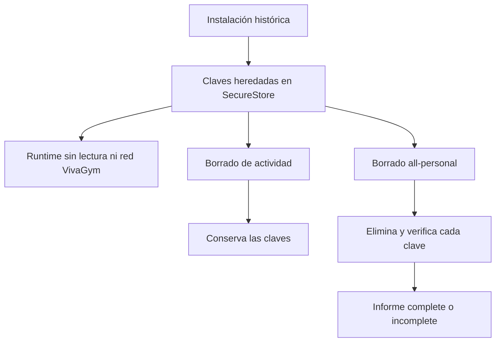
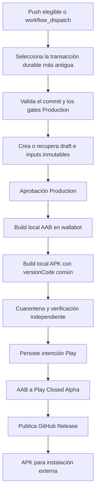

# VivaGym, actualizaciones y distribución

Gymnasia separa tres responsabilidades que no deben confundirse:

1. **VivaGym no es una integración ejecutable.** El runtime no ofrece autenticación, red, QR ni interfaz para ese servicio.
2. **Dos claves de una instalación histórica se retienen únicamente para borrarlas.** No constituyen credenciales activas ni reactivan el protocolo.
3. **El cliente no se actualiza a sí mismo.** La compilación, validación y distribución Android son operaciones externas al runtime.

Para estado local y borrado general, véase [Estado local, persistencia y copias](../mobile/local-state-and-backup.md). Los permisos y la operación de releases se detallan en [Permisos Android](../operations/android-permissions.md) y [Build, release y pruebas](../operations/build-release-and-testing.md).

## VivaGym: integración retirada

`apps/mobile/agent/vivagymRemoval.contract.test.ts` recorre las fuentes TypeScript y TSX de runtime, excluyendo tests, scripts, `public`, `dist` y `node_modules`. Rechaza símbolos y endpoints del protocolo anterior —incluidos `vivagym.myvitale.com`, OAuth, QR y `react-native-qrcode-svg`— y exige que la dependencia QR tampoco esté en `package.json`. También comprueba que las declaraciones públicas no anuncien VivaGym. En consecuencia, no se debe interpretar documentación histórica sobre MyVitale o QR como una especificación de producción.

Reintroducir el servicio sería una integración nueva: requeriría definir autorización, privacidad, límites de red y almacenamiento, borrado, controles de QR y pruebas positivas. Eliminar este contrato de ausencia no sería suficiente.

### Datos heredados

La lista cerrada `RETAINED_LEGACY_SECURE_STORE_KEYS` contiene `vivagym.email` y `vivagym.password`. Solo `legacySecureStorage.ts` y el flujo de borrado las consumen. En `LOCAL_SECURE_DATA_MANIFEST`, su política es `activity: "preserve"` y `full: "delete"`: el borrado de actividad las conserva, mientras que `all-personal` las elimina de SecureStore y verifica la eliminación.

*Las claves heredadas son pasivas y solo se eliminan en el borrado total explícito.*

El ejecutor aplica tiempos límite independientes a eliminación y verificación; no verifica una clave cuya eliminación falló. Solo informa `complete` si todos los destinos concluyen y se verifican, de modo que un fallo queda visible para informar o reintentar sin afirmar un borrado no comprobado.

## No hay actualizador en el cliente

`apps/mobile/agent/updateRemoval.contract.test.ts` impide que `App.tsx` recupere el servicio, estado, acciones, textos, navegación o endpoint `/releases/latest` del actualizador anterior. La clave `gymnasia.mobile.lastUpdateCheck` sobrevive exclusivamente como dato heredado: se incluye en `LEGACY_STORAGE_KEYS` y se elimina al arrancar con `AsyncStorage.multiRemove`; no provoca una consulta de versiones.

Android bloquea `REQUEST_INSTALL_PACKAGES` en `apps/mobile/app.json`, y la política y sus pruebas impiden que configuración o dependencias lo reintroduzcan. La verificación de artefactos inspecciona además el manifest fusionado. Por tanto, alguien puede descargar e instalar externamente `gymnasia.apk`, pero Gymnasia no solicita permiso para descargar o instalar paquetes.

## Distribución Android vigente

El workflow `.github/workflows/build-apk.yml` crea dos binarios de la misma versión y los conserva en la misma GitHub Release:

- `gymnasia.aab`, perfil `production`, se envía mediante EAS Submit al track `alpha` de Google Play, la **prueba cerrada**, con `releaseStatus: completed`.
- `gymnasia.apk`, perfil `production-apk`, queda como asset para instalación directa externa.

El environment de GitHub aún se llama `Play Internal`, pero es un nombre histórico que conserva su secreto: no determina el track. Los testers de la prueba cerrada reciben el AAB por Play; la promoción desde esa prueba a producción es manual. Ninguna de ambas rutas añade comprobación, descarga o instalación de actualizaciones al runtime.

*La release sigue siendo borrador hasta validar ambos binarios, el envío a Play y sus evidencias.*

### Entrada, cola e inputs inmutables

El workflow se activa manualmente o ante cambios elegibles bajo `apps/mobile/**` en `main`; la concurrencia `android-production-release` no cancela una ejecución en curso. Selecciona primero la transacción durable pendiente de menor versión. Las operaciones manuales son `reconcile`, `retry-failed`, `supersede-failed` y `adopt-submission`; `target_version` no puede saltarse la transacción más antigua. Tras publicar o sustituir, `enqueue-next` puede encolar la versión posterior presente en `main`.

`validate-production` trabaja sobre el commit exacto y genera una evidencia de fuente común a AAB y APK. Antes de compilar se crea o recupera el draft durable: una transacción nueva fija evidencia de fuente, snapshot y bundle de política, y la referencia de `versionCode`; una reanudación restaura esos inputs. El controlador registra SHA-256 de los inputs de cada intento y el runner los vuelve a comprobar antes de construir.

### Build local y cuarentena

`compile-android` es el único job en el environment `Production`; la aprobación libera `EXPO_TOKEN` para el runner `wallabot`. `run-local-build.mjs` exige el commit, versión, run, toolchain y aislamiento esperados, y ejecuta `eas build --local --non-interactive --freeze-credentials` dentro de un directorio privado. Primero construye el AAB con `production`, que reserva el siguiente `versionCode`; luego construye el APK con `production-apk`, que no incrementa el contador y reutiliza ese código. No crea builds EAS cloud.

Los binarios y sus metadatos se transfieren como resultados no confiables a `verify-artifacts`. Allí se enlazan con sus intentos y se inspeccionan por separado contra política, snapshot y evidencia de fuente: configuración embebida, manifest, identidad, versión, certificado, permisos, recursos, tamaño, SHA-256 y MIME. El AAB se valida además con `bundletool`; el APK con herramientas Android. Ambos deben conservar el mismo `versionCode`, y el AAB debe superar el umbral configurado de Play.

### Transacción, Play y publicación

La transacción durable V2 mantiene patas `aab`, `apk` y `play`. Los binarios progresan por `prepared`, `building`, `built` y `validated`; Play solo puede prepararse cuando los dos artefactos están validados y la intención contiene el hash del AAB y el `versionCode` común. El estado global alcanza `validated` únicamente después de un submission EAS `FINISHED`, el recibo de Google para el bundle y track esperados, y la evidencia Play asociada.

Antes de contactar EAS, el workflow persiste esa intención. Sube exclusivamente el AAB ya validado por `--path` y guarda el submission ID. Un fallo conocido puede reintentarse por ID sin volver a subir bytes. Si la petición pudiera haber llegado a EAS pero no devuelve ID, la pata queda `uncertain`: se prohíbe repetir automáticamente y una persona debe reconciliarla mediante `adopt-submission`.

La publicación final vuelve a exigir que el draft apunte al commit correcto, que todos los assets y evidencias existan, y que MIME, tamaños y digests coincidan con la transacción. Solo entonces publica la GitHub Release con `gymnasia.aab`, `gymnasia.apk`, las evidencias de fuente, artefactos y Play, el recibo de Google y la transacción. Un fallo lleva la transacción a `failed`; reintentar o sustituir exige una operación manual con motivo.

### Nota sobre el permiso de instalación

La justificación de `REQUEST_INSTALL_PACKAGES` todavía dice que Production se actualiza exclusivamente mediante Google Play, mientras que el workflow adjunta un APK instalable directamente a GitHub Releases. Esa contradicción documental no altera el límite de seguridad: el permiso sigue bloqueado y el cliente no tiene actualizador propio. Al cambiar la política conviene corregir esa explicación para reflejar las dos rutas externas.

## Comprobaciones focalizadas

| Riesgo o cambio | Comprobación | Qué cubre |
| --- | --- | --- |
| Reaparición de VivaGym, MyVitale, QR o dependencia QR | `npm run test:deterministic` | Ausencia de protocolo e interfaz, claves heredadas cerradas y uso solo en borrado total. |
| Reaparición del actualizador | `npm run test:deterministic` | Ausencia de servicio, UI y endpoint; limpieza de la marca heredada. |
| Permisos Android | `npm run check:android-permissions && npm run test:android-permissions` | Coherencia configuración-política y permisos aportados por dependencias. |
| Fuente y binarios Production | `npm run verify:production-source` y `npm run verify:production-artifact` | Correspondencia del candidato y de cada binario con política, snapshot, identidad y evidencia. |
| Controlador y workflow | `npm run test:production-release` | Cola, estados V2, intentos locales, `versionCode` común, envío por path, incertidumbre y publicación posterior a Play. |

Estas pruebas no sustituyen una release real: las E2E de retirada acreditan ausencia observable de interfaz y red, mientras que la distribución exige además inspección de ambos binarios, recepción de Google Play y reconciliación de la transacción.
