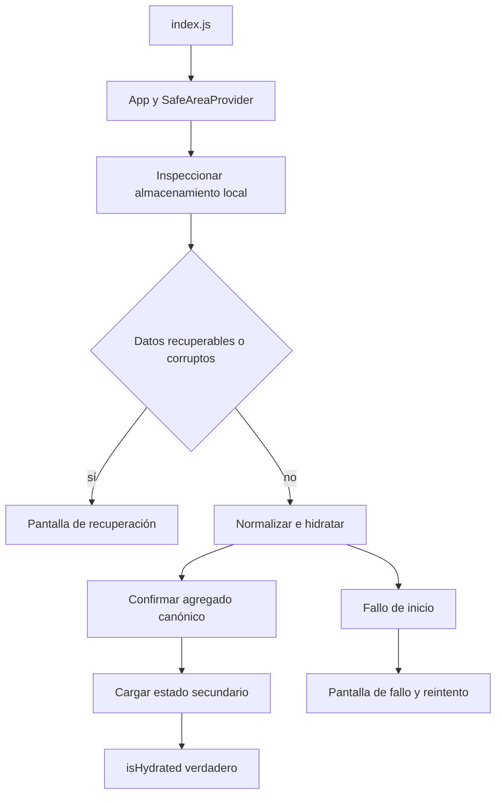
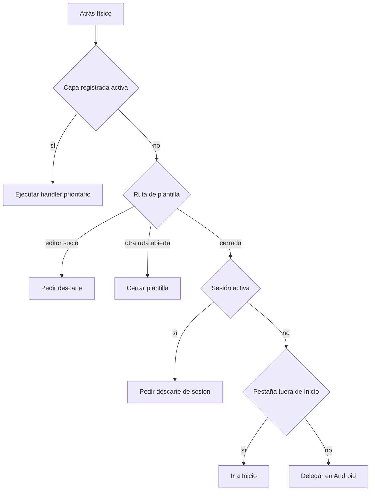

# Shell de aplicación móvil

`apps/mobile/index.js` registra `App` con `registerRootComponent`. `App` es deliberadamente pequeño: instala un único `SafeAreaProvider`, conserva una generación de runtime y monta `GymnasiaApp`. Tras un borrado local completado, incrementa la generación y remonta el árbol con una `key` nueva; el resultado del borrado se entrega al nuevo shell para mostrar el resultado y, si fue incompleto, abrir Configuración. `GymnasiaApp` es el compositor de runtime local, estado de navegación, controladores y superficies globales, no un sustituto de los límites de cada dominio.

## Arranque local-first y barrera de hidratación

El runtime comienza con `createInitialStore()`, `loading: true` e `isHydrated: false`. Al montar, `runLocalStoreHydration` inspecciona el agregado local **antes** de normalizarlo, publicarlo en React o persistirlo. Un resultado `recoverable` o `corrupt` mantiene la barrera cerrada y sustituye el shell por `LocalStoreRecoveryScreen`. Si un error no puede llevarse a cuarentena, aparece `LocalStoreStartupFailureScreen`, que permite reintentar pero no presenta una aplicación vacía.



*El agregado principal se inspecciona y se confirma antes de que el shell habilite sus escrituras.*

En la ruta válida, el shell carga y migra las claves de proveedor según plataforma, confirma la representación canónica del agregado y luego lee sesión activa, instantánea y borrador de plantilla, preferencias, salud de alarmas y consentimiento. Los fallos de SecureStore o de datos secundarios se señalan como no fatales cuando es posible: no invalidan por sí solos el agregado principal. Solo al reemplazar los runtimes y el estado React se activa `isHydrated`; después se refrescan los diagnósticos de notificaciones.

`isHydrated` es una barrera de escritura. Los runtimes que persisten el agregado, la sesión y el borrador deben retornar mientras sea falso. Si el `commit` es ambiguo o queda bloqueado, el shell vuelve a inspeccionar y solo vuelve a habilitarse mediante una ruta válida. No retire esta condición al mover una pantalla, un hook o un controlador.

### Recuperación explícita

La recuperación no revela valores del usuario en sus detalles: expone rutas y códigos de incidencias. Sus operaciones son recuperar la última instantánea verificada, exportar el payload en cuarentena con contraseña, reintentar la inspección sin respetar una cuarentena previa o descartar los datos afectados tras confirmación. Al descartar, se escribe un `createInitialStore()` con la configuración de proveedores disponible y se eliminan sesión activa, instantánea y borrador de sesión; no implica borrar indiscriminadamente preferencias u otras particiones personales.

## Composición: shell, runtimes, controladores y UI

`GymnasiaApp` posee el ensamblaje y los efectos transversales: crea el runtime de almacén local, hidrata estado, conecta servicios de plataforma y decide qué superficie se renderiza. Los hooks de dominio reciben datos y capacidades concretas —por ejemplo `useDietRuntime`, `useMeasurementsRuntime` y los runtimes de Configuración— y exponen controladores con `model`, `actions` y, cuando corresponde, `back`. Las pantallas reciben esos contratos (`HomeScreen`, `DietMealsScreen`, `MeasurementsScreen`, pantallas de entrenamiento y `SettingsScreen`) en lugar de leer directamente almacenamiento o servicios de plataforma.

El shell conserva el estado que cruza dominios o compone vistas: pestaña, sesión activa, ruta anidada de entrenamiento y overlays globales. El controlador de Inicio ilustra la frontera: recibe `openTraining` y `startTrainingSession` desde el shell; si hay sesión abre Entrenamiento, si hay una plantilla ejecutable inicia esa plantilla y, si no, abre Entrenamiento para crearla. Por tanto una pantalla no debe inventar otra ruta ni persistir por fuera del runtime que la posee.

## Insets y superficie raíz

La superficie normal se dibuja dentro de un `SafeAreaView` de `react-native-safe-area-context`. Con el modo edge-to-edge de Android no se debe importar el `SafeAreaView` del core de React Native ni añadir `StatusBar.currentHeight`: ambos provocarían insets ausentes o duplicados. Los `Modal` nativos quedan fuera del contenedor raíz, por lo que cada modal debe aplicar su propio `SafeAreaView` de la misma biblioteca. El contrato estático protege un proveedor raíz único y prohíbe las compensaciones manuales y el import del core.

## Navegación: un estado, dos formatos

No hay rutas URL ni una pila principal restaurable. `TAB_DESTINATIONS` es el registro único de los `TabKey`: `home`, `training`, `diet`, `measures`, `chat` y `settings`; también declara etiqueta, iconos y `testID`. La pestaña es estado React, inicialmente Inicio salvo un restablecimiento incompleto, que abre Configuración. El shell selecciona el contenido de la pestaña y las rutas secundarias conservan su propio estado y controlador.

`usesDesktopNavigation` solo devuelve escritorio cuando `Platform.OS === "web"` y el viewport tiene al menos 960 px. En ese caso se monta `DesktopSidebar`; en web estrecha y en iOS/Android se usa la navegación compacta de `AppHeader`, incluso si el dispositivo nativo es ancho. Ambos controles llaman al mismo `onTabChange`, por lo que cambiar el ancho intercambia el control visual sin reiniciar `tab` ni una vista anidada.

| Formato | Navegación | Selectores |
|---|---|---|
| Escritorio web | Barra lateral con los seis destinos. | `desktop-nav-${key}` |
| Compacto, web estrecha y nativo | Banda del encabezado con los mismos destinos. | `nav-tab-${key}` |

Añadir una pestaña exige actualizar `TAB_DESTINATIONS` **y** el renderizado de contenido de `App`; ambas barras se derivan del registro, pero el contenido no. Las pruebas del registro fijan destinos, la frontera de 960 px, selectores únicos y que Android/iOS nunca adopten escritorio solo por su ancho.

## Atrás de Android y propiedad de las superficies

`SHELL_BACK_LAYERS` registra cada superficie propiedad de `BackHandler`: identificador, alcance, prioridad única descendente, `testID`, propietario y comportamiento. `App.tsx` debe construir de forma exhaustiva el mapa de visibilidad y el de handlers a partir de estado local y de controladores. `resolveShellBackCommand` toma la primera capa activa en ese orden; existe una única suscripción Android estable que consulta un `ref` actualizado en cada render, evitando resuscripciones y cierres obsoletos.



*Una capa registrada prevalece sobre rutas anidadas, sesión y pestaña; Inicio sin superficie administrada devuelve el evento al sistema.*

Los modales nativos y las pantallas de recuperación/fallo aparecen separadamente en `SYSTEM_OWNED_SHELL_SURFACES`: React Native gestiona `onRequestClose` de los modales y el arranque delega al sistema. Una nueva superficie que deba responder a Atrás necesita registro, estado de visibilidad, handler y prueba; renderizarla no basta.

## Sesión, alertas locales y ciclo de vida

Al iniciar una sesión se solicitan permisos de notificación y, en Android, se crea o consulta el canal `rest_end_alert`. Un fallo se traza pero no bloquea el entrenamiento. Cuando empieza un descanso programable, el shell cancela avisos anteriores, valida sesión y preferencias y programa la notificación para el instante esperado. Al pasar a segundo plano persiste el reloj conciliado y conserva el aviso solo si sigue aplicando.

En primer plano, el reloj reproduce la alerta interna al terminar. El `setNotificationHandler` global suprime banner y sonido de una notificación de descanso recibida en primer plano para evitar una alerta duplicada. La bandeja, listeners y la última respuesta aportan evidencia de entrega y el retraso frente a `expected_at_ms`; esa evidencia determina si corresponde la alerta recuperada al volver.

## Variantes Expo, permisos y aislamiento local

`app.config.ts` exige `APP_ENV` con `development`, `staging` o `production`. Cada variante define nombre, identificador iOS/Android, canal de política y espacio de nombres. Desarrollo usa `fake` por defecto y puede usar `byok` con `DEV_PROVIDER_MODE`; staging y producción usan `byok`. El config inyecta esa configuración, la versión de configuración, metadatos de política y el endpoint de incidencias en `expo.extra`; `resolveRuntimeEnvironment` rechaza extras ausentes, híbridos o incompatibles.

Las claves AsyncStorage y SecureStore se prefijan fuera de producción mediante el espacio de nombres; producción usa las claves canónicas. Esto evita que instalaciones de prueba compartan estado local con producción. El manifiesto Android declara `WAKE_LOCK`, `VIBRATE`, `RECEIVE_BOOT_COMPLETED` y `SCHEDULE_EXACT_ALARM`, bloquea `USE_EXACT_ALARM`, instalación de paquetes, micrófono y ventanas superpuestas, y no declara servicio en primer plano. `app.config.ts` añade dinámicamente `expo-notifications` y sus sonidos empaquetados.

## Validación enfocada

Use validación proporcional al límite modificado:

```bash
npm --workspace apps/mobile exec tsc --noEmit
npm --workspace apps/mobile run test:deterministic -- shell/shellRegistry.test.ts shell/shellRegistry.contract.test.ts shell/safeArea.contract.test.ts
npm --workspace apps/mobile run build:web
npm --workspace apps/mobile run test:shell-navigation:e2e
npm --workspace apps/mobile run test:storage-recovery:e2e
```

`shellRegistry.test.ts` cubre destinos, prioridades y fallbacks de plantilla, sesión, pestaña y sistema; el contrato exige una suscripción estable, handlers/estados exhaustivos y `testID` por superficie. `safeArea.contract.test.ts` inspecciona todas las fuentes de la app para proteger los insets de Android. `shell-navigation.e2e.mjs` exporta el bundle web de desarrollo, siembra un almacén local y recorre los seis destinos a 390 y 960 px; además verifica que capas representativas se abren y cierran sin perder estado de vista anidada. Para permisos, canales, audio o alarmas, la exportación web no sustituye una compilación nativa probada con permisos concedidos y denegados y una transición real entre segundo plano y primer plano.
