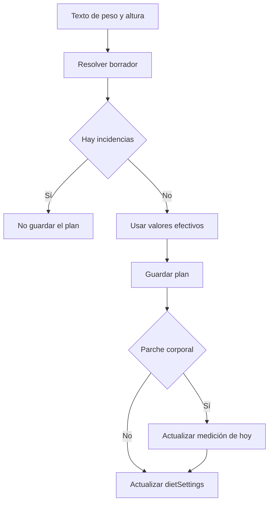
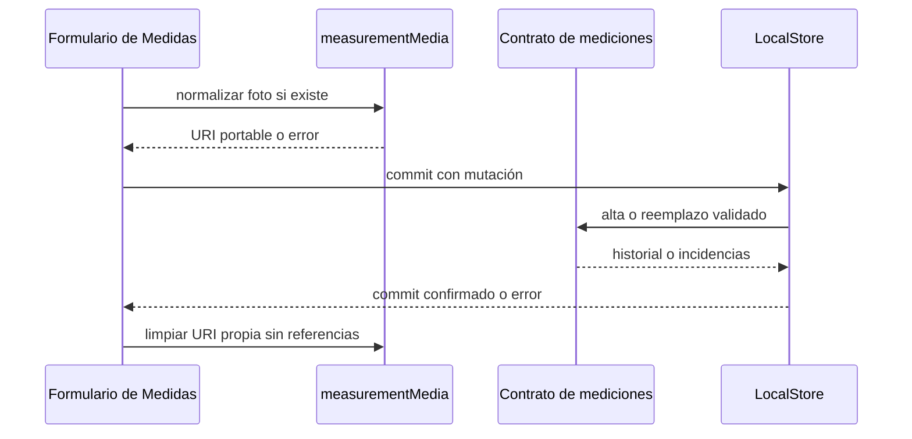

# Mediciones y métricas corporales

El historial `measurements` es la fuente de verdad para las métricas corporales. `apps/mobile/measurements/measurementContract.ts` concentra su forma, normalización, mutaciones y lecturas derivadas; la pantalla de Medidas, el plan de dieta y las herramientas del agente pasan por ese límite. En particular, peso y altura no deben convertirse en una segunda copia persistida dentro de `dietSettings`.

## Registro, validación y mutaciones

Una `Measurement` contiene `id`, el día de calendario `measured_on`, el instante técnico `measured_at`, `photo_uri` opcional y estas diez métricas opcionales: `weight_kg`, `body_fat_pct`, `neck_cm`, `chest_cm`, `waist_cm`, `hips_cm`, `biceps_cm`, `quadriceps_cm`, `calf_cm` y `height_cm`.

| Invariante | Efecto observable |
|---|---|
| Fecha | Debe ser un día real `AAAA-MM-DD`, no futuro. Para migrar datos antiguos puede derivarse desde un `measured_at` válido; cuando se crea o cambia el instante del día se usa el mediodía local, evitando desplazar la fecha por zona horaria. |
| Métricas | Deben ser números finitos y positivos, se redondean a dos decimales y `body_fat_pct` no supera 100. Las cadenas con coma o punto decimal se admiten solamente en entradas que solicitan esa compatibilidad. |
| Contenido | El registro debe conservar al menos una métrica o una foto. Para quitar el último dato se elimina el registro por `id`, no se persiste una medición vacía. |
| Orden y límite | El historial se ordena por día descendente, luego `measured_at` e `id`, y conserva como máximo 1.826 registros. La mutación devuelve los desplazados por el límite. |
| Conflictos diarios | Datos heredados pueden tener duplicados. No se puede hacer `upsert` sobre un día ambiguo ni mover una edición a un día ya ocupado; se debe corregir desde el historial. |

`upsertMeasurementByDate` aplica un parche a un único registro del día: mantiene las métricas y la foto omitidas. `replaceMeasurementById`, usada al editar desde el historial, reemplaza todos los valores del formulario y puede cambiar de fecha solo sin conflicto. Las dos rutas vuelven a validar, exigen contenido, ordenan y aplican el límite. `deleteMeasurementById` es la única operación que puede dejar de existir el último contenido.

## Borrador de peso y altura del plan

El formulario de dieta mantiene solamente texto efímero en `BodyMetricsDraft` (`weightInput`, `heightInput`). `resolveBodyMetricsDraft` acepta coma decimal y produce en una misma resolución:

- valores efectivos para macros por kg y cálculo calórico: borrador válido o, si está vacío, el último valor medido;
- un mensaje por campo y `hasIssues` cuando el texto no representa una métrica positiva válida;
- un `MeasurementPatch` con los valores válidos, no vacíos y distintos del último valor registrado.

Un campo vacío no borra una medición. Uno inválido queda efectivo como `null`, marca el problema y no entra en el parche: no se sustituye silenciosamente por el valor previo. Guardar el plan rechaza tanto incidencias del plan como `hasIssues` corporal.



*El plan usa el borrador resuelto; solo escribe peso o altura en la medición de hoy si hay un cambio válido.*

Antes de guardar un parche corporal, `useDietSettingsRuntime` previsualiza `upsertMeasurementByDate` contra el almacén actual. Si falla, no actualiza nada y presenta las incidencias. Si pasa, `localStore.update` escribe en una sola actualización `dietSettings` y la colección resultante; el ID se genera antes del actualizador para que una repetición no cambie el ID. Home, Medidas, dieta y agente vuelven así a leer el mismo historial.

## Entrada manual, fotos y commit

`useMeasurementsRuntime` prepara el historial cuando cambia `store.measurements`, calcula último peso y altura, y entrega modelo y acciones a `MeasurementsScreen`. Para visualizar y calcular grasa, la altura efectiva prefiere la última medida y solo entonces usa un `dietSettings.height_cm` positivo como alternativa, sin copiarlo a una medición.

El estado del formulario —campos de texto, fecha, foto, edición y carga— es local a la pantalla. Al guardar, el runtime analiza cada campo con `parseOptionalPositiveMetricInput`, exige alguna métrica o foto y usa `upsertMeasurementByDate` para un alta o `replaceMeasurementById` para edición. Ambas mutaciones se ejecutan dentro de `localStore.commit`; ante error de contrato se conserva el estado previo y el formulario solo se cierra tras el commit exitoso.

Una foto seleccionada o capturada no se persiste directamente como URI del selector. Antes del commit se normaliza como JPEG, se limita su lado mayor a 2048 px, se comprime con calidad 0,8, se elimina su metadato y se rechaza si sigue superando 5 MiB. En dispositivo nativo se guarda bajo `Paths.document/gymnasia_measurement_media_v1` con nombre SHA-256, por lo que la misma imagen puede reutilizarse; en web queda como URI no poseída y la interfaz advierte que no puede garantizar su disponibilidad tras cerrar el navegador.

Después de una edición o borrado, se elimina un archivo propio solo si ninguna medición resultante lo referencia. Al hidratar, el runtime intenta migrar fotos heredadas a ese almacenamiento propio en nativo y barre huérfanos; un fallo de migración no elimina las mediciones, sino que deja un aviso para revisar las fotos antes de exportar.



*La foto se hace portable antes de persistir; ningún cambio de formulario se considera guardado hasta que el commit termina.*

## Resumen, gráficas y privacidad de visualización

`prepareMeasurementHistory` ordena una vez y localiza los últimos registros con peso y altura. El resumen y las gráficas seleccionan el primer valor finito de cada día, por lo que duplicados heredados no hacen que el resultado dependa del orden de entrada. Los gráficos filtran un rango inclusivo de días de calendario y devuelven puntos cronológicos.

Para grasa corporal, un `body_fat_pct` explícito tiene prioridad. Si falta, se estima con cintura, cuello y altura; para `female` también requiere cadera. Si faltan requisitos o la fórmula no es válida devuelve `null`; las estimaciones válidas se redondean a un decimal y se acotan entre 3 y 60.

Los contadores opcionales de trabajo nunca contienen valores de mediciones. Solo se habilitan en web de desarrollo con `EXPO_PUBLIC_MEASUREMENT_PERF_TEST=1`, para probar que cambios ajenos no fuerzan preparar u ordenar de nuevo el historial.

## Herramientas del agente

`read_measurement` valida la fecha y rechaza un día duplicado antes de responder. Expone métricas y `measured_on`, pero elimina `id`, `photo_uri` y `measured_at`: una conversación no recibe identificadores internos, URI de una foto corporal ni el timestamp técnico.

`write_measurement` recibe `date`, un objeto estructurado `data` y `clear_fields`. Los campos omitidos se conservan; los solicitados en `clear_fields` pasan a `null`. El análisis rechaza claves desconocidas, un parche vacío y actualizar y borrar el mismo campo en una operación. Después el ejecutor usa el mismo `upsertMeasurementByDate` que la app.

La operación exige `context.commitStore`. `App.tsx` lo adapta a `localStoreRuntime.commit`, y el ejecutor añade el recibo de operación en la misma escritura. Solo marca el efecto como confirmado tras completarse el commit; si no hay almacenamiento durable o la mutación encuentra un conflicto, devuelve un error sin afirmar que la medición quedó guardada. Al añadir una métrica, actualice `MEASUREMENT_METRIC_KEYS`, el esquema de `write_measurement` y las proyecciones de pantalla para no desalinear los límites.

## Pruebas y operación

- `bodyMetricsDraft.test.ts` cubre coma/punto decimal, vacío como ausencia, rechazo de texto no finito o no positivo, valor efectivo, parche mínimo y conservación de las demás métricas. Incluye pruebas de propiedades con cadenas y números positivos formateados.
- `measurementContract.test.ts`, `measurementSummary.test.ts`, `presentationModel.test.ts` y `measurementMemoization.contract.test.ts` cubren validación, migración, conflictos, reemplazo, borrado, resúmenes, gráficas y memoización.
- `scripts/measurement-performance.e2e.mjs` construye una app web de prueba con 1.826 registros, inyecta un fallo de persistencia y comprueba que alta, edición, borrado, recarga, importación, recuperación y borrado total actualizan el resultado sin conservar resúmenes obsoletos.

Para cambios en contrato o borrador:

```bash
npx vitest run --config apps/mobile/vitest.config.mts apps/mobile/measurements/bodyMetricsDraft.test.ts apps/mobile/measurements/measurementContract.test.ts apps/mobile/measurements/measurementSummary.test.ts
npx tsc --noEmit -p apps/mobile/tsconfig.json
```

Para la comprobación de rendimiento web, ejecute el script `apps/mobile/scripts/measurement-performance.e2e.mjs` con las dependencias de Playwright disponibles.
