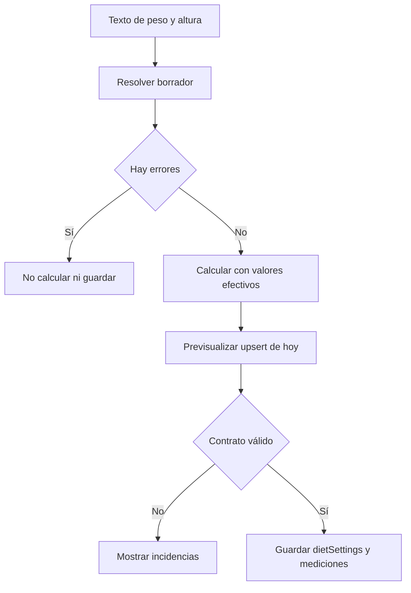
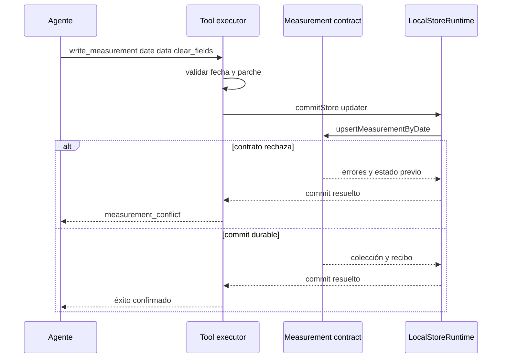

# Mediciones y métricas corporales

`apps/mobile/measurements/measurementContract.ts` es el límite de dominio del historial. Centraliza la forma almacenada, normalización, mutaciones y proyecciones derivadas; la pantalla Medidas, el borrador del plan de dieta y las herramientas del agente deben pasar por él. Peso y altura no tienen una segunda copia persistida en `dietSettings`.

## Registro e invariantes

Una `Measurement` contiene `id`, el día de calendario `measured_on`, el instante técnico `measured_at`, `photo_uri` opcional y diez métricas opcionales: peso, porcentaje de grasa, siete contornos y altura. Al normalizar datos heredados puede derivar el día desde un `measured_at` válido; si debe crear el instante para un día, usa el mediodía local, lo que evita desplazar el día por zona horaria.

| Invariante | Consecuencia práctica |
|---|---|
| Fecha | Debe ser una fecha real `AAAA-MM-DD` y no futura. |
| Métrica | Debe ser finita y positiva, se redondea a dos decimales, y `body_fat_pct` no puede superar 100. Las cadenas con coma o punto decimal se admiten solo en rutas de entrada que lo piden expresamente. |
| Contenido | Una medición debe conservar una métrica o una foto. Para retirar el último contenido hay que borrar el registro por `id`; no existe una medición vacía. |
| Orden y capacidad | La colección queda en orden descendente por día, `measured_at` e `id`, y conserva como máximo 1.826 registros. La mutación informa los registros desplazados por ese límite. |
| Día duplicado | Los duplicados heredados se detectan para su reparación. No se puede hacer `upsert` sobre un día ambiguo ni mover una edición a una fecha ya ocupada. |

`upsertMeasurementByDate` aplica un parche a la única medición existente del día: conserva las métricas y la foto omitidas. `replaceMeasurementById`, usado al editar desde el historial, sustituye todos los valores del formulario y solo puede cambiar de día si no introduce un conflicto. Ambas rutas vuelven a validar, exigir contenido, ordenar y limitar la colección.

## Borrador de peso y altura del plan de dieta

El plan mantiene únicamente texto efímero en `BodyMetricsDraft` (`weightInput` y `heightInput`). `resolveBodyMetricsDraft` analiza ambos con `validateMeasurementMetric`, admite coma decimal y produce a la vez:

- valores efectivos para cálculo: un valor válido del borrador o, si está vacío, el último valor medido;
- un mensaje por campo y `hasIssues` si el texto no es un número positivo válido;
- un `MeasurementPatch` solo con valores válidos, no vacíos y diferentes del último registro.

Un campo vacío no borra una medición. Un valor inválido queda efectivo como `null`, se señala como problema y no entra en el parche; así no se sustituye silenciosamente por el dato anterior. El guardado del plan se bloquea si hay errores. Antes de escribir, el runtime previsualiza el `upsert`; si falla, no cambia nada. Si pasa, actualiza `dietSettings` y la medición de hoy en el mismo mutador del almacén. El ID se crea antes del mutador para que una repetición de este no produzca IDs distintos.



*El borrador decide el valor efectivo y el parche; el contrato decide si la medición de hoy puede persistirse.*

## Entrada manual, fotos y persistencia

`App.tsx` crea `useMeasurementsRuntime` con `LocalStoreRuntime`, servicios de plataforma, preferencias y un generador de IDs. El runtime prepara una vez el historial por cambio de `store.measurements`; de ahí toma últimos peso y altura y el resumen de la pantalla. Cuando aún no hay altura medida, usa como alternativa un `height_cm` positivo de los ajustes de dieta para presentación y cálculos, sin convertirlo en una medición.

La entrada manual conserva localmente fecha, textos, foto, estado de edición, carga y overlays. Al guardar:

1. convierte cada texto con `parseOptionalPositiveMetricInput` y rechaza el primer campo inválido;
2. exige una métrica o una foto;
3. normaliza una foto nueva en almacenamiento de medios propio antes del commit;
4. para una alta hace `upsertMeasurementByDate`; para una edición, `replaceMeasurementById`;
5. ejecuta la mutación con `localStore.commit` y solo cierra el formulario tras el commit exitoso.

Al reemplazar o borrar un registro, el controlador elimina una foto propia únicamente si ya no está referenciada. Tras hidratar, intenta migrar fotos heredadas a ese almacenamiento; en web no puede garantizar la supervivencia de esas URI y muestra un aviso para exportar una copia. Esto evita tratar una URI de galería o cámara como respaldo durable y reduce el riesgo de borrar un medio aún compartido.

## Lecturas derivadas y visualización

Los selectores trabajan sobre un historial preparado y ordenado. Para cada métrica el resumen toma el primer valor finito de cada día: los duplicados heredados no hacen que tarjetas, último peso o gráficas dependan del orden de entrada. Las gráficas filtran un intervalo inclusivo de días de calendario y devuelven los puntos en orden cronológico.

El porcentaje de grasa explícito tiene prioridad. Si falta, se estima con cintura, cuello y altura; para `female` también requiere cadera. La estimación devuelve `null` cuando faltan prerrequisitos o las relaciones son inválidas, y acota su resultado a 3–60 con un decimal. Las preferencias de métrica y periodo de gráfico se actualizan fuera de la colección de mediciones.

## Herramientas del agente: límite de privacidad y confirmación

`read_measurement` valida la fecha y rechaza días duplicados antes de responder. Solo serializa `measured_on` y las métricas: elimina `id`, `photo_uri` y `measured_at`, por lo que el agente no recibe identidad interna, URI de fotografía ni timestamp técnico.

`write_measurement` está declarado como `local_write`. Recibe `data` estructurado y `clear_fields`: campos omitidos conservan el valor existente y los solicitados para borrar pasan a `null`. El parser rechaza campos desconocidos, un parche vacío, tipos inválidos y actualizar/borrar el mismo campo en la operación. Después delega el `upsert` al contrato, por lo que mantiene los límites de fecha, métrica, contenido y duplicados de la UI.

La escritura requiere `context.commitStore`; el adaptador de `App.tsx` lo conecta con `localStoreRuntime.commit`. No hay mensaje de éxito ni `markEffectCommitted` antes de que ese commit resuelva. Si el commit lanza, el ejecutor marca el resultado como indeterminado; si el contrato falla dentro del mutador, responde con conflicto sin modificar la colección. Con `operationId`, el ID de medición se deriva de la operación y se añade un recibo `write_measurement`, lo que permite a la infraestructura de operaciones reconocer la escritura repetida sin crear otra medición.



*La herramienta solo confirma una escritura después del commit durable; una excepción de persistencia no se presenta como éxito.*

Al añadir una métrica, actualice de forma coordinada `MEASUREMENT_METRIC_KEYS`, el esquema de `write_measurement`, sus `clear_fields` y las proyecciones de pantalla. De otro modo el contrato, el agente y la UI aceptarían superficies distintas.

## Pruebas focalizadas

- `bodyMetricsDraft.test.ts` cubre coma/punto decimal, vacío como ausencia, valores no finitos o no positivos, valores efectivos, parche mínimo y preservación de otras métricas al aplicarlo hoy. Incluye propiedades sobre cadenas arbitrarias y números positivos formateados.
- `measurementContract.test.ts` cubre calendario y futuro, redondeo y máximo de grasa, migración heredada, parches del agente, duplicados, reemplazo, borrado, límite, resumen, gráficas y estimación.
- `measurementSummary.test.ts` compara resumen y gráficas con una referencia, permuta historiales y exige una sola ordenación más recorridos lineales del historial preparado. Los contadores de rendimiento no contienen valores de medición.
- `agent/toolExecutor.test.ts` verifica escritura estructurada, preservación de campos omitidos, borrado explícito, rechazo sin persistir ante dato inválido o día duplicado y resultado indeterminado si falla el almacenamiento.

Para cambios de contrato, borrador o herramienta, ejecute:

```bash
npx vitest run --config apps/mobile/vitest.config.mts apps/mobile/measurements/bodyMetricsDraft.test.ts apps/mobile/measurements/measurementContract.test.ts apps/mobile/measurements/measurementSummary.test.ts apps/mobile/agent/toolExecutor.test.ts
npx tsc --noEmit -p apps/mobile/tsconfig.json
```
