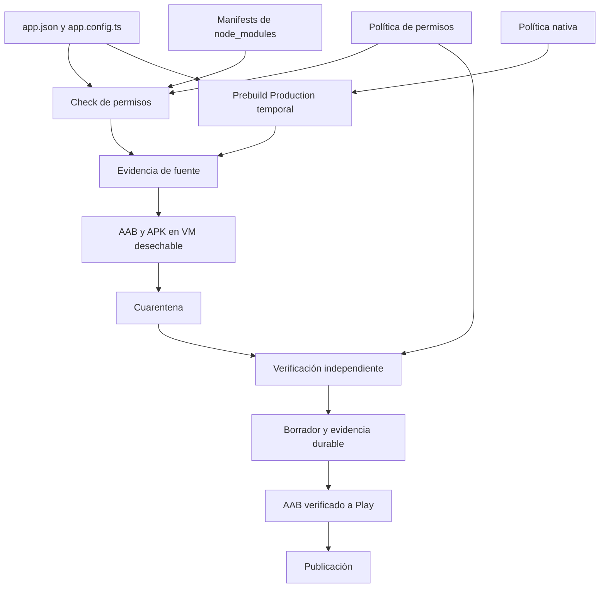

# Permisos Android y verificación de artefactos

La política Android usa defensas complementarias: la configuración Expo declara el mínimo, los permisos prohibidos se eliminan durante el *manifest merger*, el checkout se analiza con dependencias instaladas, y la publicación inspecciona el manifest fusionado del binario. Un resultado verde en una capa no sustituye las demás: el escaneo anticipa deriva de dependencias, el prebuild confirma la configuración nativa generada y la verificación del artefacto examina lo que se distribuye.

Las fuentes declarativas son `apps/mobile/app.json`, `apps/mobile/app.config.ts` y las políticas de `scripts/android-permissions/` y `scripts/android-native-config/`. No se debe editar ni usar `apps/mobile/android/` como verdad de publicación: el control de prebuild lo genera en un directorio temporal.

## Superficie aprobada

`expo.android.permissions` declara exactamente estos permisos:

| Permiso | Necesidad aprobada |
| --- | --- |
| `WAKE_LOCK` | Despertar el dispositivo para el aviso de fin de descanso. |
| `VIBRATE` | Vibración configurable del aviso. |
| `RECEIVE_BOOT_COMPLETED` | Reprogramar avisos después de reiniciar. |
| `SCHEDULE_EXACT_ALARM` | Programar el aviso exacto de descanso. |

`expo.android.blockedPermissions` bloquea `USE_EXACT_ALARM`, `REQUEST_INSTALL_PACKAGES`, `RECORD_AUDIO` y `SYSTEM_ALERT_WINDOW`. El bloqueo es una instrucción efectiva para el merger, no solo documentación. En particular, `USE_EXACT_ALARM` no es intercambiable con `SCHEDULE_EXACT_ALARM`; `FOREGROUND_SERVICE` tampoco forma parte del contrato permitido. `expo-av` establece `microphonePermission: false`: la aplicación reproduce avisos, no graba audio.

`app.config.ts` exige un `APP_ENV` conocido y deriva el identificador de paquete por variante sin reemplazar la configuración Android base. También incorpora `expo-notifications` a partir del catálogo de sonidos. Por ello, introducir un plugin, cambiar sonidos o tocar el configurador dinámico es un cambio de configuración nativa y no solamente de JavaScript.

## Límites de control



*La publicación requiere que el candidato mantenga la evidencia de fuente, ambos artefactos validados y el recibo de Play.*

### Checkout y dependencias

`checkAndroidPermissions` normaliza formas cortas y `android.permission.*`. Exige que la lista configurada sea idéntica a `allowedPermissions` y que cada permiso bloqueado permanezca en `expo.android.blockedPermissions`. Así detecta tanto una ampliación no revisada como la retirada de un permiso que la política aún considera aprobado.

El escáner recorre `node_modules` de la raíz y de `apps/mobile`, no sigue enlaces simbólicos y omite ejemplos, pruebas e intermedios configurados. Lee los elementos `<uses-permission>` de cada `AndroidManifest.xml`. Si no hay manifiestos, falla con `scanner-empty`: hay que ejecutar `npm ci`, pues un escaneo sin dependencias no aporta evidencia.

Una entrada `tools:node="remove"` se ignora en ese escaneo. Ordena al merger retirar un permiso, no lo aporta. Por la misma razón, encontrar `USE_EXACT_ALARM` con un `grep` en el manifest fuente generado no demuestra que exista en el APK/AAB. `acknowledgedContributors` identifica un origen conocido para que el diagnóstico sea accionable, pero no permite que el permiso sobreviva al artefacto final.

### Prebuild aislado

`check:android-native-config` copia `apps/mobile` a un temporal, excluye productos generados y dependencias, enlaza las dependencias instaladas y ejecuta `expo prebuild --platform android --clean --no-install` con `APP_ENV=production`. Evita modificar el checkout y evita validar un directorio Android generado anteriormente.

El contrato del resultado exige conjuntos exactos de permisos y directivas de retirada; rechaza permisos bloqueados y `FOREGROUND_SERVICE` en declaraciones fuente. Además verifica el atributo `android:enableOnBackInvokedCallback`, los atributos y marcadores Kotlin requeridos de `.MainActivity`, los sonidos WAV aprobados y que no haya advertencias de prebuild no permitidas. El manifest fuente puede contener una directiva `remove`; el artefacto no puede contener el permiso eliminado.

### APK/AAB y cadena de Production

El job `validate-production` instala el lockfile, ejecuta `verify:production-source` sobre el SHA seleccionado y conserva su evidencia. Los gates canónicos incluyen `check:android-permissions`, `test:android-permissions`, `check:android-native-config` y `test:android-native-config`, junto con los controles de privacidad, políticas y pruebas generales. La evidencia de fuente también exige que los gates no ensucien el checkout.

Tras la aprobación del entorno `Production`, `compile-android` vuelve a obtener solo el SHA validado, restaura entradas inmutables y construye primero AAB y luego APK en la VM desechable. Los binarios y sus metadatos salen como resultados no confiables hacia cuarentena. En `verify-artifacts`, otro runner descarga esos resultados, vincula cada intento a la transacción y ejecuta `verify:production-artifact` por separado para ambos formatos.

El verificador extrae el manifest mediante `bundletool` para AAB y `apkanalyzer` para APK. Comprueba herramientas, firma/certificado, paquete, SDK, versión, `app.config`, snapshot de política, sonidos, tipo MIME, tamaño y SHA-256. Sobre permisos del manifest fusionado aplica dos invariantes: ningún permiso de `blockedPermissions` puede aparecer y el conjunto debe coincidir exactamente con `expectedArtifactPermissions`. La igualdad detecta permisos añadidos y permisos retirados sin revisión; `expectedMergedExtras` describe aportaciones relevantes, pero no relaja ese contrato.

Solo después se adjuntan los binarios y evidencias validadas al borrador durable. El job de envío restaura el AAB validado y las evidencias de AAB y APK, envía únicamente ese AAB a Play Internal, registra y reconcilia el identificador de envío, y obtiene un recibo de Google Play. La publicación exige que el borrador siga dirigido al commit fuente, que ambos binarios y todas las evidencias tengan los hashes esperados y que la transacción esté en estado `validated`. Si una compilación, verificación o envío falla, se conserva la transacción/borrador para reconciliar o reintentar sin duplicar un envío incierto.

## Operación

Ejecute desde la raíz con dependencias instaladas:

```bash
npm ci
npm run check:android-permissions
npm run test:android-permissions
npm run check:android-native-config
npm run test:android-native-config
npm run check:data-inventory
npm run test:data-inventory
```

`check:*` evalúa el checkout; `test:*` comprueba el evaluador con fixtures y casos de regresión. El check de permisos requiere manifests instalados y el nativo necesita Expo CLI para el prebuild temporal. Ninguno sustituye una prueba manual en dispositivo de permisos concedidos/denegados, alarmas, notificaciones, audio y comportamiento en segundo plano.

El inventario de datos consume la política de permisos y exige una clasificación Data safety para cada permiso permitido y cada extra relevante esperado del merger. Por tanto, un cambio de permisos debe actualizar simultáneamente la configuración Expo, la política y su justificación, el contrato nativo si cambia lo generado, el inventario de datos y las declaraciones publicables. Solo se modifica `expectedArtifactPermissions` tras revisar un artefacto; no para silenciar un fallo.

## Diagnóstico y cambios seguros

| Señal | Acción |
| --- | --- |
| `config-drift` o `config-missing-block` | Alinee `app.json` con la política; no retire el gate. |
| `dependency-contribution` | Identifique la dependencia y confirme que el bloqueo la neutraliza. Reconocer el contribuidor no autoriza el permiso final. |
| `scanner-empty` | Ejecute `npm ci` y repita el check. |
| `source-permissions`, `removal-directives` o `forbidden-source-permission` | Revise plugin/configuración y la semántica del merger en el prebuild. |
| `prebuild-warning`, `main-activity-*` o `notification-sounds` | Investigue el cambio de Expo o plugin; no amplíe una allowlist genérica. |
| `permission` o `artifact-permissions` | Detenga la publicación: el manifest fusionado no satisface el contrato. |

Al añadir una capacidad, parta de la necesidad mínima. Cambie en la misma revisión la declaración y la política, revise los manifests de dependencias, ejecute la batería anterior y amplíe las pruebas focalizadas si cambia un parser, una categoría de infracción o un contrato. Para una release, use el workflow Production: un APK local no equivale a la cadena de SHA, transacción, evidencia de fuente, verificación independiente y recibo de Play.

`permissions.test.mjs` cubre el contrato de configuración, códigos de infracción, recorrido de manifests y el tratamiento de `tools:node="remove"`. `native-config.test.mjs` cubre conjuntos exactos, atributos y marcadores de `MainActivity`, sonidos y advertencias. Estas pruebas son guardrails deterministas, no una prueba de integración Android en un dispositivo.

Para el proceso de release completo consulte [Build, release y estrategia de validación](build-release-and-testing.md); para el ciclo de runtime móvil consulte [Shell y navegación de la aplicación móvil](../mobile/application-shell.md).
