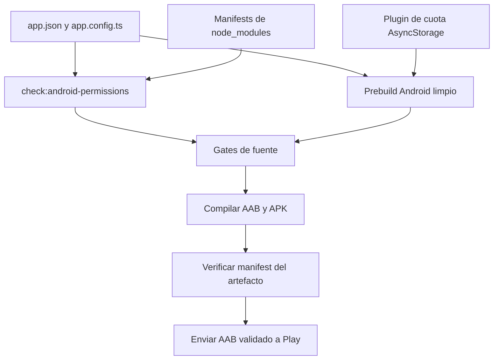

# Configuración nativa, permisos y cuota Android

La configuración Android tiene fronteras deliberadamente distintas. `app.json` expresa la intención de Expo; `app.config.ts` la especializa para una variante; los checks de fuente inspeccionan esa configuración y las dependencias instaladas; el contrato nativo ejecuta un prebuild limpio; y la release inspecciona el manifest fusionado de APK/AAB. Ninguna frontera sustituye a otra.

`apps/mobile/android/` **no es fuente de verdad**: está ignorado y es resultado de `expo prebuild`. No se debe editar para corregir un permiso o la cuota, ni usarlo como evidencia de una release; el siguiente prebuild limpio puede eliminar ese cambio.



*Cada etapa reduce una clase diferente de deriva: el artefacto, no el manifest fuente, es lo que declara permisos al dispositivo y a Play.*

## Permisos: contrato de mínimo privilegio

La allowlist de `expo.android.permissions` contiene exactamente `WAKE_LOCK`, `VIBRATE`, `RECEIVE_BOOT_COMPLETED` y `SCHEDULE_EXACT_ALARM`. `expo.android.blockedPermissions` debe contener `USE_EXACT_ALARM`, `REQUEST_INSTALL_PACKAGES`, `RECORD_AUDIO` y `SYSTEM_ALERT_WINDOW`; la política también prohíbe `FOREGROUND_SERVICE`. `expo-av` se configura con `microphonePermission: false`: la aplicación reproduce avisos, no graba audio.

| Permiso permitido | Finalidad aprobada |
| --- | --- |
| `WAKE_LOCK` | Despertar el dispositivo para el aviso de fin de descanso. |
| `VIBRATE` | Vibración configurable del aviso. |
| `RECEIVE_BOOT_COMPLETED` | Reprogramar avisos tras reiniciar. |
| `SCHEDULE_EXACT_ALARM` | Programar el aviso exacto de descanso. |

`check:android-permissions` normaliza los nombres con o sin `android.permission.`, exige igualdad entre permisos configurados y allowlist, y exige todos los bloqueos. Después busca `AndroidManifest.xml` en los `node_modules` raíz y de `apps/mobile`, sin seguir enlaces simbólicos y omitiendo ejemplos, tests e intermedios definidos por política. Si no hay manifests, falla con `scanner-empty`: correrlo sin `npm ci` no verifica las contribuciones de dependencias.

El diagnóstico `dependency-contribution` identifica la dependencia que aporta un permiso bloqueado. `acknowledgedContributors` solo reconoce un origen conocido; **no autoriza** el permiso en el binario. Asimismo, una entrada con `tools:node="remove"` no es una declaración: es una instrucción para que el *manifest merger* la retire. Por tanto, el escaneo de dependencias y un `grep` del manifest fuente no demuestran el contenido final.

El verificador de producción extrae el manifest de cada APK/AAB y rechaza permisos bloqueados o un conjunto distinto de `expectedArtifactPermissions`. Ese conjunto es mayor que los cuatro permisos explícitos porque fija contribuciones revisadas de dependencias. Comprueba declaraciones empaquetadas, no que el usuario haya concedido un permiso ni que una alarma se ejecute correctamente.

## Configuración Expo y prebuild reproducible

`app.config.ts` parte de `app.json`, rechaza un `APP_ENV` desconocido y aplica nombre, `applicationId`, canal y namespace por variante. También reinyecta `expo-notifications` usando el catálogo de sonidos. Por ello, cambiar un plugin, una dependencia con configuración nativa, un sonido o el configurador dinámico es un cambio del contrato Android, aunque el diff sea TypeScript o JSON.

`npm run check:android-native-config` copia `apps/mobile` a un temporal, excluye `.expo`, `android`, `ios`, `dist` y `node_modules`, enlaza las dependencias ya instaladas y ejecuta allí:

```bash
expo prebuild --platform android --clean --no-install
```

Lo hace con `APP_ENV=production`, `CI=1` y `EXPO_NO_GIT_STATUS=1`; no instala dependencias ni modifica el checkout. El temporal se borra salvo que se solicite `keepTemporary`. Así detecta que Expo o un plugin hayan cambiado el Android generado, sin depender de un árbol nativo residual.

La política compara productos semánticos, no un snapshot completo del árbol generado:

| Producto | Invariante comprobado |
| --- | --- |
| Manifest fuente | Conjuntos exactos de permisos declarados y de directivas `tools:node="remove"`; ausencia de permisos fuente prohibidos. |
| `application` y `.MainActivity` | `enableOnBackInvokedCallback=false`, atributos de actividad y marcadores Kotlin revisados. |
| `res/raw` | Exactamente los WAV de notificación aprobados. |
| `gradle.properties` | Exactamente una propiedad `AsyncStorage_db_size_in_MB=64`. |
| Salida de prebuild | Solo warnings que coincidan con `allowedPrebuildWarnings`. |

Los warnings se detectan en líneas que empiezan por `!`, `»`, `⚠`, `warning` o `warn`. La allowlist actual está vacía: cualquier warning detectado falla como `prebuild-warning`. No se debe añadir un patrón amplio para recuperar el verde; hay que investigar el cambio concreto de Expo o del plugin.

## Cuota de AsyncStorage y actualización segura

El plugin `withAsyncStorageCapacity.cjs` elimina cualquier propiedad previa `AsyncStorage_db_size_in_MB` y escribe `64` durante el prebuild. La cuota Android por defecto de AsyncStorage 2.x es 6 MiB y es compartida por el almacén principal, el snapshot de recuperación y las demás particiones; al agotarse puede aparecer `SQLITE_FULL` aunque el dispositivo tenga espacio. El ajuste eleva el máximo a 64 MiB, pero no reserva espacio, no migra ni reemplaza la base y no borra registros.

Es una propiedad Gradle del binario Android generado: no es un permiso, no aumenta una cuota web y no aplica a Expo Go. Tampoco elimina un disco realmente lleno ni el límite de lectura por entrada de `CursorWindow` (aproximadamente 2 MiB); un valor individual que se acerque a ese límite debe particionarse o trasladarse a otro almacenamiento. Los límites y la recuperación de datos en runtime se documentan en [Estado local, cachés y respaldo](../mobile/local-state-and-backup.md).

La subida de cuota llega únicamente al instalar una build nueva **sobre la instalación existente y con el mismo paquete**. Para validar la actualización sin destruir evidencia:

1. Conservar una instalación cuyos datos hayan alcanzado la cuota anterior.
2. Instalar encima la nueva versión; no desinstalar ni borrar datos.
3. Guardar una medición o sesión y reiniciar la aplicación para comprobar que persiste.
4. Si el teléfono está realmente lleno, liberar espacio fuera de los datos de Gymnasia antes de reintentar.

Así se verifica tanto que los datos sobreviven a la actualización como que la nueva capacidad permite persistir. El cambio solo altera la capacidad máxima del mismo almacén; no cambia por sí mismo categorías de datos, terceros, protección de copias, permisos ni acciones de borrado. Aun así, la cuota debe permanecer inventariada y una modificación de permisos exige la revisión de Data safety y Play.

## Gates de release y operación

Antes de una publicación, `validate-production` acredita el SHA elegido con `verify:production-source`, incluidos los checks y tests de permisos y configuración nativa. El build vuelve a obtener ese SHA, genera AAB antes que APK y un runner separado verifica los artefactos desde cuarentena. Para Play solo se restaura y envía el AAB validado al track `production`; la inspección del artefacto sigue siendo el gate que detecta deriva del manifest merger.

Ejecute desde la raíz, con dependencias instaladas:

```bash
npm ci
npm run test:android-permissions
npm run check:android-permissions
npm run test:android-native-config
npm run check:android-native-config
npm run check:data-inventory
npm run test:data-inventory
```

Los tests prueban los evaluadores mediante fixtures: permisos configurados y de dependencias, semántica de `tools:node="remove"`, conjuntos exactos, atributos y marcadores de `MainActivity`, sonidos, warnings, y cuota ausente, de 6 MiB o duplicada. Son guardrails deterministas; no sustituyen pruebas en Android físico de concesión/denegación de permisos, alarmas, notificaciones, sonido, segundo plano, navegación atrás o capacidad efectiva.

| Señal | Acción segura |
| --- | --- |
| `config-drift` o `config-missing-block` | Alinear `app.json` y la política; no retirar el gate. |
| `dependency-contribution` | Revisar el manifest de la dependencia. Reconocer el contribuidor no autoriza el artefacto. |
| `scanner-empty` | Ejecutar `npm ci` y repetir el check. |
| `source-permissions`, `removal-directives` o `forbidden-source-permission` | Revisar configuración/plugin y la semántica del merger. |
| `gradle-property` | Corregir plugin o política hasta tener una única cuota nativa de 64 MiB. |
| `prebuild-warning`, `main-activity-*` o `notification-sounds` | Investigar el cambio específico; no ampliar una allowlist genérica. |
| `permission` o `artifact-permissions` | Detener la release: el manifest distribuible no satisface el contrato. |

Para un cambio intencionado, actualice en la misma revisión la fuente declarativa, las políticas afectadas y su justificación. Si cambia un permiso, actualice `scripts/data-inventory/inventory.json`, recorra el checklist de privacidad y revise las declaraciones de Play. Después ejecute también `npm run test:production-release`, `npm run check:legal`, `npm run test:legal` y `npm --workspace apps/mobile exec tsc --noEmit`; genere un artefacto Production y pruébelo en un Android físico.

Consulte [Build, release y estrategia de validación](build-release-and-testing.md) para la cadena de publicación, [Shell y navegación de la aplicación móvil](../mobile/application-shell.md) para el runtime, y [VivaGym y actualizaciones](../integrations/vivagym-and-updates.md) para el comportamiento de integraciones ante actualizaciones.
