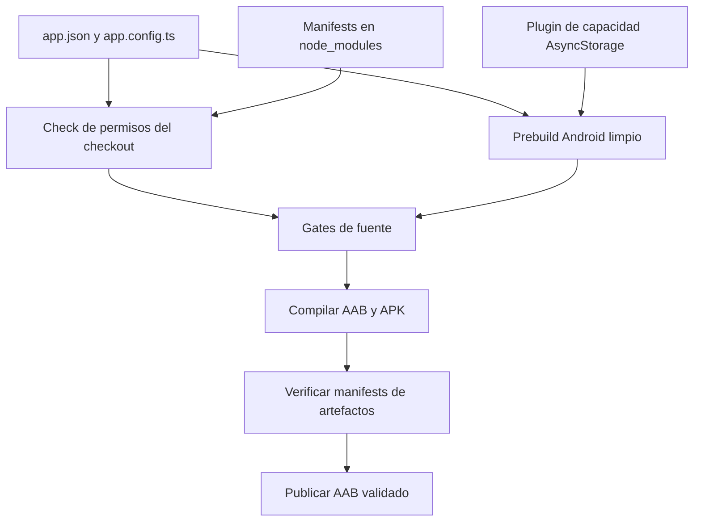

# Permisos y configuración nativa Android

La configuración publicable tiene tres fronteras que deben coincidir: `app.json` expresa la intención de Expo, el prebuild limpio comprueba los archivos nativos que Expo y los plugins generan, y la verificación de release inspecciona el manifest fusionado del APK/AAB. No se debe usar `apps/mobile/android/` como evidencia: es un producto ignorado que puede estar ausente o desactualizado.

## Permisos: intención, contribuciones y artefacto final

`expo.android.permissions` declara exclusivamente `WAKE_LOCK`, `VIBRATE`, `RECEIVE_BOOT_COMPLETED` y `SCHEDULE_EXACT_ALARM`. `expo.android.blockedPermissions` debe conservar `USE_EXACT_ALARM`, `REQUEST_INSTALL_PACKAGES`, `RECORD_AUDIO` y `SYSTEM_ALERT_WINDOW`; el contrato también excluye `FOREGROUND_SERVICE`. `expo-av` configura `microphonePermission: false`, coherente con reproducir avisos y no grabar audio.

| Permiso permitido | Necesidad aprobada |
| --- | --- |
| `WAKE_LOCK` | Despertar el dispositivo para el aviso de fin de descanso. |
| `VIBRATE` | Vibración configurable del aviso. |
| `RECEIVE_BOOT_COMPLETED` | Reprogramar avisos tras reiniciar. |
| `SCHEDULE_EXACT_ALARM` | Programar el aviso exacto de descanso. |

`check:android-permissions` normaliza tanto `android.permission.X` como `X`, exige la igualdad entre los permisos configurados y la allowlist, y exige cada bloqueo configurado. También recorre los `AndroidManifest.xml` de `node_modules` raíz y de `apps/mobile`, sin seguir enlaces simbólicos y omitiendo ejemplos, tests e intermedios definidos por la política. Si no encuentra manifiestos, falla con `scanner-empty`: ejecutar el check sin `npm ci` no es una comprobación válida.

El escáner de dependencias identifica contribuidores de permisos bloqueados; `acknowledgedContributors` solo silencia ese diagnóstico para un origen ya conocido, no autoriza el permiso final. Una entrada `<uses-permission ... tools:node="remove"/>` no cuenta como declaración: es una instrucción para que el *manifest merger* lo retire. Por ello, ni ese escaneo ni un `grep` del manifest fuente prueban el contenido del binario.



*La declaración Expo, el árbol nativo generado y el manifest fusionado se verifican en fases distintas; una no sustituye a otra.*

## Configuración dinámica y prebuild limpio

`app.config.ts` rechaza un `APP_ENV` desconocido, parte de `app.json`, cambia el identificador de paquete por variante y vuelve a añadir `expo-notifications` con las rutas del catálogo de sonidos. Así, cambiar un plugin, un sonido, el configurador dinámico o una dependencia que aporte configuración nativa requiere revisar el contrato, no solo TypeScript/JavaScript.

`npm run check:android-native-config` no reutiliza el Android ignorado del checkout. Copia `apps/mobile` a un directorio temporal excluyendo `.expo`, `android`, `ios`, `dist` y `node_modules`; enlaza las dependencias ya instaladas y allí ejecuta:

```bash
expo prebuild --platform android --clean --no-install
```

El proceso fija `APP_ENV=production`, `CI=1` y `EXPO_NO_GIT_STATUS=1`, lee los resultados generados y borra el temporal salvo que se solicite conservarlo desde la API del script. Por tanto, detecta deriva introducida por la configuración o por plugins con un árbol nativo nuevo, sin modificar el checkout.

La política evalúa estos productos del prebuild, no el comportamiento de la aplicación en ejecución:

| Producto generado | Invariante actual |
| --- | --- |
| `AndroidManifest.xml` fuente | Conjuntos exactos de permisos declarados y directivas `tools:node="remove"`; ningún permiso fuente prohibido. |
| Etiquetas `application` y `.MainActivity` | `enableOnBackInvokedCallback=false`, atributos revisados de actividad y marcadores Kotlin requeridos. |
| `res/raw` | Exactamente los WAV de notificación aprobados. |
| `gradle.properties` | Una y solo una propiedad `AsyncStorage_db_size_in_MB=64`. |
| Salida de `expo prebuild` | Solo advertencias reconocidas por las expresiones regulares de `allowedPrebuildWarnings`. |

Las advertencias se extraen solo de líneas que comienzan por `!`, `»`, `⚠`, `warning` o `warn`. Una advertencia es aceptable únicamente si coincide con un patrón de política; la allowlist actual está vacía, por lo que cualquier advertencia detectada produce `prebuild-warning`. No se debe añadir una allowlist genérica: hay que entender y aprobar el cambio concreto de Expo o del plugin.

### Cuota de AsyncStorage: ajuste nativo, no capacidad web

`withAsyncStorageCapacity.cjs` es un config plugin de Expo que, durante el prebuild Android, elimina cualquier propiedad previa `AsyncStorage_db_size_in_MB` y escribe el valor `64`. El check confirma que el `gradle.properties` generado contiene exactamente una ocurrencia con ese valor, de modo que una regresión al valor por defecto de 6 MiB, una ausencia o valores duplicados falla como `gradle-property`.

Este mecanismo no migra ni reemplaza la base de datos y no declara permisos. Tampoco describe ni aumenta una cuota del runtime web: su alcance es el proyecto Android nativo generado y la propiedad de Gradle de AsyncStorage. Los límites, errores de capacidad y recuperación de datos en runtime se tratan en [Estado local, persistencia y copias](../mobile/local-state-and-backup.md).

## Del prebuild a Production

`validate-production` hace checkout del SHA seleccionado e invoca `verify:production-source` antes de la aprobación humana. Sus gates incluyen los checks y tests de permisos y configuración nativa; después verifica que los gates no hayan modificado el checkout. `compile-android` es el único job asociado al entorno `Production`: vuelve a obtener el SHA validado en el runner self-hosted `wallabot` y construye AAB antes que APK.

Los resultados del build se transfieren como no confiables y `verify-artifacts`, en un runner separado, los descarga a cuarentena. Para cada formato ejecuta `verify:production-artifact`; el verificador extrae el manifest —con `bundletool` para AAB y herramientas Android para APK— y rechaza un permiso bloqueado o un conjunto diferente de `expectedArtifactPermissions`. Esto verifica declaraciones del artefacto distribuible, no que un usuario haya concedido un permiso ni que una alarma funcione en un dispositivo.

Tras validar los dos artefactos, el borrador durable debe mantener la transacción, hashes y evidencias coherentes. Para el destino Play se restaura **solo** el AAB validado y sus evidencias; se envía con el perfil `production` al track `alpha`, se reconcilia el envío y se obtiene el recibo de Google Play. Solo entonces, con la transacción en `validated` y los hashes de AAB, APK, evidencias y recibo comprobados, se publica el borrador. Un fallo conserva el estado durable para reconciliar o reintentar sin duplicar un envío incierto.

## Operación y diagnóstico

Ejecute desde la raíz con dependencias instaladas:

```bash
npm ci
npm run check:android-permissions
npm run test:android-permissions
npm run check:android-native-config
npm run test:android-native-config
npm run check:data-inventory
npm run test:data-inventory
```

Los checks evalúan el checkout y el prebuild; los tests ejercitan el evaluador con fixtures y regresiones. `permissions.test.mjs` cubre el contrato real, la vivacidad del recorrido de manifests, códigos de infracción y que `tools:node="remove"` no sea una declaración. `native-config.test.mjs` cubre conjuntos exactos, atributos y marcadores de `MainActivity`, sonidos, warnings y la propiedad Gradle de 64 MiB, incluidos ausencia, valor de 6 MiB y duplicados. Son guardrails deterministas y no sustituyen pruebas Android físicas de permisos concedidos/denegados, alarmas, notificaciones, audio, segundo plano o capacidad real.

| Señal | Acción segura |
| --- | --- |
| `config-drift` o `config-missing-block` | Alinear `app.json` y la política; no retirar el gate. |
| `dependency-contribution` | Revisar el manifest de la dependencia y confirmar el bloqueo; reconocer el origen no autoriza el artefacto. |
| `scanner-empty` | Ejecutar `npm ci` y repetir. |
| `source-permissions`, `removal-directives` o `forbidden-source-permission` | Revisar la configuración/plugin y la semántica del merger. |
| `gradle-property` | Corregir el plugin o la política para dejar una única cuota nativa de 64 MiB. |
| `prebuild-warning`, `main-activity-*` o `notification-sounds` | Investigar el cambio específico; no ampliar una allowlist genérica. |
| `permission` o `artifact-permissions` | Detener la release: el manifest fusionado no satisface el contrato. |

Un cambio intencionado debe actualizar en la misma revisión la configuración Expo, las políticas afectadas y su justificación; si cambia el prebuild, también el contrato nativo y sus pruebas. Los cambios de permisos requieren además revisar el inventario Data safety y las declaraciones de Play. Antes de una release, ejecute también `npm run test:production-release`, `npm run check:legal` y `npm run test:legal`; `expectedArtifactPermissions` solo se modifica tras revisar un artefacto, nunca para silenciar un fallo.

Para la cadena completa consulte [Build, release y estrategia de validación](build-release-and-testing.md). Para el ciclo del runtime móvil, consulte [Shell y navegación de la aplicación móvil](../mobile/application-shell.md).
