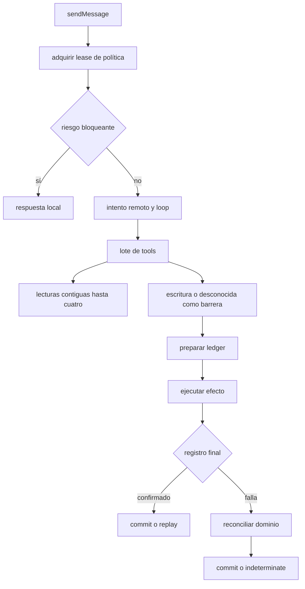

# Comportamiento en ejecución y oportunidades

Este informe consolida una extracción LangSmith con los controles verificables del chat de `apps/mobile`. La extracción indica dónde investigar, no prueba causalidad; el código indica qué cambios son seguros. Para los contratos completos, véanse [Runtime del agente y herramientas](../agent/runtime.md), [Streaming de proveedores](../agent/provider-streaming.md), [Entrega de políticas](../architecture/policy-delivery.md) y [Build, release y pruebas](build-release-and-testing.md).

## Registro: Observado

**Muestra sesgada y cobertura.** La última extracción disponible cubre del 26 de octubre al 2 de noviembre de 2026 y está marcada `truncated`. Tiene 6 roots exitosos, 0 fallidos y 0 desconocidos; los buckets de fallo disponibles también son cero. No hay trazas fallidas, URLs de traza autorizadas ni contenido de runs en el artefacto. Esto no es una tasa de flota ni demuestra disponibilidad: es una ventana truncada y los buckets error, outlier y baseline —si se emplearon al producirla— no son poblaciones comparables.

| Señal agregada de esta extracción | Observado | Límite de interpretación |
| --- | ---: | --- |
| Roots | 6; p50 150281 ms; p95 y máximo 184082 ms | No separa proveedor, intento, ronda ni tool. |
| Modelos | 127; p50 3694 ms; p95 18956 ms; máximo 88227 ms | No atribuye latencia a una causa ni equivale a mensajes de usuario. |
| Tools | 130; p50 2 ms; p95 224 ms; máximo 865 ms | No identifica handler, lote, argumentos ni efecto. |
| LLM por root | p50 20; p95 y máximo 30 | La mediana es solo referencia de operación normal de esta extracción, no SLO. |
| Categorías de tools | 66 `read`, 21 `write`, 43 `other`; 43 nombres desconocidos | `other` no prueba lectura, escritura ni mutación. |
| Tokens y coste | `unavailable`, cobertura `partial`, 0 llamadas observadas | Los ceros no son valores medidos. |

Todas las duraciones declaradas tienen `unknown: 0`, pero siguen siendo agregados sin relación causal. No se reproducen inputs, outputs, prompts, argumentos, resultados, razonamiento ni identificadores de runs. La configuración sí apunta al proyecto `gymnasia-app-agent` en el endpoint europeo, pero el manifiesto no liga estos agregados a una traza individual ([`openwiki/.langsmith.json`](repo://openwiki/.langsmith.json#L1-L18), [`ops/openwiki-runtime-telemetry.json`](repo://ops/openwiki-runtime-telemetry.json#L1-L88)).

## Registro: Correlacionado con código



*Flujo relevante para explicar por qué una llamada o duración agregada no identifica por sí sola un efecto ni una causa.*

- **Turno y reintentos.** `sendMessage` adquiere un único `AgentPolicyLease` antes de clasificar el input; el lease se congela profundamente. Riesgo bloqueante devuelve una respuesta local. La ruta remota conserva el ID del mensaje como `executionId`, permite hasta tres intentos para firmas reconocibles, espera 2 y 4 segundos, y reinicia el borrador; el flusher limita los repintados a 40 ms ([`App.sendMessage`](repo://apps/mobile/App.tsx#L4828-L5078), [`acquireAgentPolicyLease`](repo://apps/mobile/agent/agentPolicyRuntime.ts#L108-L123), [`createSignedAgentPolicyLease`](repo://apps/mobile/agent/agentPolicyRuntime.ts#L126-L171)). Por ello, 127 llamadas LLM no equivalen a 127 mensajes ni prueban duplicación de escritura.
- **Rondas, transporte y presupuesto.** Los loops admiten diez rondas ejecutables y fuerzan un cierre sin tools al agotarlas. En Google nativo, un fallo de conexión antes de un delta visible puede repetir la generación por XHR buffered; web usa `fetch` con 120 s. Para Coach, la ventana de 20 mensajes se conserva también como máximo de 20 intercambios Google —no el valor genérico de 10— antes de aplicar 512 KiB no-imagen y 19 MB de petición; si el último intercambio aún excede el presupuesto, falla antes de red ([`requestProviderToolChat`](repo://apps/mobile/agent/providerToolClient.ts#L331-L360), [`prepareGoogleInteractionRequest`](repo://apps/mobile/agent/googleContextBudget.ts#L186-L276), [`requestGoogleInteraction`](repo://apps/mobile/agent/googleStreamTransport.ts#L28-L80)). Estas rutas pueden incrementar calls o rechazar una petición sin que el agregado permita distinguirlas.
- **Lotes y efectos.** `executeToolBatch` solapa solo lecturas conocidas contiguas, con máximo cuatro; una escritura o tool desconocida es barrera. Tras fallo, espera lo ya iniciado y propaga el primer error en orden de proveedor ([`executeToolBatch`](repo://apps/mobile/agent/toolBatch.ts#L4-L64)). Las escrituras se identifican por versión, `executionId`, proveedor, nombre, JSON canónico y `occurrence`, no por `providerCallId`; el coordinador une trabajo en vuelo, hace replay de commit y prepara el ledger antes del handler. Si no puede registrar un commit, reconcilia el dominio y conserva `indeterminate` en vez de repetir ([`ToolOperationCoordinator.execute`](repo://apps/mobile/agent/toolOperationLedger.ts#L479-L671)).
- **Diagnóstico seguro.** `GoogleContextReport` solo lleva contadores de intercambios, bytes, imágenes retiradas y razones; el callback no bloquea la solicitud ni su error. Es una dimensión segura para agregación, a diferencia del historial o del cuerpo de solicitud ([`GoogleContextReport`](repo://apps/mobile/agent/googleContextBudget.ts#L35-L47), [`requestGoogleInteraction`](repo://apps/mobile/agent/googleStreamTransport.ts#L36-L45)).

## Registro: Hipótesis para investigar

Estas hipótesis no describen producción; convierten la muestra truncada en comprobaciones falsables sin capturar contenido.

| Señal o discrepancia | Hipótesis y comprobación | Decisión de cambio |
| --- | --- | --- |
| Muchas LLM por root | Separar intento remoto, ronda, cierre y fallback de transporte. | Añadir contadores agregados por proveedor y estado; no usar llamadas LLM como contador de turnos. |
| Máximo de modelo 88227 ms | Puede incluir espera del proveedor, reintentos o rondas, no una tool concreta. | Medir duración por intento, ronda y cierre antes de cambiar timeout o concurrencia. |
| 43 tools `other` | La clasificación de telemetría es incompleta, no evidencia de 43 efectos. | Mapear categorías mediante metadatos seguros de efecto y mantener nombres y argumentos fuera de la telemetría. |
| Escritura seguida de error o repetición | Puede ser unión `inFlight`, replay, reconciliación o incertidumbre; no prueba doble mutación. | Revisar recibo de dominio y `indeterminate`; no introducir reintento ciego. |
| Rechazo Google sin llamada visible | Puede provenir del presupuesto local. | Registrar solo `GoogleContextReport.outcome` y razones agregadas. |

## Runtime findings & opportunities

1. **Alta — recuperar cobertura de tokens y coste.** Es la ausencia más material: `unavailable`, cobertura parcial y ninguna llamada observada impiden priorizar modelo, prompt o presupuesto por coste. Añadir agregados de proveedor, modelo, tokens y coste con cobertura explícita; nunca payloads ni razonamiento.
2. **Alta — descomponer el conteo de 127 LLM.** El código admite reintento de turno, rondas, cierre y fallback Google. Instrumentar intento, ronda, cierre y fallback permite decidir si reducir tools, cambiar transporte o ajustar reintentos sin confundirlos con mensajes o efectos.
3. **Media — cerrar el hueco de las 43 `other`.** Categoría desconocida no es un permiso para paralelizar ni para asumir que no hubo mutación. Clasificar desde la definición de efecto y medir barreras y concurrencia máxima por lote.
4. **Media — hacer observable la incertidumbre durable.** Toda tool nueva con efecto debe tener recibo y reconciliador. Medir estados `prepared`, `committed`, `indeterminate` y fuente de replay como contadores; una incertidumbre requiere revisión del dominio, no una repetición automática.
5. **Media — atribuir presupuesto Google antes de cambiar límites.** Coach ya eleva el máximo de intercambios a 20, mientras que bytes e imágenes siguen limitando. Antes de ampliar tamaño o timeout, medir razones del reporte para distinguir contexto, imagen y red.

## Cambio seguro y validación focalizada

- Mantenga un lease inmutable por turno y el mismo `executionId` a través de sus reintentos.
- No convierta el presupuesto Google de Coach en el default genérico de diez intercambios; preserve el último intercambio y los límites de bytes.
- No introduzca paralelismo en escrituras: respete la barrera y el máximo de cuatro lecturas.
- Tras una mutación irreversible, el handler debe marcar `markEffectCommitted`; para estados no confirmables, entregue recibo y reconciliador. El ledger conserva commits siete días y limita entradas a 256, sin expulsar no resueltas ([`toolOperationLedger.ts`](repo://apps/mobile/agent/toolOperationLedger.ts#L79-L80), [`bounded`](repo://apps/mobile/agent/toolOperationLedger.ts#L290-L307)).
- Mantenga la instrumentación en dimensiones agregadas: proveedor, intento, ronda, cierre, categoría, duración de lote, estado de commit y razones de presupuesto.

Ejecute desde la raíz:

```bash
npm exec -- vitest run --config apps/mobile/vitest.config.mts apps/mobile/agent/agentPolicyRuntime.test.ts apps/mobile/agent/coachContext.test.ts apps/mobile/agent/providerToolClient.roundLimit.test.ts apps/mobile/agent/providerToolLoop.test.ts apps/mobile/agent/toolBatch.test.ts apps/mobile/agent/toolExecutor.test.ts apps/mobile/agent/toolOperationLedger.test.ts apps/mobile/agent/toolOperationReceipts.test.ts apps/mobile/agent/googleInteractions.test.ts
```

Estas pruebas validan límites y recuperación locales; no miden disponibilidad, coste, frecuencia ni latencia de proveedores remotos.
