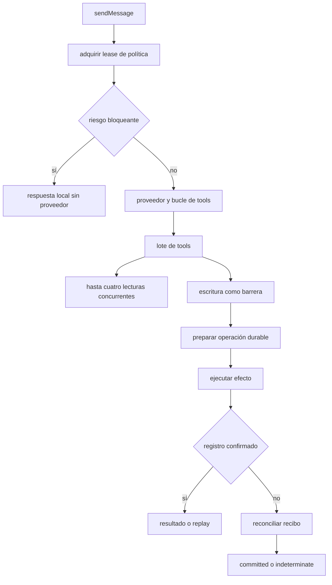

# Comportamiento en ejecución y oportunidades

Esta página interpreta el manifiesto operativo vigente junto con los límites que el código impone al chat de `apps/mobile`. La telemetría responde qué ocurrió en una ventana concreta; el código delimita qué puede ocurrir y dónde hacer cambios seguros. Véanse también [Streaming de proveedores](../agent/provider-streaming.md), [Runtime del agente y herramientas](../agent/runtime.md), [Entrega de políticas](../architecture/policy-delivery.md) y [Build, release y pruebas](build-release-and-testing.md).

## Muestra disponible: agregados, cobertura y límites

**Observado — no es una tasa de flota.** El último intento está disponible y aporta una ventana de siete días, pero el manifiesto la marca como `truncated`. Hay 8 roots: 8 con éxito, 0 fallidos y 0 de estado desconocido. Los contadores de fallos por categoría del manifiesto son todos cero; esto no convierte el resultado en una medición exhaustiva ni permite inferir disponibilidad global.

| Señal agregada | Valor observado | Cómo leerla |
| --- | ---: | --- |
| Duración de roots | p50 103329 ms; p95 y máximo 212020 ms | 8 duraciones conocidas; no atribuye el tiempo a un proveedor ni a una tool. |
| Duración de modelos | p50 3210 ms; p95 19264 ms; máximo 134046 ms | 150 duraciones conocidas. |
| Duración de tools | p50 2 ms; p95 145 ms; máximo 757 ms | 159 mediciones; el agregado no identifica handlers ni argumentos. |
| Llamadas LLM | 150; p50 17 y p95 30 por root | Una root puede incluir reintentos, rondas de tools y cierre; no equivale a mensajes de usuario. |
| Tools | 159: 83 `read`, 15 `write`, 61 `other` | Hay 61 nombres no clasificados; `other` no demuestra que sean efectos ni permite asignarlos a una implementación. |
| Tokens y coste | `unavailable`, cobertura `partial` | Los ceros del manifiesto no son valores medidos: no hay llamadas observadas con tokens o coste. |

Los percentiles y máximos son agregados de la muestra truncada, no objetivos ni SLO. Las duraciones declaradas no tienen valores desconocidos, pero siguen sin desglosar proveedor, handler, argumentos ni contenido; no permiten atribuir causalmente la latencia. No se publican contenido de runs, prompts, argumentos, resultados, URLs ni identificadores de traza.

## Flujo y controles que condicionan los agregados



Flujo de control de un turno y de una tool con efecto: las lecturas consecutivas pueden solaparse; una escritura no habilita un reintento ciego ante incertidumbre.

### Antes de red y durante el streaming

- `sendMessage` adquiere un `AgentPolicyLease` antes de clasificar el input o construir la solicitud. El lease inmutable mantiene juntos prompt, política sanitaria, contexto y estado; una política sanitaria firmada incompatible falla antes de utilizarse. Un turno no debe mezclar datos de leases distintos.
- Un riesgo sanitario bloqueante termina localmente sin llamar al proveedor. Las tools solicitadas se validan y clasifican antes de delegarse; una desconocida o no permitida devuelve un resultado local. Por tanto, un agregado de tools no debe interpretarse como que todo intento alcanzó un handler o produjo un efecto.
- El envío puede hacer hasta tres intentos para firmas de transporte o sobrecarga reconocidas, con esperas de 2 y 4 segundos y reinicio del borrador. El flusher de la UI agrupa actualizaciones visibles a 40 ms. Una llamada LLM adicional puede ser reintento y no necesariamente un efecto duplicado.
- En Google, el transporte prepara y presupuesta la petición antes de abrir red. En plataformas nativas, si el streaming XHR falla antes de emitir contenido visible por el problema de progreso, repite la generación mediante XHR buffered; tras un delta visible no aplica ese fallback. Web usa `fetch` con un límite de 120 segundos. Esta bifurcación es otra razón para no convertir conteos de llamadas en conteos de mensajes.

### Rondas, lotes y efectos

Los loops de OpenAI, Anthropic y Google permiten diez rondas por defecto. Cuando se alcanza el límite, las calls pendientes reciben resultado de no ejecución y se pide un turno de cierre con tools prohibidas; si no completa, se trunca o solicita nuevas tools, se devuelve `ToolRoundLimitError`. OpenAI y Google rechazan IDs de tools repetidos.

`executeToolBatch` solo solapa lecturas conocidas consecutivas, como máximo cuatro. Escrituras y tools desconocidas son barreras ordenadas. Ante un fallo fatal deja de iniciar lecturas nuevas, espera las ya iniciadas y luego propaga el primer error por orden de proveedor: la finalización de un turno nunca deja un lote previo ejecutándose.

Para una tool con efecto, `ToolOperationCoordinator` deriva la identidad de versión, `executionId`, proveedor, nombre, argumentos canónicos y ocurrencia, sin `providerCallId`. Une trabajo simultáneo, reproduce commits desde memoria o ledger y prepara el ledger antes de ejecutar. El handler debe llamar a `markEffectCommitted` inmediatamente después del efecto irreversible. Si el registro final falla, el coordinador intenta reconciliar el recibo de dominio; si no puede confirmar el resultado, devuelve `indeterminate` para impedir una repetición insegura. Los commits se retienen siete días y el ledger tiene máximo 256 entradas, sin expulsar entradas no resueltas.

### Contexto y privacidad de Google

`App` selecciona los últimos 20 mensajes antes de adaptar el historial. Para Google, el presupuesto por defecto conserva como máximo diez intercambios, elimina imágenes de intercambios antiguos y descarta intercambios completos hasta cumplir 512 KiB no-imagen y 19 MB de solicitud. Conserva el último intercambio; si este aún supera el presupuesto, rechaza antes de red.

`GoogleContextReport` contiene solamente contadores de intercambios, bytes, imágenes retiradas y razones. `requestGoogleInteraction` lo entrega mediante callback, pero captura errores del callback para que el diagnóstico no bloquee ni oculte la petición o el error de presupuesto. Es un límite apropiado para instrumentación agregada: no registrar historial, contenido de imágenes ni cuerpos de solicitud.

## Oportunidades operativas priorizadas

1. **Alta — tratar tokens y coste como señal ausente, no como cero.** La muestra declara ambos `unavailable` con cobertura parcial y cero llamadas observadas. Antes de optimizar precios o contexto, recupere cobertura de uso y coste con agregados por proveedor y ventana; no copie inputs, outputs ni razonamiento.
2. **Alta — separar la presión de rondas del coste por solicitud.** La mediana de 17 llamadas LLM por root y el total de 150 son compatibles con el flujo de reintentos, tools y cierre. Instrumentar contadores agregados de intento remoto, ronda, cierre y estado del límite permitirá distinguirlos sin revelar contenido.
3. **Media — investigar clasificación incompleta de tools.** Las 61 tools `other` coinciden con 61 nombres desconocidos en el manifiesto. Complete el mapeo de categorías en el productor de telemetría usando metadatos seguros de tipo o efecto, pero no nombres, argumentos o resultados de calls; mientras tanto no interprete ese grupo como lectura o escritura.
4. **Media — medir lote además de handler.** Las duraciones de tools no indican si una lectura compartió lote ni si una barrera serializó el turno. Añada agregados de duración de lote, concurrencia máxima y número de barreras, preservando el orden de los efectos y sin identificar operaciones.
5. **Media — operar incertidumbre de escrituras explícitamente.** Una repetición observable puede ser unión `inFlight`, replay de memoria, replay de ledger o reconciliación. Toda nueva escritura necesita recibo y reconciliador; `indeterminate` requiere revisión del estado de dominio, no un reintento automático.

## Cambio seguro y validación focalizada

1. Mantenga un solo `AgentPolicyLease` inmutable por turno.
2. Para una tool nueva, valide antes del efecto, invoque `markEffectCommitted` después de la mutación irreversible y proporcione recibo y reconciliación para estados `prepared` o `indeterminate`.
3. No elimine `occurrence` ni use `providerCallId` como identidad de operación.
4. Mantenga juntos los pares de tool e intercambio de Google y trate `GoogleContextReport` como diagnóstico seguro de presupuesto.
5. Instrumente solamente proveedor, ruta, estado, duración, rondas, cierre, lote, categoría y estado de commit como agregados. Excluya contenido y datos que reconstruyan un run.

Ejecute desde la raíz:

```bash
npx vitest run --config apps/mobile/vitest.config.mts apps/mobile/agent/agentPolicyRuntime.test.ts apps/mobile/agent/googleInteractions.test.ts apps/mobile/agent/providerToolClient.test.ts apps/mobile/agent/providerToolLoop.test.ts apps/mobile/agent/providerPipeline.test.ts apps/mobile/agent/toolExecutor.test.ts apps/mobile/agent/toolOperationLedger.test.ts
```

Estas pruebas cubren límites de política y contexto, contratos de continuación, concurrencia de lotes, commit, reconciliación e idempotencia local; no validan disponibilidad, coste ni latencia de proveedores remotos.
