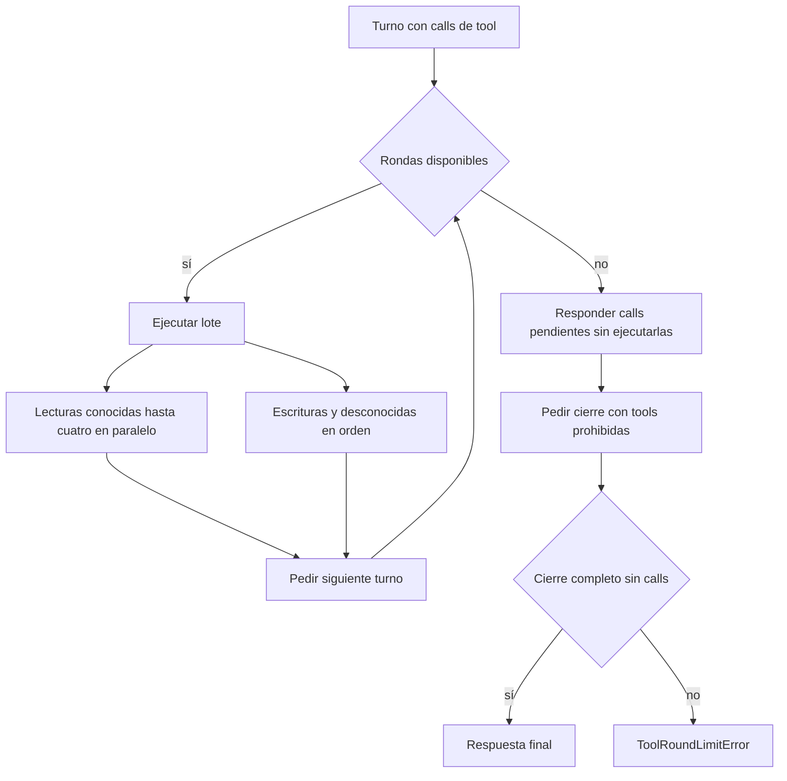

# Comportamiento en ejecución y oportunidades

Esta es la referencia operativa del chat de `apps/mobile`: relaciona una extracción LangSmith autorizada con los puntos de control que hay que preservar al modificar el agente. Complementa [Configuración BYOK de proveedores](../agent/provider-configuration.md), [Streaming de proveedores](../agent/provider-streaming.md) y [Runtime del agente y herramientas](../agent/runtime.md); esas páginas describen los contratos estáticos y enlazan a esta evidencia de ejecución.

## Alcance, privacidad y lectura de la muestra

La configuración declara los proyectos LangSmith `gymnasia-app-agent`, `gymnasia-food-agent` y `openwiki` en el endpoint europeo. Se comprobó `openwiki/.langsmith.json` y el contexto de ejecución que indica que la extracción ya se realizó; sin embargo, en el árbol y las herramientas disponibles para esta actualización no hay raw items ni dump de LangSmith que se pueda agregar. La configuración no demuestra tráfico y no se reingirió nada.

Por tanto, esta edición no publica conteos de roots o llamadas, latencias, tokens, coste, repeticiones, URLs de trazas ni firmas de error. Tampoco hay evidencia de fallos, outliers, uso de una tool o proveedor, ni de un límite activado en la muestra actual disponible. No se copian entradas, salidas, prompts, argumentos, resultados de tools, razonamiento o identificadores de runs: el contenido de run es evidencia no confiable y no debe llegar a la wiki.

Cuando el raw dump esté disponible, registre solo agregados por ventana y filtro: conteos de roots y llamadas por proyecto/proveedor/ruta/tool, medianas de latencia, tokens de entrada y salida, coste si existe, y repeticiones por `executionId`, tool y ocurrencia. Los buckets `error`, `outlier` y `baseline` forman una **muestra sesgada**, no tasas de flota ni causalidad; las medianas de `baseline` son únicamente la referencia normal de esa muestra. Mantenga esas métricas volátiles en esta sección y los mecanismos siguientes como patrones durables.

## Comprobaciones ancladas a código

### Observado

No hay métricas publicables de esta extracción: conteos, latencia, tokens, coste, repeticiones y composición de buckets no están disponibles. En particular, no se puede atribuir un fallo ni una latencia a un proveedor, una ronda o un handler.

### Correlacionado — archivo y símbolo

- **Gate sanitario y validación antes del efecto — `App.tsx`, `callProviderChatAPIWithTools`.** Un riesgo sanitario bloqueante lanza `health-safety-provider-blocked` antes de pedir al proveedor. Para una call de tool, el wrapper clasifica nombre y argumentos para la política, rechaza un efecto desconocido o no permitido con un resultado de bloqueo, y solo entonces pasa al coordinador. El ejecutor vuelve a comprobar que existan handler y esquema y valida los argumentos antes de invocarlo. Véase también [Runtime del agente y herramientas](../agent/runtime.md).
- **Reintento de la conversación — `App.tsx`, `sendMessage`.** Hay hasta tres intentos, solo ante firmas reconocidas de transporte o sobrecarga; los reintentos esperan 2 y 4 segundos y reinician el borrador. `createStreamDraftFlusher` agrupa el pintado del streaming en ventanas de 40 ms. Una futura multiplicidad de requests por mensaje debe separar esos intentos de una continuación de tools o de un fallback de streaming.
- **Contexto entregado a proveedores — `App.tsx`, `selectCoachContext`; `googleContextBudget.ts`, `prepareGoogleInteractionRequest`.** `App` reduce el historial reconstruido a los últimos 20 mensajes **antes de construir `chatMessages` para cualquier proveedor**. En Google, el preparador aplica un segundo presupuesto: retiene como máximo diez intercambios, quita imágenes de intercambios anteriores y elimina intercambios completos hasta caber en 512 KiB no-imagen y 19 MB de petición. Si el intercambio imprescindible sigue excediendo el límite, falla antes de red. El reporte resultante son contadores y razones; `requestGoogleInteraction` lo notifica sin que un callback de diagnóstico pueda bloquear la petición. Véase [Streaming de proveedores](../agent/provider-streaming.md).
- **Rondas y concurrencia de tools — `providerToolLoop.ts`, `runOpenAIToolLoop`, `runAnthropicToolLoop` y `runGoogleToolLoop`; `toolBatch.ts`, `executeToolBatch`.** Los loops admiten diez rondas por defecto. Al agotarlas, devuelven resultados de no ejecución para las calls pendientes y solicitan un cierre con tools prohibidas; si no hay cierre válido, lanzan `ToolRoundLimitError`. OpenAI requiere la continuación devuelta por el proveedor y tanto OpenAI como Google rechazan IDs de call repetidos en su historial correspondiente. Dentro de una ronda, no todas las calls son secuenciales: lecturas conocidas consecutivas pueden solaparse hasta cuatro; las escrituras y tools desconocidas son barreras y se esperan en orden. Esto es relevante al atribuir una latencia de ronda a una tool. Véase [Runtime del agente y herramientas](../agent/runtime.md).
- **Resultado de handler y commit — `toolExecutor.ts`, `createDetailedAgentToolExecutor`.** Solo `markEffectCommitted` produce estado `committed`. Una excepción se transforma en resultado de tool y conserva `committed` exclusivamente si el handler lo marcó antes; si marcó incertidumbre, devuelve `indeterminate`, y en otro caso `failed_before_commit`.
- **Idempotencia y recuperación — `toolOperationLedger.ts`, `ToolOperationCoordinator`.** Para tools con efecto, la identidad deriva de versión, `executionId`, proveedor, nombre, argumentos canónicos y ocurrencia, no de `providerCallId`. El coordinador une trabajo simultáneo y reproduce commits desde memoria o ledger. Persiste `prepared` antes del efecto; si no puede registrar el commit final, consulta el recibo de dominio y, si sigue sin poder confirmarlo, devuelve/persiste `indeterminate` para impedir una repetición insegura. El ledger conserva commits siete días y limita a 256 entradas sin descartar las no resueltas. Estas garantías protegen tools que modifican [dieta](../mobile/diet-and-food-estimation.md) o [mediciones](../mobile/measurements.md).



El diagrama muestra el límite de rondas y la concurrencia por tipo de tool confirmados por `providerToolLoop.ts` y `toolBatch.ts`; no representa actividad medida en producción.

### Hipótesis de diagnóstico

1. **Coste, tokens o latencia altos:** agrupar primero por proveedor, historial efectivo, número de rondas, turno de cierre y composición de lote. Para Google, incluir únicamente razones y contadores de `GoogleContextReport`; no asumir que se envió todo el historial local.
2. **Más de una request por mensaje:** distinguir reintento de transporte, continuación de tools y fallback de streaming Google antes de cambiar deduplicación o UX.
3. **Call repetida con un solo efecto:** contrastar `executionId`, nombre, argumentos canónicos y ocurrencia; comprobar si fue unión `inFlight`, replay de ledger, reconciliación o una segunda operación intencional.
4. **Error después de una escritura:** revisar el recibo de dominio y la reconciliación. `indeterminate` protege contra una duplicación; no demuestra rollback.

## Hallazgos y oportunidades de runtime

1. **Prioridad alta — recuperar la extracción agregada antes de modificar límites o proveedor.** **Observado:** no hay raw items accesibles ni métricas de esta ejecución, así que no hay evidencia de fallos, coste, latencia, tokens, recortes o repeticiones. **Correlacionado:** `prepareGoogleInteractionRequest` y `ToolOperationCoordinator` ya emiten resultados agregables por razón/estado sin necesitar contenido de usuario. **Hipótesis:** instrumentar únicamente proveedor, ruta, duración, rondas, estado de cierre, razones de presupuesto y estado de operación permitirá localizar el cuello de botella real. **Consecuencia operativa:** no eleve 19 MB, 512 KiB o diez rondas basándose en código o una traza aislada; primero habilite y revise el agregado autorizado.
2. **Prioridad media — no atribuir la duración de un lote a una sola tool ni serializar lecturas por defecto.** **Observado:** no existe muestra de latencias por tool o ronda. **Correlacionado:** `executeToolBatch` permite hasta cuatro lecturas conocidas consecutivas en paralelo y usa escrituras como barreras; los loops esperan que termine el lote antes de continuar. **Hipótesis:** un outlier futuro puede venir de la sección de escritura, de varias lecturas lentas solapadas o del siguiente turno remoto. **Consecuencia operativa:** al añadir telemetría, mida duración de ronda y de cada call con su tipo de efecto, además de la concurrencia del lote; al cambiar una tool, no relaje la barrera de escritura.
3. **Prioridad media — una repetición remota no autoriza repetir un efecto.** **Observado:** no se midieron repeticiones. **Correlacionado:** `sendMessage` reintenta transporte y `ToolOperationCoordinator.execute` deduplica efectos y reconcilia incertidumbre. **Hipótesis:** una llamada con la misma identidad debe acabar como unión, replay o `indeterminate`, no como segunda escritura. **Consecuencia operativa:** toda nueva tool de escritura necesita recibo/reconciliador de dominio y debe marcar el commit inmediatamente después del efecto irreversible; no use `providerCallId` como identidad.

## Cambios seguros y validación focalizada

1. Mantenga un único `AgentPolicyLease` inmutable por turno: no mezcle prompt, guardrail y `PolicyContext` de selecciones distintas.
2. Al añadir una tool, conserve la validación previa al handler, `markEffectCommitted` inmediatamente tras la mutación irreversible y una reconciliación de entradas `prepared` o `indeterminate`.
3. No elimine `occurrence` ni añada `providerCallId` a la identidad: la primera distingue calls iguales intencionales y el ID remoto puede cambiar tras un reintento.
4. Para Google, trate `GoogleContextReport` como instrumentación segura: almacene solo contadores y razones y conserve el último intercambio y pares completos de tool.
5. Instrumente agregados de proveedor, ruta, estado, duración, rondas, cierre, tipo de tool y estado de commit; nunca contenido sensible ni razonamiento.

Ejecute desde la raíz:

```bash
npx vitest run --config apps/mobile/vitest.config.mts apps/mobile/agent/agentPolicyRuntime.test.ts apps/mobile/agent/googleInteractions.test.ts apps/mobile/agent/providerToolClient.test.ts apps/mobile/agent/providerToolLoop.test.ts apps/mobile/agent/providerPipeline.test.ts apps/mobile/agent/toolExecutor.test.ts apps/mobile/agent/toolOperationLedger.test.ts
```

Estas pruebas verifican presupuestos, contratos de continuación, concurrencia/barreras de lote, semántica de commit, reconciliación e idempotencia local; no establecen disponibilidad, coste ni latencia de proveedores remotos. Para el recorrido visible, añada `npm run test:agent:e2e` como indica el [Inicio rápido](../quickstart.md).
