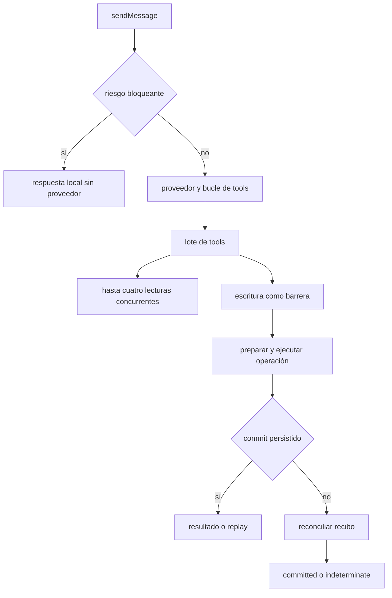

# Comportamiento en ejecución y oportunidades

Complemento operativo del chat de `apps/mobile`. Empiece por los límites verificables de esta página antes de interpretar una traza: la medición explica **qué ocurrió en una muestra**; el código explica **qué puede ocurrir y dónde cambiarlo**. Se complementa con [Configuración BYOK de proveedores](../agent/provider-configuration.md), [Streaming de proveedores](../agent/provider-streaming.md), [Runtime del agente y herramientas](../agent/runtime.md) y [Entrega de políticas](../architecture/policy-delivery.md); los cambios de despliegue y pruebas generales pertenecen a [Build, release y pruebas](build-release-and-testing.md).

## Verificaciones ancladas a código

Las siguientes afirmaciones son **Correlacionadas**: se verificaron en los símbolos y límites indicados, pero no son mediciones de producción.

- **Lease único por turno — `sendMessage` y `acquireAgentPolicyLease`.** Antes de clasificar el input o crear el prompt, el chat adquiere el lease. El lease se congela profundamente y reúne prompt, política sanitaria, contexto y estado; una política sanitaria firmada incompatible aborta antes de usarse. Al modificar envío, trazado o prompt, no combine datos de leases distintos.
- **Bloqueo local antes de red — `callProviderChatAPIWithTools`.** Un riesgo sanitario bloqueante evita al proveedor. Cada tool solicitada se clasifica por nombre, argumentos y efecto antes de delegarse; una tool desconocida o no permitida produce un resultado local. Separe ese bloqueo de un error remoto al agrupar errores.
- **Reintento de transporte — `sendMessage`.** Hay hasta tres intentos solo para firmas reconocidas de transporte o sobrecarga, con esperas de 2 y 4 segundos; el borrador se reinicia entre intentos. `createStreamDraftFlusher` agrupa la actualización visible a 40 ms. Una llamada adicional no prueba por sí misma un efecto repetido.
- **Rondas y lotes — `runOpenAIToolLoop`, `runAnthropicToolLoop`, `runGoogleToolLoop` y `executeToolBatch`.** El máximo predeterminado es diez rondas. Solo lecturas conocidas consecutivas se solapan, hasta cuatro; escrituras y tools desconocidas son barreras ordenadas. Al agotar el límite, las calls pendientes reciben un resultado de no ejecución y se solicita un cierre con tools prohibidas; un cierre fallido, truncado o que vuelve a pedir tools termina en `ToolRoundLimitError`. OpenAI y Google también rechazan IDs de tool repetidos.
- **Contexto efectivo de Google — `selectCoachContext` y `prepareGoogleInteractionRequest`.** `App` elige los últimos 20 mensajes. Google conserva como máximo diez intercambios, retira imágenes antiguas y descarta intercambios completos hasta cumplir 512 KiB no-imagen y 19 MB de petición. Si el último intercambio todavía excede el presupuesto, se rechaza antes de red. `GoogleContextReport` contiene solo contadores y razones; `requestGoogleInteraction` lo comunica mediante callback sin permitir que el diagnóstico bloquee la petición.
- **Commit y recuperación de efectos — `createDetailedAgentToolExecutor` y `ToolOperationCoordinator`.** Un handler solo llega a `committed` tras `markEffectCommitted`; una excepción se transforma en resultado y conserva ese estado únicamente si ya se marcó el efecto. Para escrituras, la identidad usa versión, `executionId`, proveedor, nombre, argumentos JSON canónicos y ocurrencia —no `providerCallId`—. El coordinador une trabajo simultáneo, reproduce commits desde memoria o ledger, prepara antes de ejecutar y, si falla el registro final, reconcilia el recibo de dominio o devuelve `indeterminate`. Los commits viven siete días y el ledger limita entradas a 256 sin expulsar las no resueltas.



Flujo durable: la concurrencia se limita a lecturas consecutivas y la incertidumbre de una escritura no habilita un reintento ciego.

## Alcance, privacidad y lectura de la muestra

**Observado — extracción disponible.** `ops/openwiki-runtime-telemetry.json` registra el último intento como `unavailable` por `network` y `sample: null`. Por ello esta actualización no contiene llamadas, rutas, latencias, tokens, costes, errores, outliers ni secuencias LangSmith publicables. La ausencia de muestra no demuestra ausencia de tráfico ni comportamiento de un proveedor.

Cuando haya una extracción autorizada, registre solo agregados: ventana y filtros; conteos de roots, llamadas y buckets; proveedor/ruta/tool; medianas de latencia; tokens de entrada y salida; coste si existe; y repeticiones por `executionId`, tool y ocurrencia. Puede incluir URLs de traza permitidas. Nunca copie prompts, entradas, salidas, argumentos, resultados de tools, razonamiento ni identificadores que permitan reconstruir un run.

Los buckets `error`, `outlier` y `baseline` son una **muestra deliberadamente sesgada**: no son tasas de flota ni prueban causalidad. Las medianas `baseline` solo sirven como referencia de normalidad de esa muestra. Coste y latencia son cifras volátiles; los límites anteriores son mecanismos durables.

### Nota breve de coste y latencia observados

**Observado:** no hay coste, latencia, tokens ni llamadas disponibles en la extracción actual. No se atribuye una anomalía a proveedor, tool ni símbolo.

## Hallazgos y oportunidades de runtime

1. **Prioridad alta — recuperar la extracción antes de cambiar límites.** **Observado (evidencia de traza):** el manifiesto de telemetría solo informa fallo de red y muestra nula. **Correlacionado (productor):** `requestGoogleInteraction` emite el `GoogleContextReport` al callback y el presupuesto se aplica en `prepareGoogleInteractionRequest`. **Implicación:** al instrumentar o reparar la obtención, capture únicamente sus contadores/razones y agregados de duración, tokens y coste por proveedor; no eleve 512 KiB ni 19 MB sin una distribución observada.

2. **Prioridad media — hacer distinguibles reintentos, rondas y efectos.** **Observado (evidencia de traza):** no hay secuencias de llamadas que permitan cuantificar repetición. **Correlacionado (productor):** `sendMessage` puede repetir transporte, los loops pueden continuar por tools y `ToolOperationCoordinator.execute` puede unir, replayar o devolver `indeterminate`. **Implicación:** toda instrumentación agregada debe separar intento remoto, ronda, cierre, lote y estado de commit. Al añadir una escritura, implemente recibo/reconciliador y llame a `markEffectCommitted` inmediatamente después del efecto irreversible; no use `providerCallId` como identidad.

3. **Prioridad media — atribuir la latencia de tools al lote correcto.** **Observado (evidencia de traza):** no hay latencia por tool ni proveedor en esta muestra. **Correlacionado (productor):** `executeToolBatch` solapa únicamente lecturas consecutivas y espera las tareas ya iniciadas incluso ante fallo fatal. **Implicación:** mida duración por tool y por lote, más máximo de lecturas simultáneas y barreras; no concluya que una latencia alta revela serialización completa ni que corresponde a un handler aislado.

### Hipótesis de diagnóstico para una futura muestra

- **Coste, tokens o latencia altos:** agrupar primero por proveedor, tamaño de historial efectivo, rondas y turno de cierre. Para Google, incluir razones y contadores de `GoogleContextReport`; no asumir que el historial local completo llegó al proveedor.
- **Más de una request por mensaje:** distinguir reintento de transporte, evaluación sanitaria consentida, continuación de tools y fallback de streaming Google antes de cambiar deduplicación o UX.
- **Tool repetida con un solo efecto:** contrastar `executionId`, nombre, argumentos canónicos y ocurrencia; después decidir si fue unión `inFlight`, replay, reconciliación o una operación intencional distinta.
- **Error posterior a una escritura:** revisar recibo de dominio y reconciliación. `indeterminate` protege contra duplicación; no es evidencia de rollback.

## Cambios seguros y validación focalizada

1. Mantenga un solo `AgentPolicyLease` inmutable por turno.
2. Para una tool nueva, preserve validación previa al efecto, `markEffectCommitted` tras la mutación irreversible y reconciliación de entradas `prepared` o `indeterminate`.
3. No elimine `occurrence` ni introduzca `providerCallId` en la identidad.
4. Para Google, conserve pares completos de tool e intercambio y trate `GoogleContextReport` como instrumentación segura de presupuesto.
5. Instrumente solo agregados de proveedor, ruta, estado, duración, rondas, cierre, lote y commit; nunca contenido sensible ni razonamiento.

Ejecute desde la raíz:

```bash
npx vitest run --config apps/mobile/vitest.config.mts apps/mobile/agent/agentPolicyRuntime.test.ts apps/mobile/agent/googleInteractions.test.ts apps/mobile/agent/providerToolClient.test.ts apps/mobile/agent/providerToolLoop.test.ts apps/mobile/agent/providerPipeline.test.ts apps/mobile/agent/toolExecutor.test.ts apps/mobile/agent/toolOperationLedger.test.ts
```

Estas pruebas cubren límites, contratos de continuación, commit, reconciliación e idempotencia local; no establecen disponibilidad, coste ni latencia de proveedores remotos. Para el recorrido visible, añada `npm run test:agent:e2e` como indica el [Inicio rápido](../quickstart.md).
