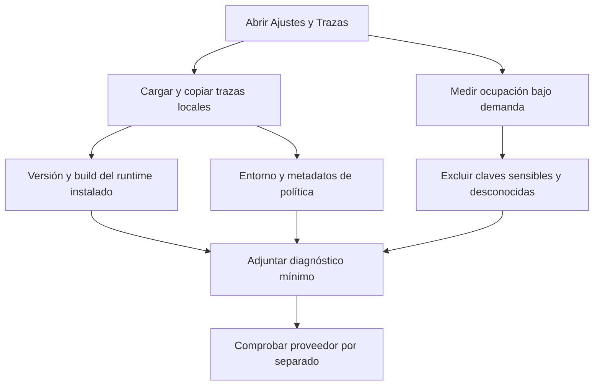

# Comportamiento operativo, trazas y degradación

La aplicación es *local-first*: sus funciones principales no requieren un servicio y el backend de incidencias es opcional. Por tanto, un diagnóstico local sirve para identificar el binario, el estado y el almacenamiento del dispositivo; no demuestra conectividad, disponibilidad, latencia ni coste de un proveedor remoto. Las pruebas del agente usan proveedores falsos y no consumen red, claves ni tokens ([`README.md`](repo://README.md#L1-L4), [`README.md`](repo://README.md#L131-L152)).

Esta página describe qué se puede copiar o interpretar con seguridad desde **Ajustes → Trazas**, y qué debe verificarse aparte. Para configurar proveedores, véase [Configuración de proveedores](../agent/provider-configuration.md); para el flujo del agente, [Runtime del agente](../agent/runtime.md); para persistencia y recuperación, [Estado local y copias de seguridad](../mobile/local-state-and-backup.md).

## Flujo de diagnóstico local



*El flujo separa la evidencia que vive en el dispositivo de una verificación que necesariamente contacta con un servicio remoto.*

### Trazas: ciclo de vida, versión y privacidad

`trace.ts` mantiene hasta 1.000 entradas en memoria y en `AsyncStorage`, dentro del espacio de nombres del entorno activo. Antes de añadir una entrada carga el buffer persistido para no sobrescribir el historial; la persistencia, el log de consola y los fallos de lectura o escritura son de mejor esfuerzo. Cada entrada se imprime además en consola, por lo que sus datos pueden aparecer en `adb logcat` o en los logs de Expo: no se debe añadir a `pushTrace` contenido de conversaciones, claves, tokens ni otros datos personales ([`apps/mobile/trace.ts`](repo://apps/mobile/trace.ts#L15-L20), [`apps/mobile/trace.ts`](repo://apps/mobile/trace.ts#L35-L87)).

El volcado copiable contiene plataforma, versión, build, entorno, canal y metadatos abreviados de política, fecha y número de entradas; después serializa el `data` de cada entrada. **No es un mecanismo de saneamiento.** Que la cabecera sea segura no vuelve seguros los `data` que los llamadores hayan registrado. La acción de copiar usa exactamente ese volcado y la de borrar elimina el buffer y su clave persistida ([`apps/mobile/trace.ts`](repo://apps/mobile/trace.ts#L89-L133), [`apps/mobile/controllers/settingsController.ts`](repo://apps/mobile/controllers/settingsController.ts#L640-L667)).

La atribución de versión tiene estas reglas:

- En una app nativa instalada, `expo-application` aporta `nativeApplicationVersion` y `nativeBuildVersion`; no se usa `app.json` como prueba del build instalado.
- En web y Expo Go se muestra la versión de proyecto disponible y el build como `unavailable`, para no atribuir al proyecto la versión del host.
- Al arrancar se guarda una entrada `App mounted` con la versión y build observados entonces. Un historial superviviente a una actualización conserva así sus arranques anteriores sin relabeling retrospectivo.

Estas reglas están implementadas y cubiertas por pruebas para Android, iOS, web, Expo Go, metadatos nativos ausentes y entradas antiguas ([`apps/mobile/trace.ts`](repo://apps/mobile/trace.ts#L22-L33), [`apps/mobile/trace.ts`](repo://apps/mobile/trace.ts#L99-L133), [`apps/mobile/platform/trace.test.ts`](repo://apps/mobile/platform/trace.test.ts#L53-L126)).

## Entorno y aislamiento de estado

`RUNTIME_ENVIRONMENT` se resuelve al cargar la aplicación desde `Constants.expoConfig.extra`. La configuración debe concordar por completo con una de las variantes `development`, `staging` o `production`: versión de configuración, canal de política, namespace, modo de proveedor, candidato y SHA-256 de política válido. Una configuración ausente, parcial o híbrida lanza un error en vez de continuar con una identidad de entorno ambigua ([`apps/mobile/environment.ts`](repo://apps/mobile/environment.ts#L1-L22), [`apps/mobile/environment.ts`](repo://apps/mobile/environment.ts#L106-L142), [`apps/mobile/runtimeEnvironment.ts`](repo://apps/mobile/runtimeEnvironment.ts#L11-L26)).

Producción conserva las claves de almacenamiento existentes; desarrollo y staging les anteponen su namespace. Las claves de almacenamiento seguro usan un separador distinto. Esta separación evita que los diagnósticos y datos no productivos se mezclen con producción, pero no es cifrado ni sustituto de `SecureStore` ([`apps/mobile/environment.ts`](repo://apps/mobile/environment.ts#L83-L103), [`apps/mobile/agent/environment.test.ts`](repo://apps/mobile/agent/environment.test.ts#L43-L56)).

En desarrollo, el modo por defecto es `fake` y `byok` requiere una elección explícita; staging y producción usan `byok`. La verificación en modo `fake` devuelve éxito local sin tocar la red, por lo que ese resultado solo confirma el fixture, no una cuenta ni un proveedor ([`apps/mobile/environment.ts`](repo://apps/mobile/environment.ts#L66-L80), [`apps/mobile/agent/providerVerification.ts`](repo://apps/mobile/agent/providerVerification.ts#L66-L80), [`apps/mobile/agent/providerVerification.test.ts`](repo://apps/mobile/agent/providerVerification.test.ts#L133-L143)).

## Uso de almacenamiento: medición parcial y segura

**Medir ocupación** se ejecuta bajo demanda desde la pantalla de trazas. La app entrega al medidor el `AsyncStorage` activo, el namespace, las fotos, metadatos de la base y la caché de artefactos; el informe se puede copiar mediante un formateador distinto del volcado de trazas ([`apps/mobile/App.tsx`](repo://apps/mobile/App.tsx#L2729-L2747), [`apps/mobile/controllers/settingsController.ts`](repo://apps/mobile/controllers/settingsController.ts#L619-L639)).

El medidor lee secuencialmente solo claves conocidas del namespace activo y suma bytes UTF-8. Cuenta como excluidas las configuraciones de proveedor, almacenes heredados y cuarentenas que podrían contener credenciales; cuenta las claves desconocidas pero no las abre. Cada lectura tiene un límite de cinco segundos, cede al event loop entre claves y convierte fallos en contadores, por lo que no bloquea indefinidamente ni expone errores o rutas nativas ([`apps/mobile/storage/storageUsage.ts`](repo://apps/mobile/storage/storageUsage.ts#L40-L62), [`apps/mobile/storage/storageUsage.ts`](repo://apps/mobile/storage/storageUsage.ts#L146-L218)).

El informe copiable contiene totales, categorías y estados, pero no valores crudos, nombres de claves, rutas ni errores. Fotos, archivos SQLite y caché pública se informan aparte; los desgloses no se suman al total y las lecturas no son una instantánea atómica. En particular, bytes medidos no equivalen a cuota libre, tamaño físico de SQLite ni uso total del dispositivo ([`apps/mobile/storage/storageUsage.ts`](repo://apps/mobile/storage/storageUsage.ts#L221-L257)).

## Capacidades de plataforma y límites operativos

La composición de servicios de plataforma adapta almacenamiento de artefactos a cada plataforma: IndexedDB en web y archivos privados en nativo. El resto de integraciones —portapapeles, almacenamiento seguro, ficheros, notificaciones, APIs nativas y red— se inyectan como puertos Expo/React Native. La red es un adaptador directo de `fetch`: su presencia no implica que haya red, DNS, TLS válido, cuota, ni que el destino esté disponible ([`apps/mobile/platform/index.ts`](repo://apps/mobile/platform/index.ts#L30-L60), [`apps/mobile/platform/index.ts`](repo://apps/mobile/platform/index.ts#L63-L92), [`apps/mobile/platform/network.ts`](repo://apps/mobile/platform/network.ts#L1-L7)).

La degradación esperada es la siguiente:

| Situación | Comportamiento verificable | No permite concluir |
| --- | --- | --- |
| No se puede leer o persistir una traza | El diagnóstico se degrada silenciosamente; el flujo principal no debe depender de ello. | Que el historial esté completo. |
| No se puede medir una fuente de almacenamiento | El informe conserva `No disponible` o contadores de fallo, sin exponer el error nativo. | Que el tamaño sea cero. |
| Web o Expo Go | El build instalado de Gymnasia se marca no disponible. | Que el build del host sea el de la app. |
| Modo `fake` | La comprobación confirma el fixture local sin red. | Conectividad, autenticación, coste o disponibilidad remota. |
| Estado visual «Conectado» | La presentación muestra el último resultado de comprobación. | Salud continua, capacidad del modelo, saldo o éxito de una conversación posterior. |

## Comprobación de proveedores y errores

`verifyProviderConfiguration` es una comprobación puntual de configuración, no un health check continuo. Sin API key devuelve advertencia sin llamada. Con key, consulta un endpoint específico por proveedor: `/v1/models` para OpenAI, el modelo de Google, y una petición mínima a Anthropic; en web puede delegar Anthropic a un proxy. Las credenciales se envían en cabeceras cuando corresponde —no en la URL—, salvo el contrato explícito del proxy que recibe un cuerpo para custodiar la comprobación ([`apps/mobile/agent/providerVerification.ts`](repo://apps/mobile/agent/providerVerification.ts#L66-L116), [`apps/mobile/agent/providerVerification.ts`](repo://apps/mobile/agent/providerVerification.ts#L143-L199), [`apps/mobile/agent/providerVerification.test.ts`](repo://apps/mobile/agent/providerVerification.test.ts#L23-L39)).

Los resultados distinguen `success`, `warning` y `error`. Un 404 de Anthropic se interpreta como key verificada con advertencia de modelo no disponible; en un servidor `custom_openai`, que `/models` no exista deja guardar el modelo manualmente y advierte que probarlo aparte puede consumir API. El timeout y los errores de transporte se convierten en un mensaje de error grave. Por ello, al informar una incidencia se debe registrar proveedor, plataforma, tipo de resultado y código o mensaje ya saneado, pero nunca la clave, el cuerpo de petición ni la conversación ([`apps/mobile/agent/providerVerification.ts`](repo://apps/mobile/agent/providerVerification.ts#L84-L95), [`apps/mobile/agent/providerVerification.ts`](repo://apps/mobile/agent/providerVerification.ts#L164-L206), [`apps/mobile/agent/providerPresentation.ts`](repo://apps/mobile/agent/providerPresentation.ts#L50-L59)).

El badge no inventa una métrica de servicio: «Comprobando» procede del estado local; éxito se presenta como «Conectado», advertencia como «Atención», error como «Error» y los demás estados como «Sin verificar» o «No conectado». Consúmase como feedback de la última operación, no como garantía contractual de conectividad o disponibilidad ([`apps/mobile/agent/providerPresentation.ts`](repo://apps/mobile/agent/providerPresentation.ts#L83-L98)).

## Procedimiento mínimo de triage

1. Reproduzca con el entorno y la variante correctos. Confirme `environment`, `policy-channel`, candidato y el prefijo de SHA-256 del volcado; no infiera producción desde una clave o un nombre aislado.
2. Copie trazas solo tras revisar que sus entradas no incluyan contenido personal. Identifique versión/build desde la cabecera y arranques antiguos desde sus entradas `App mounted`.
3. Si el problema es capacidad local, use **Medir ocupación** y comparta el informe formateado, no los valores de `AsyncStorage`, SQLite ni ficheros.
4. Si es un proveedor, distinga falta de key, fixture `fake`, fallo de configuración, modelo no disponible y fallo remoto/timeout. Una prueba puede realizar red y, según proveedor, consumir API.
5. Para una hipótesis de coste, cuota o indisponibilidad remota, recoja la evidencia autorizada del proveedor y el periodo consultado. No derive esas propiedades de la UI, una traza local o una prueba determinista.

## Validación focalizada

Ejecute desde la raíz los tests que fijan estos contratos locales:

```bash
npm exec -- vitest run --config apps/mobile/vitest.config.mts apps/mobile/platform/trace.test.ts apps/mobile/agent/environment.test.ts apps/mobile/storage/storageUsage.test.ts apps/mobile/storage/storageFileUsage.test.ts apps/mobile/agent/providerVerification.test.ts apps/mobile/agent/providerPresentation.test.ts apps/mobile/platform/index.test.ts apps/mobile/platform/network.test.ts
```

Estas pruebas validan formatos, aislamiento, degradación y mapeo de errores con mocks. No prueban que una API externa esté disponible, que una petición tenga coste cero o que un proveedor vaya a aceptar una conversación real.
