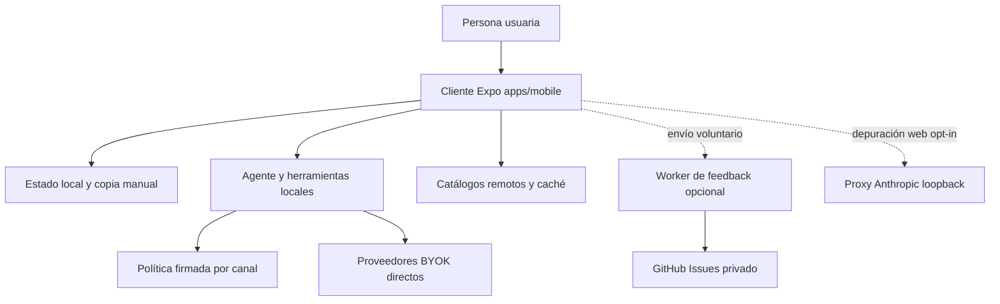

# Inicio rápido y mapa de cambios

Gymnasia tiene una única superficie de producto: el cliente Expo de `apps/mobile` para Android, iOS y web. El entrenamiento, la dieta, las mediciones, las conversaciones, las preferencias y la configuración BYOK pertenecen al dispositivo o navegador; no hay una API de producto, cuentas ni sincronización central obligatoria. Las integraciones de red enriquecen funciones concretas, pero su ausencia no debe impedir usar los dominios locales.

Empiece por [Arquitectura local-first](architecture/overview.md) para los límites del sistema. Esta página sirve para encaminar trabajo: el código y los tests ejecutables prevalecen sobre wiki, tickets, roadmaps y otros planes históricos.

## Arranque local

El repositorio declara workspaces npm. Para una instalación reproducible desde el lockfile use `npm ci`; para el trabajo local ordinario, `npm install`.

```bash
npm ci
npm run dev:mobile
```

`apps/mobile/index.js` importa `App` y lo registra con `registerRootComponent`. Los scripts del workspace arrancan desarrollo con `APP_ENV=development`:

```bash
npm --workspace apps/mobile run web
npm --workspace apps/mobile run android
npm --workspace apps/mobile run ios
npm --workspace apps/mobile run build:web
npm --workspace apps/mobile exec tsc --noEmit
```

`app.config.ts` exige `APP_ENV` y separa `development`, `staging` y `production` mediante nombre, identificador de aplicación, *namespace* de almacenamiento y canal de política. Development usa el canal `Local` y el proveedor `fake`, salvo `DEV_PROVIDER_MODE=byok`; Staging y Production usan BYOK. No mezcle datos ni expectativas entre variantes.

Para Expo Go físico por túnel, el segundo `--` entrega los flags al script del workspace:

```bash
npm --workspace apps/mobile run start -- --tunnel --clear
```



*El cliente conserva la autoridad sobre los datos de producto; las flechas remotas no constituyen un backend central.*

## Mapa compacto de tareas

Elija primero el dominio que posee el contrato. Ejecute la señal inicial y amplíela al cruzar una frontera.

| Cambio | Contrato que se debe leer | Validación inicial |
| --- | --- | --- |
| Límites local-first, configuración de variante, persistencia transversal o dependencia remota | [Arquitectura local-first](architecture/overview.md) | `npm test`, typecheck y el guard rail específico; guardar datos personales no puede requerir red. |
| Shell, navegación, arranque Expo o diferencias por plataforma | [Shell de aplicación](mobile/application-shell.md) | typecheck, `build:web`, `npm run test:shell:e2e`; prueba nativa si cambia una capacidad nativa. |
| Almacenes, secretos BYOK, borrado, snapshots o cuarentena | [Estado local, recuperación, borrado y copias](mobile/local-state-and-backup.md) | `npm test`, más `npm run test:storage-recovery:e2e` o `npm run test:data-deletion:e2e` según el flujo. |
| Copia `.gymnasia`, contraseña, cifrado, ZIP, importación o compartir | [Cifrado portátil e importación](mobile/portable-encryption-and-recovery.md) | `npm test`, `npm run test:storage-recovery:e2e` y `npm run test:recovery-cli` si cambia la CLI; compruebe en dispositivo selector o compartir nativos. |
| Entrenamiento, plantillas, series, descansos o historial | [Entrenamiento móvil](mobile/training.md) | La E2E pertinente: `test:train:e2e`, `test:train:series:e2e`, `test:train:series-operations:e2e`, `test:train:compound:e2e` o `test:train:history:e2e`. |
| Dieta, alimentos personales, búsqueda o estimación | [Dieta y estimación de alimentos](mobile/diet-and-food-estimation.md) | `npm run test:diet:e2e` y pruebas del agente si una tool accede al dominio. |
| Mediciones, fotos, gráficos o copias | [Mediciones](mobile/measurements.md) | Pruebas de dominio y de copia/borrado que cubran los datos modificados. |
| Chat, tools, confirmación, reintento, idempotencia o lease de política | [Runtime del agente](agent/runtime.md) | Vitest focalizado, `npm test` y `npm run test:agent:e2e` si cambia el recorrido visible. Para evidencia observada, consulte [Comportamiento en ejecución](operations/runtime-behavior.md). |
| Clave, proveedor, modelo, transporte o streaming | [Configuración BYOK](agent/provider-configuration.md) y [Transporte y streaming](agent/provider-streaming.md) | typecheck, pruebas deterministas del adaptador y E2E del agente para el flujo afectado. |
| Prompt, reglas sanitarias, firma, activación o fallback de política | [Gobierno de prompts y política](operations/prompt-policy-governance.md) | `check:health-safety`, `test:health-safety`, `check:prompt-policy`, `test:prompt-policy`, `policy:bundle:check` y `check:policy-trust`. |
| Fichas, imágenes o agregados de catálogos | [Repositorios de contenido](content/repositories.md) | `sync:catalogs`, `check:catalogs`, `test:catalogs` y `test:catalogs:e2e`. |
| Permisos, plugins Expo, notificaciones, build o release Android | [Build, release y validación](operations/build-release-and-testing.md) | `check:android-permissions`, `test:android-permissions`, controles de privacidad y build/prueba nativa. |
| Inventario de datos, texto legal o política publicada | [Build, release y validación](operations/build-release-and-testing.md) | `check:data-inventory`, `test:data-inventory`, `check:legal`, `test:legal` y la E2E aplicable. |
| Proxy CORS de Anthropic | [Proxy Anthropic](services/anthropic-proxy.md) | `npm run test:proxy` y `npm run check:anthropic-proxy`; no lo despliegue. |
| Feedback que crea incidencias | [Worker de feedback](services/feedback-worker.md) | `npm --workspace apps/feedback-worker run test` y pruebas de contrato cliente afectadas. |
| Tablero de tickets, conciliación Linear o despliegue Vercel | [Tablero de arquitectura](services/architecture-board.md) | `test:linear`, `test:board-automation`, `test:board` y `test:board:e2e`. |

## Fronteras operativas

### Estado, contenido y política

El estado de producto y las copias manuales son responsabilidad del cliente. Los catálogos de alimentos, productos, recetas y ejercicios son contenido de referencia: las fichas JSON e imágenes son editables; `all.json`, índices y schemas móviles son derivados. La aplicación valida el contenido remoto y conserva la última copia local aceptada, por lo que una caída de red o un schema inválido no debe borrar datos personales ni bloquear el arranque.

El agente también se ejecuta en el cliente. La política se distribuye como bundle firmado con prompt, runtime sanitario y herramientas requeridas; las raíces públicas incluidas en el repositorio permiten verificarla. Un `AgentPolicyLease` inmutable conserva prompt, guardrail sanitario y contexto del turno: una respuesta del proveedor no autoriza por sí misma una tool con efecto.

Cambiar `prompts/` o `policy/health-safety/` cambia una frontera de seguridad. Explique el impacto y obtenga aprobación explícita del mantenedor antes de promoción o merge; los checks técnicos no sustituyen esa autorización.

### Integraciones remotas deliberadamente limitadas

OpenAI, Anthropic y Google se llaman desde el cliente con claves BYOK. Anthropic también funciona directamente en navegador mediante la cabecera de acceso directo; `EXPO_PUBLIC_API_BASE_URL` está vacío por defecto y solo activa el proxy cuando se configura expresamente.

```bash
uv sync --project apps/anthropic_proxy --extra dev
apps/anthropic_proxy/.venv/bin/python apps/mobile/cors-proxy.py
curl -sS http://127.0.0.1:8000/health
```

El proxy de Anthropic es una herramienta de desarrollo opt-in: escucha en loopback, rechaza clientes remotos y no debe desplegarse como infraestructura de producto.

El Worker `apps/feedback-worker` es la única excepción remota de producto: conserva la credencial de GitHub para transformar feedback voluntario en incidencias privadas. En Development el endpoint está vacío; Staging y Production usan el endpoint configurado, y `FEEDBACK_API_BASE_URL` es un override solo para desarrollo. Si el canal falta, está apagado o falla, devuelve indisponibilidad sin afectar al resto de la aplicación.

Su contrato es cerrado y saneado: reserva y deduplica por clave de idempotencia antes de crear una issue, y solo responde como creada cuando obtiene su referencia de GitHub. No lo convierta en autenticación, base de datos de producto ni sincronización.

## Validación proporcional

```bash
# Base habitual para TypeScript móvil
npm test
npm --workspace apps/mobile exec tsc --noEmit
npm --workspace apps/mobile run build:web

# E2E web o CLI: seleccione solo las que cubran el cambio
npm run test:agent:e2e
npm run test:catalogs:e2e
npm run test:train:e2e
npm run test:diet:e2e
npm run test:storage-recovery:e2e
npm run test:recovery-cli

# Fronteras especializadas
npm run test:proxy
npm --workspace apps/feedback-worker run test
npm run check:catalogs
npm run check:android-permissions
```

`npm test` encadena la suite determinista móvil, el dev store y los límites arquitectónicos móviles. Las E2E de agente, catálogos, entrenamiento, dieta y recuperación son comandos separados. La recuperación combina la E2E web con una CLI Node: esta exige archivos de entrada y salida distintos, no sobrescribe la salida y la crea con modo `0600`.

La exportación web y las pruebas deterministas no prueban capacidades nativas. Si cambia permisos, plugins Expo, notificaciones, recursos, instalación o distribución, ejecute su guard rail y haga una build/prueba nativa representativa, preferiblemente en dispositivo. [Build, release y validación](operations/build-release-and-testing.md) define los gates y la comprobación del artefacto.

## Ejecutable frente a planificación histórica

Los componentes ejecutables actuales son el cliente `apps/mobile`, los catálogos cacheables, la política firmada, las llamadas BYOK, el Worker opcional y el proxy loopback de diagnóstico. El tablero estático es un componente de seguimiento separado, no parte de la topología de producto.

Documentos que describan una API central, cuentas, Postgres, Supabase o sincronización sin código ejecutable correspondiente son planes históricos; no deben justificar una dependencia obligatoria de backend.
