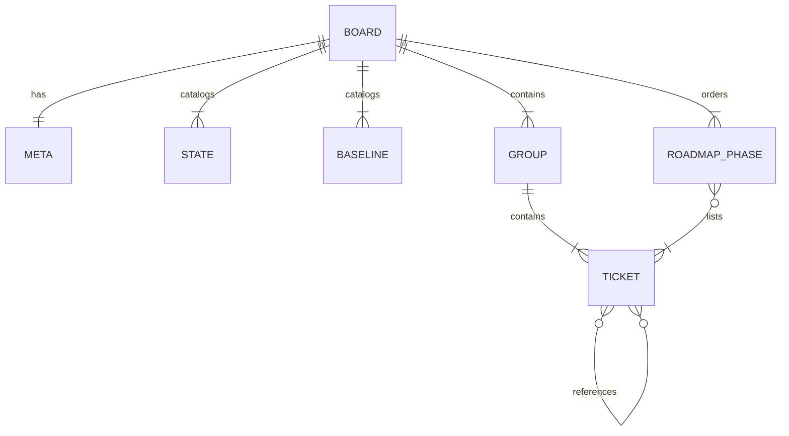
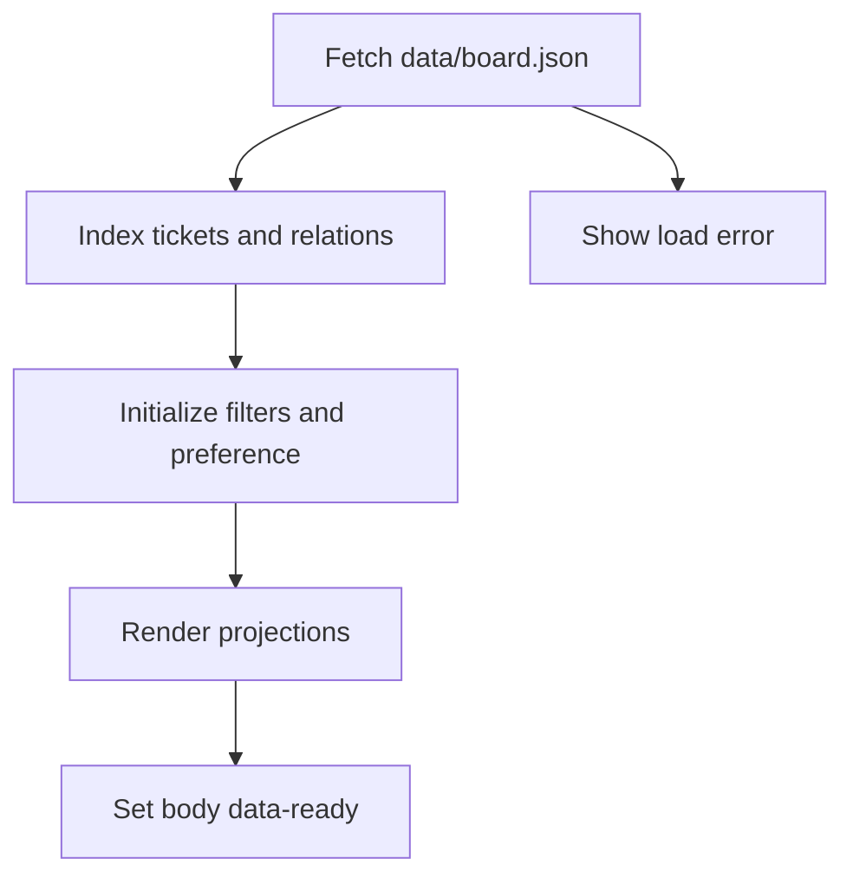
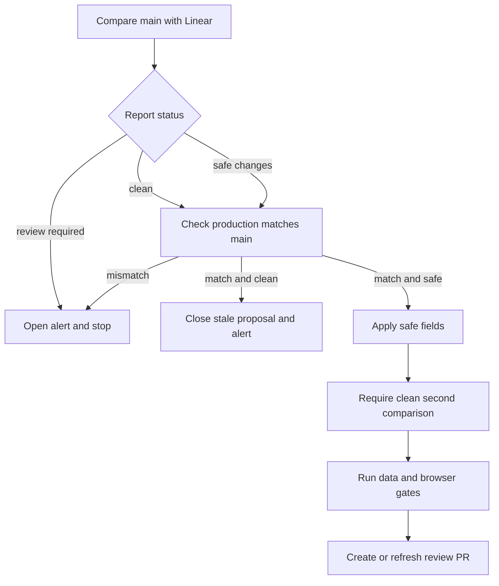

# Tablero de arquitectura

## Propósito y límite

`arquitectura-agente/` es el sitio estático de seguimiento publicado en <https://gymnasia-sable.vercel.app/>. El navegador carga recursos estáticos y lee `data/board.json`; durante esa navegación no usa API ni token de Linear, backend, cron o base de datos. Linear es la autoridad cuando el espejo discrepa.

El tablero es un artefacto editorial versionado, no una prueba de que los tickets descritos estén implementados, desplegados o formen parte del runtime. Tampoco es una ruta del cliente Expo: la entrada móvil registra `App`, mientras que `arquitectura-agente/index.html` carga el cascarón del tablero. Para los componentes ejecutables del producto, véase [Arquitectura local-first](../architecture/overview.md).

| Límite | Responsabilidad |
| --- | --- |
| `data/board.json` | Estado persistente del tablero: inventario, relaciones y orden editorial. |
| `index.html`, `script.js`, `styles.css` | Proyección en el navegador y presentación local; no escriben hacia Linear. |
| `linear.py board` y la conciliación de Actions | Comparar con Linear y proponer únicamente cambios mecánicos revisables. |
| Workflows y `scripts/board-automation/` | Validar, desplegar, comprobar producción y notificar fallos. |

Para desarrollo, sírvase el directorio por HTTP: `fetch("data/board.json")` hace que `file://` no sea un modo admitido.

## Contrato editorial de `board.json`

El objeto raíz contiene:

- `meta`, incluido `updated` con formato `YYYY-MM-DD`, la base HTTPS de enlaces a Linear y `ignore`. Un ID ignorado debe tener formato `GYM-n` y no puede aparecer simultáneamente como nodo del tablero.
- Los catálogos `states` y `baselines`. Los estados de un ticket o épica deben pertenecer al primero; un `baseline` opcional debe pertenecer al segundo. `baseline` expresa el punto de partida del código, no el estado de Linear.
- `groups`, cada uno con `id`, `title`, `kind` (`epic` o `group`) y al menos un ticket. Las épicas tienen identificador de Linear y estado; los tickets tienen identificador, título y estado. `summary`, `dependsOn`, `related`, `baseline` y `article` son metadatos editoriales opcionales; un `article` debe usar HTTPS.
- `recommendedOrder`, fases con `id`, `title`, `why` y una lista de tickets. Es una recomendación humana de secuenciación, no un workflow ejecutable.



*El JSON versionado concentra tanto los datos de las vistas como la topología y la secuencia editorial.*

`dependsOn` nombra el nodo que bloquea al que lo declara; puede referenciar tickets o épicas. `related` solo aporta contexto. Toda referencia debe resolver a un ticket o épica del JSON y no puede autorreferenciarse; las dependencias deben ser acíclicas. Además, un nodo `done` no puede depender de uno que permanezca abierto.

Las fases no pueden repetir tickets. Cada ticket abierto de una épica debe figurar una vez en `recommendedOrder` y, cuando su bloqueador también está planificado, después de él. Por ello un alta, una baja o un cambio de relaciones requiere decisión editorial: no basta con copiar título y estado.

## Lectura y proyecciones locales

En la inicialización, `script.js` solicita el JSON con `cache: "no-cache"`, construye índices en memoria de tickets, bloqueadores, bloqueados y relaciones, inicializa filtros y preferencias, renderiza las proyecciones y finalmente fija `body[data-ready="true"]`. Si la respuesta HTTP o el parseo fallan, muestra el error de carga sin utilizar una copia alternativa.



*Una única lectura local alimenta las vistas; no existe escritura de vuelta a Linear desde el navegador.*

- **Épicas** es la vista inicial. La búsqueda por ID, título o resumen y los filtros de estado se combinan con AND; el progreso no se limita a los resultados filtrados.
- **Estado** proyecta los tickets en columnas según el catálogo `states`; no hay arrastre ni mutación del JSON.
- **Dependencias** no aplica búsqueda ni filtros de estado. Dibuja cada arista desde el bloqueador al bloqueado y puede añadir relaciones informativas; estas se deduplican de forma simétrica. Sus niveles usan la ruta más larga de prerrequisitos. Una guarda evita que un ciclo bloquee el render, pero la aceptación de datos depende de la validación de aciclicidad.

El hash admite `#epics`, `#states` y `#deps`; un valor no reconocido vuelve a `#epics`. En **Por dónde seguir**, los tickets `done` y `canceled` y las fases vacías no se muestran, y las fases restantes se renumeran. Solo el plegado de esa hoja de ruta persiste, bajo `gymnasia.board.roadmapCollapsed`; si `localStorage` falla, el tablero sigue operativo y la preferencia no se conserva.

## Actualización asistida, no sincronización viva

La actualización normal empieza comparando explícitamente el checkout con Linear:

```bash
npm run test:linear
python3 .claude/skills/linear-tickets/scripts/linear.py board
python3 .claude/skills/linear-tickets/scripts/linear.py board --format json
python3 .claude/skills/linear-tickets/scripts/linear.py board --apply-safe
npm run test:board
npm run test:board:e2e
```

`board` clasifica la diferencia en `clean`, `safe_changes` o `review_required` y distingue cambios de estados y títulos de faltas de inventario en uno u otro lado. `In Review` de Linear se representa como `in_progress`. El formato JSON usa `schemaVersion: 1` y permite a la automatización inspeccionar la diferencia; la salida humana sin aplicación devuelve código 1 cuando hay deriva.

`--apply-safe` cambia solo estados, títulos y `meta.updated`, y rechaza toda escritura si hay altas o bajas. El `--apply` heredado solo actualiza estados. La aplicación segura se prepara y verifica en memoria; al persistir usa un temporal sincronizado, conserva permisos y reemplaza el archivo mediante `os.replace`, por lo que no deja una escritura parcial.

Las altas y bajas no son una excepción mecánica: quien edite `board.json` debe decidir grupo, resumen, dependencias o relaciones y, para tickets abiertos de épicas, la fase apropiada de `recommendedOrder`. Después debe ejecutar las validaciones antes de abrir una PR. Esta frontera evita convertir el espejo en una integración de escritura con Linear.



*Solo estados y títulos siguen la vía mecánica; los cambios de inventario se detienen para revisión humana.*

## Conciliación y alertas

`board-reconcile.yml` se ejecuta cada seis horas —a los 17 minutos— o manualmente. Consulta siempre `refs/heads/main` y cancela ejecuciones solapadas. Si el informe es `review_required`, abre o reutiliza una alerta, cierra una PR automática obsoleta y termina en fallo sin aplicar cambios parciales. Para `clean` o `safe_changes`, comprueba antes que producción sirva los mismos bytes que `main`; una discrepancia también alerta y detiene el flujo.

Con `safe_changes`, instala las dependencias de propuesta, aplica la actualización, exige una segunda comparación `clean`, ejecuta los gates y crea o actualiza la rama `automation/board-sync`. El push existente se protege con `--force-with-lease`; el workflow no usa auto-merge ni fusiona la PR. Si la diferencia desaparece o el estado es limpio, cierra propuestas automáticas obsoletas.

La automatización conserva un único issue identificado por el marcador de `[board-sync] El tablero necesita atención`: cierra duplicados y no repite un comentario cuyo payload tenga la misma huella SHA-256. Cuando la conciliación confirma que Linear, `main` y producción vuelven a coincidir, comenta y cierra las alertas abiertas.

## Validaciones, CI y publicación

`npm run test:board` ejecuta `node --test` sobre el contrato de datos. Protege los catálogos, los IDs, referencias y duplicados, el ciclo de dependencias, la coherencia de tickets cerrados y la cobertura, unicidad y orden de `recommendedOrder`.

`npm run test:board:e2e` levanta el sitio estático en `127.0.0.1:8123` —configurable con `BOARD_E2E_PORT`— y usa Playwright/Chromium. Comprueba que el JSON se proyecta en las tres vistas, la interacción de plegados, filtros, pestañas y grafo, la ausencia de errores de página y la contención a `390x844`. Esas suites validan el sitio estático, no el runtime de Expo.

El CI se activa en PR y en cambios relevantes de `main`, tiene únicamente `contents: read` y ejecuta estas cuatro puertas:

```bash
npm run test:linear
npm run test:board-automation
npm run test:board
npm run test:board:e2e
```

El despliegue se activa desde `main` para archivos publicables o manualmente, serializa producción en `board-production` y vuelve a ejecutar las cuatro puertas. Antes de publicar con `vercel@59.16.0`, confirma que `vercel pull` resolvió el proyecto `gymnasia` y que los IDs de proyecto y organización coinciden con los secretos esperados. El sitio no tiene paso de build; `vercel.json` configura URL limpias y sin barra final.

Después del despliegue, `verify-production.mjs` solicita la raíz canónica y `/data/board.json` sin caché, comprueba el título de la página y compara SHA-256 del JSON remoto con el archivo local. El despliegue usa hasta 12 intentos con cinco segundos entre ellos para tolerar propagación; deja hashes, commit, URL e intentos en el resumen y conserva la evidencia como artefacto durante 30 días. Un fallo o discrepancia actualiza la alerta y hace fallar el workflow.

La recuperación manual excepcional es:

```bash
npm exec --yes -- vercel@59.16.0 deploy --prod --yes --cwd arquitectura-agente
```

La vía habitual es el workflow, porque aplica las puertas, comprueba el destino y verifica los bytes publicados. Para comprobar manualmente la página publicada, solicite `/`, no `/index.html`.
